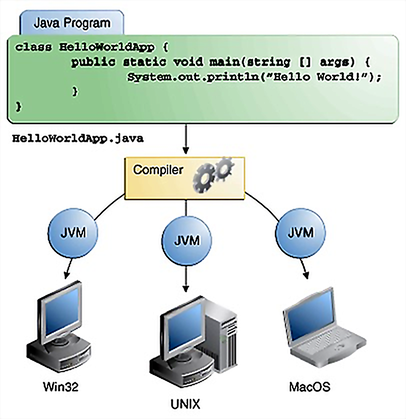
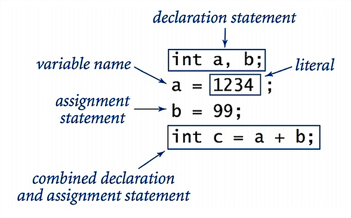
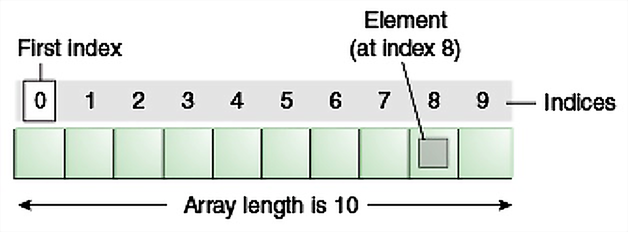
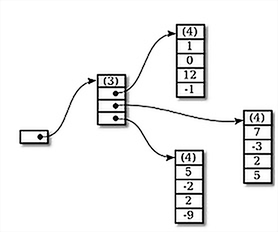
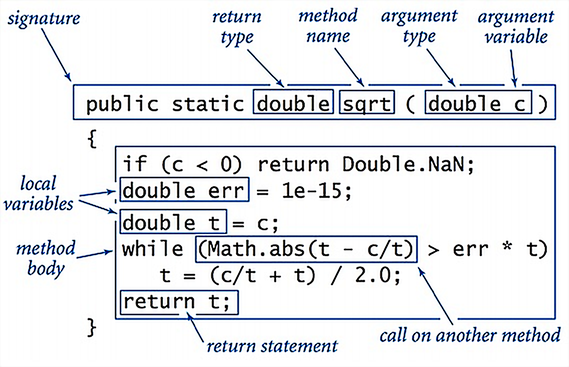
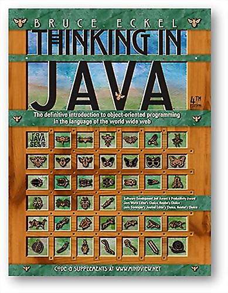
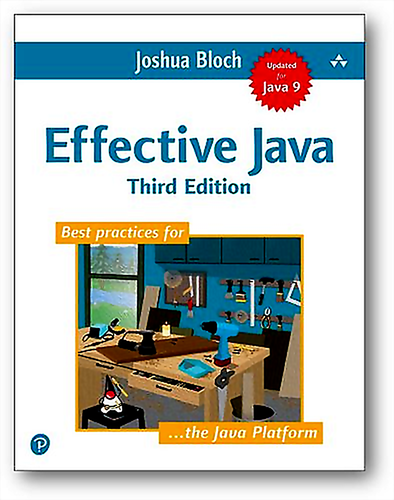

# Introduction to Java

2024-09-01

---

### What is Java?

- A programming language
- Java compiler
- Java Virtual Machine (JVM)
- Java Development Kit (JDK)
  - Java Runtime Environment (JRE)
- The Java platform

---

### Java Editions

- A Java Edition is a variation of the Java platform (the JDK), assembled for a different purpose
  - Java Platform Standard Edition (Java SE)
  - Java Platform Enterprise Edition (Java EE)
  - Java Platform Micro Edition (Java ME)
      - vs. Android SDK
  - Java Card

---

### JDK Tools

- Core tools
  - javac
  - java
- Additional tools
  - jshell
  - javadoc
  - jar
  - ...

---

### Java: Most Popular IDEs

- IntelliJ IDEA
- Eclipse
- NetBeans

---

### The Java Language

- Created in 1995 by James Gosling (Sun Microsystems)
- Current LTS version: Java 21 (released 2023-09-19)
- Java 17 (released 2021-09-14) is also an LTS version, widely used in production


---

### The Java Language

- Object-oriented
- C/C++-inspired syntax
- "Write once, run anywhere"

---

### Hello World!

```java
public class HelloWorldApp {
    public static void main(String[] args) {
        System.out.println("Hello world!");
    }
}
```

<br>

```bash
$ javac HelloWorldApp.java
$ java HelloWorldApp
Hello world!
```

---

### A Standard Java Application

<p align="center">
  
</p>

---

### The Java Virtual Machine (JVM)

- Interprets and executes bytecode instructions
- JIT-compiles bytecode to native machine code at runtime
- Allocates memory for runtime data
- Automatically reclaims unused memory (garbage collection)
- Loads classes dynamically
- Manages threads
- Interfaces with the operating system

---

### We Will Start with...

- Data types
- Operators, expressions, statements
- Conditionals and branching
- Iteration / Loops
- Strings and string operations
- Arrays
- Functions (methods)

---

### Data Types and Variables

- A data type = a set of values + the operations defined on them
- Java is statically typed → all variables must be declared before use, and their type is fixed at declaration and cannot change
- A declaration includes the name and type, and may optionally include an initializer

---

### Data Types and Variables

<p align="center">
  
</p>

---

### Data Types

- Primitive types
  - Boolean type (`boolean`)
  - Numeric types
      - Integral types (`byte`, `short`, `int`, `long`, `char`)
      - Floating-point types (`float`, `double`)
- Reference types

---

### Primitive Data Types

| Data type | Size    | Minimum         | Maximum                    |
| :-------- | :------ | :-------------- | :------------------------- |
| boolean   | -       | -               | -                          |
| byte      | 8 bits  | -128            | +127                       |
| char      | 16 bits | Unicode 0       | Unicode 2<sup>16</sup> - 1 |
| short     | 16 bits | -2<sup>15</sup> | +2<sup>15</sup> - 1        |
| int       | 32 bits | -2<sup>31</sup> | +2<sup>31</sup> - 1        |
| long      | 64 bits | -2<sup>63</sup> | +2<sup>63</sup> - 1        |
| float     | 32 bits | IEEE754         | IEEE754                    |
| double    | 64 bits | IEEE754         | IEEE754                    |
| void      | -       | -               | -                          |

---

### Min and Max Values of Primitive Types

```java
Byte.MIN_VALUE // -128
Byte.MAX_VALUE // 127
Short.MIN_VALUE // -32768
Short.MAX_VALUE // 32767
Integer.MIN_VALUE // -2147483648
Integer.MAX_VALUE // 2147483647
Long.MIN_VALUE // -9223372036854775808
Long.MAX_VALUE // 9223372036854775807
(int) Character.MIN_VALUE // 0
(int) Character.MAX_VALUE // 65535
```

---

### The `char` Type

- An unsigned integer
- Value (*code point*) from 0 to 65535 inclusive
- Represents a Unicode character
- Can participate in arithmetic operations (using its code point value)

---

### The `char` Type

| Code point | Unicode escape | Printed representation | Description              |
| ---------- | -------------- | ---------------------- | :----------------------- |
| 33         | !         | !                      | Exclamation mark         |
| 50         | 2         | 2                      | Digit 2                  |
| 65         | A         | A                      | Latin capital letter 'A' |

---

### Primitive Type Literals

```java
int i = 1;           // int by default
long l = 1L;         // L or l
double d = 0.1;      // d or D is optional
double d2 = 1e-1;    // same value, scientific notation
float f = 0.1f;      // without f it won't compile
char c = 'A';
char c2 = 'A';  // also 'A'
```

---

### Integer Literals

```java
// The number 26, in decimal
int decVal = 26;

// The number 26, in hexadecimal
int hexVal = 0x1a;

// The number 26, in binary
int binVal = 0b11010;

// The number 26, in octal
int octVal = 032;
```

---

### Underscore in Literals: Syntactic Sugar

```java
int thousand = 1_000;
int million  = 1_000_000;
long magic   = 0xCAFE_BABE;
int one      = 0b1;
int mask     = 0b1010_1010_1010;
```

---

### Default Values

The compiler **does not** assign default values to uninitialized local variables!

---

### Default Values

| Data type        | Default value |
| :--------------- | :------------ |
| boolean          | false         |
| short            | 0             |
| int              | 0             |
| long             | 0L            |
| float            | 0.0f          |
| double           | 0.0d          |
| char             | '\u0000'      |
| Reference types  | null          |

---

### Type Conversions

- Implicit — widening conversions, no loss of precision
- Explicit — narrowing conversions via cast

<br>

| Expression        | Type of expression | Value of expression |
| :---------------- | :----------------- | :------------------ |
| "1234" + 99       | String             | "123499"            |
| (int) 2.71828     | int                | 2                   |
| 11 \* 0.3         | double             | 3.3                 |
| (int) 11 \* 0.3   | double             | 3.3                 |
| 11 \* (int) 0.3   | int                | 0                   |
| (int) (11 \* 0.3) | int                | 3                   |

---

### Why Do We Need Types?

- So the compiler can help us catch errors early

<p align="center">
  
</p>

*In 1996, the Ariane 5 rocket exploded shortly after launch due to a software bug in type conversion — an attempt to fit a 64-bit floating-point number into a 16-bit integer.*

---

### Operator Precedence

<table style="width:100%">
  <tr>
    <th style="width:50%; font-size:1.3em;">Operators</th>
    <th style="width:50%; font-size:1.3em;">Precedence</th>
  </tr>
  <tr style="font-size:0.7em; text-align: left;">
    <td>postfix</td>
    <td>expr++ expr--</td>
  </tr>
  <tr style="font-size:0.7em; text-align: left;">
    <td>unary</td>
    <td>++expr --expr +expr -expr ~ !</td>
  </tr>
  <tr style="font-size:0.7em; text-align: left;">
    <td>multiplicative</td>
    <td>\* / %</td>
  </tr>
  <tr style="font-size:0.7em; text-align: left;">
    <td>additive</td>
    <td>+ -</td>
  </tr>
  <tr style="font-size:0.7em; text-align: left;">
    <td>shift</td>
    <td><< >> >>></td>
  </tr>
  <tr style="font-size:0.7em; text-align: left;">
    <td>relational</td>
    <td>< > <= >= instanceof</td>
  </tr>
  <tr style="font-size:0.7em; text-align: left;">
    <td>equality</td>
    <td>== !=</td>
  </tr>
  <tr style="font-size:0.7em; text-align: left;">
    <td>bitwise AND</td>
    <td>&</td>
  </tr>
  <tr style="font-size:0.7em; text-align: left;">
    <td>bitwise exclusive OR</td>
    <td>^</td>
  </tr>
  <tr style="font-size:0.7em; text-align: left;">
    <td>bitwise inclusive OR</td>
    <td>|</td>
  </tr>
  <tr style="font-size:0.7em; text-align: left;">
    <td>logical AND</td>
    <td>&&</td>
  </tr>
  <tr style="font-size:0.7em; text-align: left;">
    <td>logical OR</td>
    <td>||</td>
  </tr>
  <tr style="font-size:0.7em; text-align: left;">
    <td>ternary</td>
    <td>? :</td>
  </tr>
  <tr style="font-size:0.7em; text-align: left;">
    <td>assignment</td>
    <td>= += -= *= /= %= &= ^= |= <<= >>= >>>=</td>
  </tr>
</table>

---

### Scoping

```java
{
    int x = 12;
    // Only x available
    {
        int q = 96;
        // Both x & q available
    }
    // Only x available
    // q is "out of scope"
}
```

---

### Wrapper Types

- Reference-type counterparts of the primitive types
- Used when:
    - the language syntax requires an object rather than a primitive (e.g., generics)
    - constants or utility methods defined on the wrapper class are needed
- Implicitly converted to/from their primitive counterpart (autoboxing / unboxing)

---

### Primitive Types and Wrapper Types

| Data type | Size    | Minimum         | Maximum                    | Wrapper   |
| :-------- | :------ | :-------------- | :--------------------------| :-------- |
| boolean   | -       | -               | -                          | Boolean   |
| char      | 16 bits | Unicode 0       | Unicode 2<sup>16</sup> - 1 | Character |
| byte      | 8 bits  | -128            | +127                       | Byte      |
| short     | 16 bits | -2<sup>15</sup> | +2<sup>15</sup> - 1        | Short     |
| int       | 32 bits | -2<sup>31</sup> | +2<sup>31</sup> - 1        | Integer   |
| long      | 64 bits | -2<sup>63</sup> | +2<sup>63</sup> - 1        | Long      |
| float     | 32 bits | IEEE754         | IEEE754                    | Float     |
| double    | 64 bits | IEEE754         | IEEE754                    | Double    |
| void      | -       | -               | -                          | Void      |

---

### Constants and Utility Methods in Wrapper Types

```java
Integer.MAX_VALUE         // maximum value of the type
Integer.MIN_VALUE         // minimum value of the type
Integer.valueOf(25)       // returns an Integer instance wrapping 25
Integer.intValue()        // returns the int value wrapped in the instance
Integer.parseInt(String)  // parses a string representation of an integer to int
```

---

### Autoboxing

```java
// initializing a char variable with a literal
char c = 'a';

// initializing a Character object with a literal
Character ch1 = Character.valueOf('a');

// autoboxing: char is implicitly converted to Character
Character ch2 = 'x';

// unboxing: wrapper is converted back to the primitive type
char c2 = ch1;
```

---

### Strings in Java

- Strings are a reference type, not a primitive
- Instances of the `String` class
- Immutable: any modification produces a new `String` object; the original remains unchanged

---

### Strings in Memory: String Pool vs Heap

- `String` literals are stored in a special JVM memory area called the *string pool*
- When a string is added to the pool, if an identical string already exists there, no new object is created — a reference to the existing one is returned (saves memory)

---

### Strings in Memory: String Pool vs Heap

- `String` objects created with the `new` operator are allocated on the heap. Each is a separate instance, even if the contents are identical to another string
- A heap `String` can be moved to the string pool by calling `intern()`

---

### Comparing Strings

- Comparing strings with `==` compares references, not content
- To compare by content, use the `equals()` method of the `String` class

---

### Strings in Memory: String Pool vs Heap

```java
String literalOne = "FMI"; // goes into the string pool
String literalTwo = "FMI"; // "FMI" is already in the pool ->
                           // literalTwo points to the same object

System.out.println(literalOne == literalTwo); // true

String newString = new String("FMI"); // new object on the heap

System.out.println(literalOne == newString); // false
System.out.println(literalOne.equals(newString)); // true

String intern = newString.intern(); // adds the string to the pool
                                    // and returns a reference to it
System.out.println(literalOne == newString); // false, newString
                                             // was not reassigned
System.out.println(literalOne == intern); // true
```

---

### Strings — Literals and Concatenation

```java
String language = "Java";
String tbd = null;
String message = "I <3 " + language;
String year = "The current year is " + 2021;
```

---

### Multi-line String Literals

```java
// multi-line string literals before Java 15
String html = "<html>\n" +
              "    <body>\n" +
              "        <p>Hello world!</p>\n" +
              "    <body>\n" +
              "</html>\n";

// from Java 15: text blocks for multi-line string literals
String html = """
                       <html>
                           <body>
                               <p>Hello world!</p>
                           </body>
                       </html>
              """;
```

---

### Strings — Iteration

```java
String s = "Firebird";
char ic = s.charAt(i);
char[] ca = s.toCharArray();

for (int i = 0; i < ca.length; i++) {...}
for (char c : ca) {...} // enhanced for-loop (for-each)

Arrays.sort(ca);
String sorted = String.valueOf(ca); // "Fbdeiirr"
```

---

### String.split()

```java
String str1 = "Current year is 2021";

String[] tokens = str1.split(" "); // delimiter — space

// tokens = ["Current", "year", "is", "2021"]

int year = Integer.parseInt(tokens[3]);
// year == 2021
```

---

### Other String Operations

The `String` class has many more useful methods.
Explore them in the [official documentation](https://docs.oracle.com/en/java/javase/17/docs/api/java.base/java/lang/String.html).

---

### Mutable Strings

When a mutable string is needed — one whose modification does not create a new instance — use `StringBuilder` or `StringBuffer` instead of `String`.

<br>

| Class name    | Mutable | Performant        | Thread-safe |
| :------------ | :------ | :---------------- | :---------- |
| String        | no      | slow, if modified | yes         |
| StringBuilder | yes     | fast              | no          |
| StringBuffer  | yes     | slower            | yes         |

---

### Local Variable Type Inference

```java
// from Java 10
var message = "FMI rulez!"; // type inferred from the initializer

message = "Cool"; // the variable can be reassigned

message = 1; // won't compile: the type is fixed at declaration
             // and cannot change

var mystery; // won't compile: type cannot be inferred
             // without an initializer
```

---

### `final` Variables and Constants

- A `final` variable can be assigned only once; attempting to reassign it is a compile error
- By convention, constants (static final fields) are named in `UPPER_SNAKE_CASE`

```java
final int MAX_RETRIES = 3;
// MAX_RETRIES = 5; // compile error

static final double PI = 3.14159265358979;
static final String DEFAULT_ENCODING = "UTF-8";
```

- `final` local variables are useful to communicate intent — this value should not change — and are required when used in lambdas or anonymous classes

---

### Boolean Constants

- `true` or `false`
- Unlike C/C++, a number cannot be used in place of a boolean expression

---

### Boolean Logical Operators

```text
|    the OR operator
&    the AND operator
^    the XOR operator
!    the NOT operator
||   the short-circuit OR operator
&&   the short-circuit AND operator
==   the EQUAL TO operator
!=   the NOT EQUAL TO operator
```

---

### Boolean Logical Operators

<table style="width:100%">
  <tr style="text-align: left; background: #F0F0F0;">
    <th>A</th>
    <th>B</th>
    <th>A|B</th>
    <th>A&B</th>
    <th>A^B</th>
    <th>!A</th>
  </tr>
  <tr>
    <td>false</td>
    <td>false</td>
    <td>false</td>
    <td>false</td>
    <td>false</td>
    <td>true</td>
  </tr>
  <tr>
    <td>true</td>
    <td>false</td>
    <td>true</td>
    <td>false</td>
    <td>true</td>
    <td>false</td>
  </tr>
  <tr>
    <td>false</td>
    <td>true</td>
    <td>true</td>
    <td>false</td>
    <td>true</td>
    <td>true</td>
  </tr>
  <tr>
    <td>true</td>
    <td>true</td>
    <td>true</td>
    <td>true</td>
    <td>false</td>
    <td>false</td>
  </tr>
</table>

---

### if-else

```java
if (booleanExpression) {
    // statements
}

if (booleanExpression) {
    // statements
} else {
    // statements
}
```

---

### The Ternary Operator `? :`

```java
// the only ternary (three-operand) operator in Java
condition ? statement1 : statement2

// equivalent to:
if (condition) {
    statement1
} else {
    statement2
}
```

---

### Iteration — while

```java
while (booleanExpression) {
    statement
}
```

---

### Iteration — do-while

```java
do {
    statement
} while (booleanExpression);
```

---

### Iteration — for

```java
for (initialization; booleanExpression; step) {
    statement
}
```

---

### Unconditional Control Flow

- `return [value]`
- `break [label]`
- `continue [label]`
- No `goto` (the keyword is reserved but unused)

---

### Switch

```java
switch (selector) {
    case value1 : statement; break;
    case value2 : statement; break;
    case value3 : statement; break;
    // [...]
    default: statement;
}
```

---

### Enhanced `switch` (from Java 15)

```java
char ch = 'a';
int t;

// before
switch (ch) {
    case 'a'      : t = 1; break;
    case 'b', 'c' : t = 12; break;
    default       : t = 27;
}

// from Java 15
switch (ch) {
    case 'a'      -> t = 1;
    case 'b', 'c' -> t = 12;
    default       -> t = 27;
}
```

---

### Enhanced `switch` as an Expression (from Java 15)

```java
int z = switch (ch) {
    case 'a'      -> 1;
    case 'b', 'c' -> 12;
    default       -> 27;
};

int r = switch (ch) {
    case 'a' : yield 1;
    case 'b' : yield 12;
    default  : yield 27;
};
```

---

### Pattern Matching for `switch` (Java 17 preview feature)

```java
String s = switch (obj) {
    case Integer i when i > 100 -> "It's an Integer > 100"; // guarded pattern
    case Integer i              -> "It's an Integer";
    case String str             -> "It's a String";
    case null                   -> "It's a null reference";
    default                     -> "It is none of the known data types";
};
```

---

### Arrays

<p align="center">
  
</p>

---

### Arrays

```java
int[] a;     // recommended syntax
int a[];     // also valid

// explicit initialization
// can only be done at declaration
int[] a = {1, 2, 3, 4};

int[] b = new int[7];
b.length;
```

---

### Arrays

- Declaration — no memory is allocated for the elements
- Initialization — memory is allocated for the elements
- Arrays of primitive types are automatically initialized to the default value of their element type

---

### Multidimensional Arrays

```java
int[][] a;
a = new int[3][4];

int[][] b = {
    { 1, 0, 12, -1 },
    { 7, -3, 2, 5 },
    { -5, -2, 2, -9 },
};
```

<p align="center">
  
</p>

---

### Multidimensional Arrays

```java
double[][] matrix = new double[7][];
// rows have not been created yet

for (int i = 0; i < 7; i++) {
    // Creates row i with i + 1 elements.
    matrix[i] = new double[i + 1];
}
```

---

### Array Operations

```java
System.arraycopy(src, srcPos, dest, destPos, length); // copy

Arrays.equals(arr1, arr2); // check equality
Arrays.fill(arr, value);   // fill with a value
Arrays.toString(arr);      // convert to string
```

---

### Array Operations

```java
Arrays.sort(arr);                              // sort ascending
Arrays.sort(a, Collections.reverseOrder());   // sort descending
```

---

### More Array Operations

```java
// copy a range of elements into a new array
int[] slice = Arrays.copyOfRange(arr, fromIndex, toIndex);

// binary search (array must be sorted first)
int idx = Arrays.binarySearch(arr, key);
// returns the index if found, or a negative value if not found
```

---

### Functions

<p align="center">
  
</p>

---

### Standard Input and Output

Writing to standard output

```java
System.out.println("Something printed on the console");
```

<br>

Reading from standard input

```java
import java.util.Scanner;
// [...]

Scanner sc = new Scanner(System.in);
String lineRead = sc.nextLine();

// [...]
```

---

### Where to Go Next

- [Official Java Documentation](https://docs.oracle.com/en/java/javase/21/) — API reference, tutorials, and language specification
- [JEP Index](https://openjdk.org/jeps/0) — track new language features and JVM improvements
- *Effective Java* by Joshua Bloch — essential reading for writing idiomatic, robust Java
- Practice: [LeetCode](https://leetcode.com) and [HackerRank](https://www.hackerrank.com) for algorithmic problem-solving in Java

---
  
<p align="center">
  
</p>

---

<p align="center">
  
</p>
