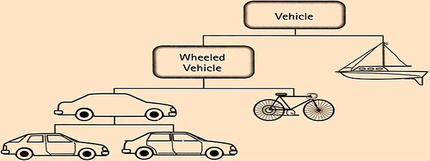

# Object-Oriented Programming with Java

<p align="center">
  
</p>

2021-10-20

---

### Last Lecture: Recap

- Data types
- Operators, expressions, statements
- Conditions and branching
- Iteration / Loops
- Strings and string operations
- Arrays
- Functions

---

### Today's Topics

- Classes and objects
- Abstract classes and interfaces
- The four fundamental OOP principles
  - Encapsulation
  - Inheritance
  - Polymorphism
  - Abstraction

---

### Object-Oriented Programming

- Born from the need for better control over concurrent modification of shared data
- The core idea: no direct access to data — all access goes through a dedicated code layer
- Because data must be passed and modified, the concept of an *object* emerged

---

### Object

- An object is a set of data that can only be passed and accessed through a set of methods bundled with that data
- The data constitutes the object's *state*; the methods constitute its *behavior*
- The object's state is hidden (*encapsulated*) from direct outside access
- An object is an instance of a class. Objects are created explicitly with the `new` operator (or implicitly) and live on the heap

---

### Creating Objects

```java
String message = new String("Operation completed."); // explicit
Integer studentsCount = Integer.valueOf(60); // implicit
int[] intArr = new int[100]; // explicit
String[] stringArr = {"Some", "example"}; // implicit
stringArr = new String[]{"Changed", "my", "mind"}; // explicit
```

---

### Class

- A class is a definition (blueprint) of objects
  - describes state through fields (member variables)
  - describes behavior through methods
- Has constructor(s) and method(s)
- A class can have no state, or no behavior
- Every class has a well-defined *interface* — a formal description of how other objects can interact with it

---

### Class Method

- A function for manipulating the state of the class
  - has a name and a list of parameters (*signature*)
      - the number of parameters is called *arity*
      - two methods have the same signature if they share the same name, arity, and parameter type sequence
  - has modifiers, return type, signature, and a body enclosed in `{}`
  - the body may contain local variable declarations and statements
  - may have side effects

---

### Class Method

```java
public class AdmissionTestProblems {

    public static int minSwaps(String s1, String s2) {

        int differences = 0;
        for (int i = 0; i < s1.length(); ++i) {
            differences += (s1.charAt(i) == s2.charAt(i)) ? 0 : 1;
        }

        return differences / 2;

    }

}
```

---

### Varargs — Methods with Variable Number of Arguments

- A special kind of method parameter: a sequence of zero or more arguments of the same type
- Called *varargs*, short for *variable arguments*
- Syntax: type name followed by three dots (ellipsis)
- A method may have at most one varargs parameter, and it must be last in the parameter list
- The compiler collects the remaining arguments into an array and passes it to the method
- Inside the method body, it is accessed like a regular array

---

### Varargs — Methods with Variable Number of Arguments

```java
static void funWithVarargs(int... a) {
    System.out.println("Number of arguments: " + a.length);

    for (int i : a) {
        System.out.print(i + " ");
    }
}

public static void main(String[] args) {
    // standard syntax
}

public static void main(String... args) {
    // varargs syntax — equivalent to the above
}
```

---

### Static Fields and Static Methods

- They belong to the class, not to any specific instance (object)
- Can be accessed without creating an object: `ClassName.memberName`

<br>

```java
System.out.println(Math.PI);        // 3.141592653589793
System.out.println(Math.pow(3, 2)); // 9.0
```

---

### Static Fields

- A static field has exactly one copy, shared by all instances of the class
  - if it is a constant, memory is saved (no need to duplicate it in every instance)
  - if it is a mutable variable, all instances see and modify the same value — a communication mechanism across all instances

---

### Static Methods

- Static methods can only access static fields and other static methods of the class
- Non-static methods can access both static and non-static members

---

### Static Methods

```java
public class Utils {
    public static final double PI = 3.14; // constant
    private static int radius = 10; // static field
    private String fact5 = "5!"; // non-static field

    public static long fact(int n) {
        if (n == 1) { return 1; } else { return n * fact(n - 1); }
    }

    public String getFact() {
        return fact5;
    }

    public static void main(String[] args) {
        System.out.println("Perimeter is " + 2 * Utils.PI * radius);
        System.out.println(new Utils().getFact() + "=" + Utils.fact(5));
        Utils.getFact(); // won't compile — getFact() is non-static
    }
}
```

---

### The `this` Keyword

- A reference to the current object
- Implicitly passed as a parameter to every constructor and non-static method
- Used to:
  - access fields that are shadowed by a parameter or local variable with the same name
  - call another overloaded constructor in the same class
  - invoke any method of the current class

---

### The `this` Keyword

```java
public class Human {

    private String name;

    public Human() {
        // Delegates to the overloaded constructor with a String parameter
        this("Unknown");
    }

    public Human(String name) {
        // Disambiguates the field from the parameter with the same name
        this.name = name;
    }

    public void whoAmI() {
        System.out.println("My name is " + name);
    }

}
```

---

### Object — A Concrete Instance of a Class

```java
public class MainApp {
    
    public static void main(String[] args) {
        Human ivan = new Human("Ivan");
        ivan.whoAmI();
        Human petar = new Human("Petar");
        petar.whoAmI();
    }

}
```

---

### Packages

- Named groups of semantically related classes
- Used to hierarchically organise code
- Correspond to a directory tree on the file system
- Naming convention:
  - lowercase letters only, dot as separator
  - companies use their reversed domain name
      - `mail.google.com` → `com.google.mail`

---

### Packages

- Every Java class belongs to some package
- The package is declared at the top of the source file (before the class definition) with the `package` keyword
- If the `package` declaration is missing, the class belongs to the unnamed default package — which is bad practice

<br>

```java
package bg.sofia.uni.fmi.mjt.example;

public class Example {
    // class Example is in package bg.sofia.uni.fmi.mjt.example
}
```

---

### Accessing a Class from Another Package

- Every class has implicit access to:
  - classes in its own package
  - classes in the `java.lang` package
- To access a class from a different package, declare an explicit `import` statement above the class declaration
- An `import` can name a specific class (fully qualified: `package.ClassName`) or all classes in a package (*wildcard import*: `package.*`)

---

### Accessing a Class from Another Package

```java
package bg.sofia.uni.fmi.mjt.example;

import java.util.Arrays;
import java.util.Scanner;

public class StringUtils {

    public static void main(String[] args) {
        Scanner scanner = new Scanner(System.in);
        char[] tokens = scanner.nextLine().toCharArray();
        Arrays.sort(tokens);
        System.out.println(tokens);
    }

}
```

---

### Accessing a Class from Another Package

- Convention: sort `import` statements lexicographically by `<package>.<class>`
- Prefer listing specific classes over `import java.util.*;`

---

### Access Modifiers — Top-Level Class

For a top-level class (not nested inside another class)

<br>

| Modifier         | Visibility                                       |
| :--------------- |:------------------------------------------------ |
| `public`         | Accessible from any class in any package         |
| no modifier*     | Accessible only within the same package          |

<br>

<small>
\* also called "package-private" or "default"
</small>

---

### Access Modifiers — Class Members

For fields and methods of a class

<br>

| Modifier      | Class | Package | Subclass | Everyone else |
| :------------ |:-----:|:-------:|:--------:|:-------------:|
| `public`      | yes   | yes     | yes      | yes           |
| `protected`   | yes   | yes     | yes      | no            |
| no modifier   | yes   | yes     | no       | no            |
| `private`     | yes   | no      | no       | no            |

---

### Encapsulation

Encapsulation addresses the core problem that motivated OOP: better management of concurrent access to shared data

---

### Encapsulation

- The set of current values of an object's fields is called its *state*
- Only the object's own methods have access to its state, making unexpected external mutations impossible
- In Java, encapsulation is achieved through access modifiers

---

### Encapsulation — Violation Example

```java
public class Human {

    public String name; // no encapsulation!

    public Human(String name) {
        this.name = name;
    }

}

public class Main {

    public static void main(String[] args) {
        Human ivan = new Human("Ivan");
        ivan.name = "Faked Ivan"; // anyone can overwrite it
    }

}
```

---

### Encapsulation — Correct Example

```java
public class Human {

    private String name; // hidden from outside

    public Human(String name) {
        this.name = name;
    }

}

public class Main {

    public static void main(String[] args) {
        Human ivan = new Human("Ivan");
        ivan.name = "Faked Ivan"; // won't compile
    }

}
```

---

### Inheritance

- Enables reuse and extension of state and behavior from existing classes
- When a class inherits another, it is called a *subclass* (or *child* or *derived class*); the other class is the *superclass* (or *parent* or *base class*)
- In Java, implemented with the `extends` keyword
- The subclass gains access to all `public` and `protected` fields and methods of the parent class
- Java does not support multiple inheritance of classes

---

### Inheritance and Method Overriding

- The subclass can provide its own definition of a method from the parent class (*method overriding*)
- The method signature in parent and subclass must be identical
- The access modifier of the overriding method must match or widen the parent's modifier (it cannot be more restrictive)
- The return type must be *compatible* with the overridden method's return type — identical, or a subtype for reference types (*return type covariance*)
- Annotate the overriding method with `@Override` — the compiler will enforce the rules above

---

### The `super` Keyword

- A reference to the direct parent of the object
- Used to:
  - access a parent's field
  - call a parent constructor from the current class's constructor
  - invoke any method of the parent class
- Does not break encapsulation — only `public` and `protected` members of the parent are accessible through `super`

---

### The `super` Keyword

```java
public class Student extends Human {

    private int facultyNumber;

    public Student(String name, int facultyNumber) {
        super(name); // calls the parent constructor
        this.facultyNumber = facultyNumber;
    }

    public static void main(String[] args) {
        Student ivan = new Student("Ivan", 61786);
        ivan.whoAmI(); // method inherited from Human
    }

}
```

---

### The Java Class Hierarchy

- All Java classes are (direct or indirect) subclasses of `java.lang.Object`
- The absence of multiple inheritance means every class has exactly one parent (except `java.lang.Object` itself, which has none)
- Therefore, the class hierarchy is a tree with `java.lang.Object` at the root

---

### `java.lang.Object`

```java
boolean equals(Object obj)
int hashCode()
String toString()
Object clone()
```

Key methods every class inherits — override them to give your objects meaningful semantics.

---

### `equals()`

- Override it when you need to compare two objects for *semantic equality* (meaningful sameness), not reference equality (same memory address)
- Example: two `Student` instances are semantically equal if their faculty numbers are equal — regardless of whether they are the same object in memory

---

### `hashCode()`

- Must be overridden whenever `equals()` is overridden
- Contract: if `equals()` returns `true` for two objects, their `hashCode()` values must be equal
- The converse is not required: equal hash codes do not imply `equals()` returns `true`

---

### The `instanceof` Operator

- Used for type checking of reference types — tests whether a given object is an instance of a given class

---

### The `instanceof` Operator

```java
Student ivan = new Student("Ivan", 61786);
Human petar = new Human("Petar");
        
System.out.println(ivan instanceof Student);   // true
System.out.println(ivan instanceof Human);     // true
System.out.println(petar instanceof Student);  // false
System.out.println(petar instanceof Human);    // true

// arrays are reference types
int[] intArr = new int[2];
System.out.println(intArr instanceof int[]);   // true

// null is not an instance of anything
System.out.println(null instanceof AnyClass);  // false for any class

// true for any non-null reference, because every class extends java.lang.Object
System.out.println(ref instanceof Object);
```

---

### Pattern Matching for `instanceof` (since Java 16)

```java
// before Java 16
if (obj instanceof String) {
    int stringLength = ((String) obj).length();
}

// since Java 16 (preview feature in Java 14 & 15)
if (obj instanceof String s) {
    int stringLength = s.length();
}
```

---

### The `final` Keyword

- on a variable declaration → makes it a constant (cannot be reassigned)
- on a method declaration → the method cannot be overridden
- on a class declaration → the class cannot be subclassed

---

### The `final` Keyword — Examples

```java
// final field: value set once (in constructor or at declaration)
public class Circle {
    private static final double PI = 3.14159265358979;
    private final double radius;

    public Circle(double radius) {
        this.radius = radius; // set once; cannot be changed after
    }
}

// final method: cannot be overridden by subclasses
public class Parent {
    public final void doSomething() { /* ... */ }
}

// final class: cannot be subclassed (e.g. java.lang.String)
public final class ImmutablePoint {
    private final int x;
    private final int y;
    // ...
}
```

---

### Polymorphism

- From Greek: poly (many) + morphe (form)
- Biological definition: the existence of morphologically distinct individuals within one species
- In OOP, *polymorphism* is the ability of an object to behave as an instance of a different class or as an implementation of a different interface

---

### Polymorphism

- In OOP, subclasses share behavior from the parent class but can also define their own behavior
- All Java objects are polymorphic, because every object inherits `java.lang.Object`

---

### Method Overriding vs Method Overloading

- *Overriding* — the subclass redefines the behavior of a method from the parent class
- *Overloading* — the class declares multiple methods with the same name but different number and/or types of parameters

---

### Runtime Polymorphism via Method Overriding

```java
public class Human {

    private String name;

    public Human(String name) {
        this.name = name;
    }

    public void whoAmI() {
        System.out.println("My name is " + name);
    }

}
```

---

### Runtime Polymorphism via Method Overriding

```java
public class Student extends Human {

    private int facultyNumber;

    public Student(String name, int facultyNumber) {
        super(name);
        this.facultyNumber = facultyNumber;
    }

    @Override
    public void whoAmI() {
        super.whoAmI();
        System.out.println("My faculty number is " 
            + this.facultyNumber); 
    }

}
```

---

### Compile-Time Polymorphism via Method Overloading

```java
public class Human {

    public void move() {
        System.out.println("I am walking using two legs.");
    }
        
    public void move(String vehicle) {
        System.out.println("I move using a " + vehicle);
    }

}

public class Main {

    public static void main(String[] args) {
        Human ivan = new Human();
        ivan.move();
        ivan.move("Car");
    }

}
```

---

### Method Overriding vs Method Overloading

<br>

|                                       | __Overloading__        | __Overriding__              |
| :------------------------------------ | :--------------------- | :--------------------------- |
| When                                  | Compile-time           | Runtime                      |
| Where                                 | In the same class      | In subclasses                |
| Parameter list                        | Different              | Identical                    |
| Return type                           | Can differ             | Must be compatible           |
| `static`, `private`, `final` methods  | Yes                    | No                           |
| Binding                               | Static                 | Dynamic                      |
| Runtime performance                   | Better                 |                              |

---

### Non-Polymorphic Code

```java
Student ivan = new Student("Ivan", 61786);
Human petar = new Student("Petar", 74451);

Object[] objs = {ivan, petar};

for (Object obj : objs) {

    if (obj instanceof Student) {
        ((Student) obj).whoAmI();
    } else if (obj instanceof Human) {
        ((Human) obj).whoAmI();
    }

}
```

---

### Non-Polymorphic Code

```java
Student ivan = new Student("Ivan", 61786);
Human petar = new Student("Petar", 74451);

Object[] objs = {ivan, petar};

for (Object obj : objs) {
    // instanceof and explicit casts are "red flags" — prefer polymorphism
*   if (obj instanceof Student) {
*       ((Student) obj).whoAmI();
*   } else if (obj instanceof Human) {
*       ((Human) obj).whoAmI();
*   }

}
```

---

### Non-Polymorphic Code — Modern Alternative

With Java 16+ pattern matching you can at least avoid the explicit cast:

```java
for (Object obj : objs) {
    if (obj instanceof Student s) {
        s.whoAmI();
    } else if (obj instanceof Human h) {
        h.whoAmI();
    }
}
```

But this is still a code smell — prefer a common supertype and virtual dispatch.

---

```java
Human[] humans = {ivan, petar};

for (Human human : humans) {
    human.whoAmI();
}
```
<br>
Polymorphic code is not only shorter and more readable. Think about how both code fragments would need to change if new subclasses of `Human` are introduced in the future.

---

### Abstract Classes

- Declared with the `abstract` modifier
- Can contain methods without an implementation, declared with the `abstract` modifier
- Are not fully defined — they leave completion to their subclasses
    - therefore, abstract classes cannot be instantiated
- A class cannot be both `abstract` and `final` — can you explain why?

---

### Abstract Classes — Example

```java
public abstract class Cat {
    public void move() {
        System.out.println("I am walking on 4 toes.");
    }
    public void communicate() {
        System.out.println("I mew.");
    }
    public abstract void eat();
}

public class DomesticCat extends Cat {
    public void eat() {
        System.out.println("I eat Whiskas.");
    }
}

public class Leopard extends Cat {
    public void eat() {
        System.out.println("I eat any prey.");
    }
}
```

---

### Interfaces

- A collection of method declarations without implementations
- Formally describe behavior without implementing it
- Can contain `static final` fields (constants)

---

```java
public interface Animal {
    void move();
    void communicate();
}
public class Human implements Animal {
    private String name;
    public Human(String name) {
        this.name = name;
    }
    public void move() {
        System.out.println("I am walking using two legs");
    }
    public void communicate() {
        System.out.println("I speak");
    }
}
public class Cat implements Animal {
    public void move() {
        System.out.println("I am walking using 4 toes");
    }
    public void communicate() {
        System.out.println("I mew");
    }
}
```

---

### Interface Methods

- Interface methods are `public` and `abstract` by default
- The `public` and `abstract` modifiers may be stated explicitly — whether to do so is a style choice, but be consistent
- Because they are abstract, interface methods cannot be declared `final`

---

### Interfaces and Inheritance

- Interfaces can extend other interfaces
- An interface can extend multiple interfaces

---

### Interfaces and Their Implementations

- Interfaces cannot be instantiated
- We can instantiate concrete classes that implement them
- We can assign an instance of a class to a variable of an interface type that the class implements
- We can use `instanceof` to check whether a class implements a given interface
- A class can implement multiple interfaces

---

### Interfaces and Their Implementations

- If a class declares that it implements an interface, it must either:
  - provide implementations for *all* of its methods, or
  - be declared abstract
- Consequently, changing method signatures or adding new methods to an interface forces changes in all implementing classes
- This is often a problem — sometimes even impossible when we have no control over all implementations

---

### Default Methods in Interfaces (since Java 8)

- A default method in an interface:
  - has an implementation
  - is marked with the `default` modifier in its declaration
- Implementing classes implicitly use the default implementation but may override it

---

### Default Methods in Interfaces (since Java 8)

- A class may implement any number of interfaces
- If two or more of them declare a `default` method with the same signature, the implementing class must override that method
- The override may explicitly delegate to one of the parent interfaces using `<InterfaceName>.super.<methodName>()`

---

### Default Methods in Interfaces (since Java 8)

```java
public interface OptimisticLockable {
    default boolean isLocked() {
        return false;
    }
}
public interface PessimisticLockable {
    default boolean isLocked() {
        return true;
    }
}
public class Door implements OptimisticLockable, PessimisticLockable {

    // Compile error without this override:
    // "Door inherits unrelated defaults for isLocked() from types
    //        OptimisticLockable and PessimisticLockable"
    @Override
    public boolean isLocked() {
        return OptimisticLockable.super.isLocked();
    }
}
```

---

### Static Methods in Interfaces (since Java 8)

- From Java 8, interfaces can contain static methods with implementations
- A classic use case is *factory* methods (covered in the Design Patterns lecture)

---

### Private Methods in Interfaces (since Java 9)

- From Java 9, interfaces can contain `private` methods with implementations
- Used when two or more default or static methods share duplicated logic
    - the repeated code is extracted into a `private` method to avoid code duplication

---

### Interfaces — Summary

Interfaces can contain:
- Public abstract methods without implementations
- `static final` fields (constants)
- `default` and `static` methods with implementations (since Java 8)
- `private` methods (since Java 9)

---

### Special Interface Variants

- An interface that:
    - contains no methods is called a *marker interface*
    - has exactly one public abstract method is called a *functional interface*

---

### Abstraction

- Abstraction means: when modelling real-world or virtual objects in an OOP language, focus only on the characteristics that matter for the specific problem and ignore the rest
    - Example: when modelling a student, represent them with just a name and faculty number, abstracting away all other real-world attributes (e.g. eye colour)

---

### Abstraction

- Abstraction also means working with something we know *how to use* without knowing how it works internally. Each concrete implementation of behavior is hidden inside its object; only the behavior (i.e., the interface) is visible to the outside world
- In Java, the abstraction principle is achieved through interfaces and abstract classes

---

### Records (since Java 16)

- A `record` is a special, concise class for immutable data carriers
- The compiler auto-generates: constructor, `getters`, `equals()`, `hashCode()`, `toString()`
- Use when a class only holds data with no non-trivial behaviour

```java
public record Point(double x, double y) { }

// Equivalent to a regular class with two final fields,
// all-args constructor, accessors, equals, hashCode, and toString.

Point p = new Point(3.0, 4.0);
System.out.println(p.x());   // 3.0
System.out.println(p);       // Point[x=3.0, y=4.0]
```

---

### Where to Go Next

- [Effective Java — Joshua Bloch](https://www.oreilly.com/library/view/effective-java-3rd/9780134686097/) — Chapter 4 (Classes and Interfaces)
- [Head First Design Patterns](https://www.oreilly.com/library/view/head-first-design/0596007124/) — Introduction
- [Java documentation: Interfaces and Inheritance](https://docs.oracle.com/javase/tutorial/java/IandI/index.html)
