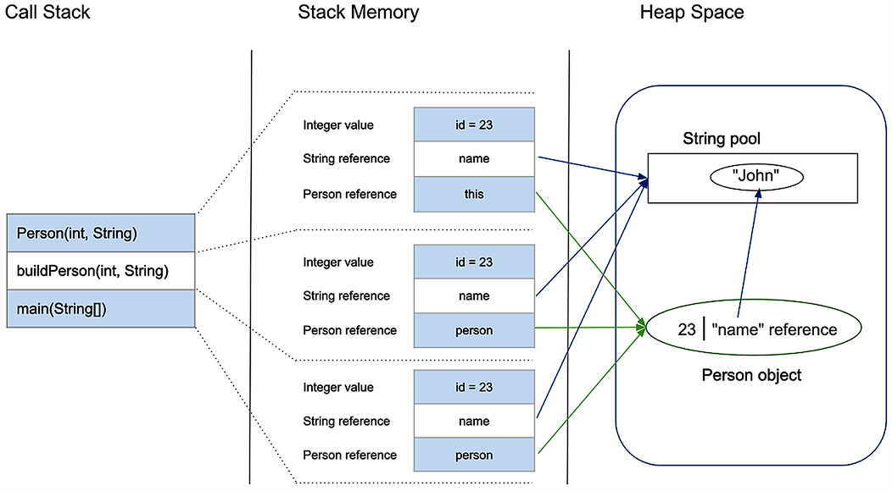
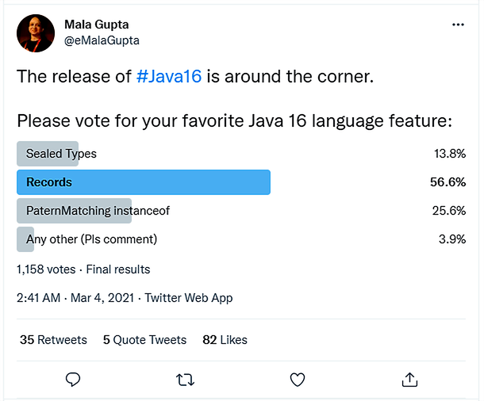
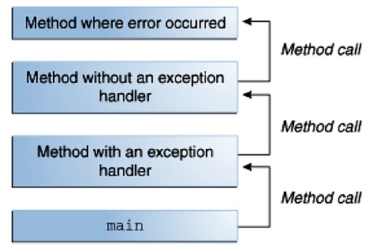
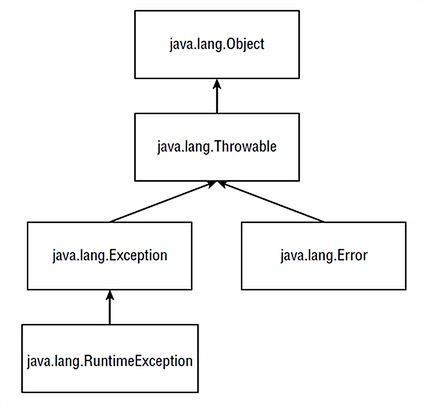
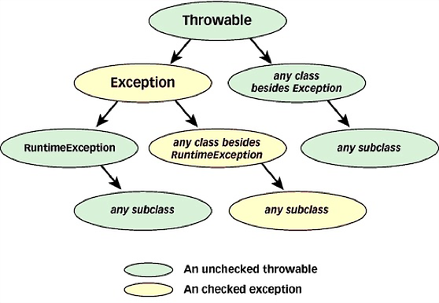

# Object-Oriented Programming in Java

### Part II

2021-10-27

---

### From the Previous Lecture

- Classes and objects
- Abstract classes and interfaces
- The four fundamental OOP principles
  - Encapsulation
  - Inheritance
  - Polymorphism
  - Abstraction

---

### Today's Topics

- Important details
    - Passing arguments
    - Stack vs. Heap
    - Object creation and initialization
- Enums
- Records (since Java 16)
- Sealed classes and interfaces (since Java 17)
- Exceptions

---

### Passing Arguments in Java

- Constructors and methods declare a list of zero or more *parameters* (formal parameters)
- Parameters are an ordered tuple of type + name pairs
- When calling a constructor or method, you pass *arguments* (actual parameters) that must be compatible in count, order, and type with the parameter list

---

### Passing Primitive Types as Arguments

Primitive types are passed by value: a copy is made, so changes to the parameter inside the constructor or method do not affect the variable that was passed as the argument.

---

### Passing Primitive Types as Arguments

```java
public class PassPrimitiveByValue {

    public static void main(String[] args) {
        int x = 3;
        // invoke passMethod() with x as argument
        passMethod(x);
        // print x to see if its value has changed
        System.out.println("After invoking passMethod(), x = " + x);
    }

    public static void passMethod(int p) {
        p = 10;
    }

}
```

---

### Passing Reference Types as Arguments

Reference types (objects, arrays) are also passed by value: the reference copy inside the method points to the same object in memory as the caller's variable. However, the fields of that object *can* be mutated inside the method if access is allowed.

---

### Passing Reference Types as Arguments

```java
public void moveCircle(Circle circle, int deltaX, int deltaY) {
    // mutates the object the reference points to
    circle.setX(circle.getX() + deltaX);
    circle.setY(circle.getY() + deltaY);

    // reassigning the local reference does NOT affect the caller
    circle = new Circle(0, 0);
}

// [...]

moveCircle(myCircle, 23, 56);
// myCircle reference is unchanged,
// but the x/y coordinates of the circle it points to have changed
```

---

### Declaration vs. Initialization, Stack vs. Heap

```java
public class Person {
    int id;
    String name;

    public Person(int id, String name) {
        this.id = id;
        this.name = name;
    }
}

public class PersonBuilder {
    private static Person buildPerson(int id, String name) {
        return new Person(id, name);
    }

    public static void main(String[] args) {
        int id = 23;
        String name = "John";
        Person person = null;
        person = buildPerson(id, name);
    }
}
```

---

<p align="center">
  
</p>

---

### Stack Memory Characteristics

- Allocated automatically when a method is called; freed when the method returns
- Variables on the stack exist only for the duration of the method that created them (parameters and local variables)
- Throws `java.lang.StackOverflowError` if the stack is full (e.g., infinite recursion)
- Typically smaller than heap memory
- Access is fast compared to the heap

---

### Heap Memory Characteristics

- Dynamic memory region for objects and arrays
- Allocated explicitly with `new` (or implicitly) and freed by the garbage collector
- Newly created objects live on the heap; references to them are stored on the stack
- Throws `java.lang.OutOfMemoryError` if no heap memory can be freed
- Access is slower than stack memory

---

### Object Creation and Initialization

- Instance fields are automatically initialised to their type's default value
- You can initialise them explicitly with an assignment in the declaration — suitable for literals or simple expressions, but not for complex logic (loops, error handling, etc.)
- Non-static fields can also be initialised in constructors
- Static fields cannot be initialised in constructors — that is what *initializer blocks* are for

---

### Initializer Blocks

- A block of code that:
  - Has no name or data type
  - Lives inside the class body but outside any constructor or method
- A class may have zero, one, or several initializer blocks
- Can be used to initialize both static and non-static fields
- The alternative is to move the initialization logic into dedicated methods

---

### Initializer Blocks

```java
public class InitializeMe {

    private int a;
    private static int b;

    static {
        // static initializer block — runs once when the class is loaded
        b = 100;
    }

    {
        // instance initializer block — runs before every constructor
        a = 5;
    }

}
```

---

### Object Initialization Order

1. Static fields and static initializers of the **superclass** are executed, in declaration order
2. Static fields and static initializers of **this class** are executed, in declaration order
3. Instance initializers of the **superclass** are executed, in declaration order
4. The **superclass constructor** runs
5. Instance initializers of **this class** are executed, in declaration order
6. **This class's constructor** runs

---

## Enums

---

### Enum

- A special reference type (class) that represents a fixed set of named constants
- Called an *enum(eration)* because its instances are defined by listing them

---

### Enum

```java
public enum Day {
    SUNDAY,
    MONDAY,
    TUESDAY,
    WEDNESDAY,
    THURSDAY,
    FRIDAY,
    SATURDAY
}
```

---

### Enum

- Every `enum` implicitly extends `java.lang.Enum`
  - It cannot explicitly extend another class (that would be multiple inheritance)
  - It can implement interfaces
- The `enum` body can contain fields and methods
- Any constructor must be `package-private` or `private`; it is called automatically for each constant and cannot be called explicitly

---

### Enum

```java
public class EnumExample {
    private Day day;

    public EnumExample(Day day) { this.day = day; }

    public void tellItLikeItIs() {
        String message = switch (day) {
            case MONDAY -> "Mondays are bad.";
            case FRIDAY -> "Fridays are better.";
            case SATURDAY, SUNDAY -> "Weekends are best.";
            default -> "Midweek days are so-so.";
        };
        System.out.println(message);
    }

    public static void main(String[] args) {
        new EnumExample(Day.TUESDAY).tellItLikeItIs();
    }
}
```

---

### Enum — Built-in Methods

The compiler automatically adds two static methods:
- `values()` — returns an array of all constants in declaration order
- `valueOf(String name)` — returns the constant with the given name

---

### Enum — Fields and Methods

```java
public enum Planet {
    MERCURY(3.303e+23, 2.4397e6),
    VENUS  (4.869e+24, 6.0518e6),
    EARTH  (5.976e+24, 6.37814e6);

    private final double mass;   // kg
    private final double radius; // metres

    Planet(double mass, double radius) {
        this.mass = mass;
        this.radius = radius;
    }

    static final double G = 6.67300E-11;

    double surfaceGravity() {
        return G * mass / (radius * radius);
    }
}
```

---

## Records

---

### Records (since Java 16)

- One of Java's most common criticisms was boilerplate: almost every class needed a public constructor, getters, `toString()`, `equals()`, and `hashCode()`
- For many classes these are trivial and can be auto-generated by an IDE — but that still makes the code harder to read
- Records solve this at the language level

---

### Records

- Like enums, records are a new reference type and a restricted kind of class
- They concisely describe *value objects*: classes whose entire state is captured in their fields — "the fields, the whole fields, and nothing but the fields"
- Think of them as a named, ordered tuple of values
- They are shallowly immutable aggregations of a fixed set of values, called the record's *components*

---

### Records

```java
public record Point(int x, int y) {}

// [...]

var p = new Point(-1, 2);
System.out.println(p.x() + ", " + p.y());
```

---

### Records — What the Compiler Generates

The compiler automatically generates:
- A `private final` field for each component, with the same name and type
- A *canonical constructor* whose parameter list matches the component list
- Accessor methods for each component (named after the component, not `getX()`)
- `equals()`, `hashCode()`, and `toString()`
  - For a record `R` with components `c1, c2, ..., cN`: `r.equals(new R(r.c1(), r.c2(), ..., r.cN())) == true`
- Components can be annotated (e.g. `@NotNull`)

---

### Records — Key Constraints

- Instances are created with `new`
- All records implicitly extend `java.lang.Record`, are themselves `final`, and cannot be `abstract`
- `java.lang.Record` cannot be extended explicitly
- It declares `equals()`, `hashCode()`, and `toString()` as abstract methods

---

### Example: Without Records

```java
public final class FXOrderClassic {

    private final int units;
    private final CurrencyPair pair;
    private final Side side;
    private final double price;
    private final LocalDateTime sentAt;

    public FXOrderClassic(int units, CurrencyPair pair, Side side,
                               double price, LocalDateTime sentAt) {
        this.units = units;
        this.pair = pair; // CurrencyPair is an enum, e.g. CurrencyPair.BGN_TO_EUR
        this.side = side; // Side is an enum, e.g. Side.BID or Side.ASK
        this.price = price;
        this.sentAt = sentAt;
    }

    // continues on next screen...
```

---

### Example: Without Records

```java
    // ...continued from previous screen
    public int units() { return units; }

    public CurrencyPair pair() { return pair; }

    public Side side() { return side; }

    public double price() { return price; }

    public LocalDateTime sentAt() { return sentAt; }

    // continues on next screen...
```

---

### Example: Without Records

```java
    // ...continued from previous screen

    @Override
    public boolean equals(Object o) {
        if (this == o) return true;
        if (!(o instanceof FXOrderClassic that)) return false;
        return units == that.units &&
                Double.compare(that.price, price) == 0 &&
                pair == that.pair &&
                side == that.side &&
                sentAt.equals(that.sentAt);
    }

    @Override
    public int hashCode() {
        return Objects.hash(units, pair, side, price, sentAt);
    }

    @Override
    public String toString() {
        return "FXOrderClassic{units=" + units + ", pair=" + pair +
               ", side=" + side + ", price=" + price + ", sentAt=" + sentAt + '}';
    }

}
```

---

### The Same Example: With Records

```java
public record FXOrder(int units,
                      CurrencyPair pair,
                      Side side,
                      double price,
                      LocalDateTime sentAt) {}
```

---

### Records — Optional Extras

- Records can optionally contain additional constructors, methods, static fields, and static factory methods
- If you find yourself adding many of these, a regular class is probably a better design choice

---

### Records — Compact Constructors

- A *compact constructor* lets you add validation/normalisation without repeating the field assignments (the compiler injects those automatically)
- Compact constructors have no parameter list — not even empty parentheses `()`

```java
public record FXOrder(int units,
                      CurrencyPair pair,
                      Side side,
                      double price,
                      LocalDateTime sentAt,
                      int ttl) {

    public FXOrder {
        if (units < 1) {
            throw new IllegalArgumentException("FXOrder units must be positive");
        }
        if (price <= 0.0) {
            throw new IllegalArgumentException("FXOrder price must be positive");
        }
    }

}
```

---

### Records — Static Factory Method

```java
public static FXOrder of(CurrencyPair pair,
                         Side side,
                         double price) {
    return new FXOrder(1, pair, side, price, LocalDateTime.now(), 0);
}
```

---

### Local Interfaces, Enums, and Records (since Java 16)

- Interfaces, enums, and records can be defined inside a method body, making them local to that method
- This improves encapsulation when those types are needed only within the method's implementation

---

## Sealed Classes and Interfaces

---

### Sealed Classes and Interfaces (since Java 17)

- `sealed` types let you restrict which classes or interfaces may extend or implement them
- This allows you to define the complete type hierarchy for a domain declaratively

---

### Sealed Classes and Interfaces

```java
// sealed class declares which classes may extend it
public abstract sealed class Shape
    permits Circle, Rectangle {}

public final class Circle extends Shape {}    // OK
public final class Rectangle extends Shape {} // OK
public class Triangle extends Shape {}        // Compile error

// exhaustive switch — no default case needed when all permitted types are covered
double area = switch (shape) {
    case Circle c    -> Math.pow(c.radius(), 2) * Math.PI;
    case Rectangle r -> r.a() * r.b();
};
```

---

### Sealed Classes and Interfaces — Motivation

- Separates *accessibility* from *extensibility*: a `sealed` class can be `public` but its subclasses still form a closed set
- Before Java 17 the two alternatives were:
    - Make the class package-private — limits accessibility everywhere
    - Make the class `public` with `private`/package-private constructors — poor control over subclasses
- Because the compiler, IDE, and JVM all know the exhaustive subtype list, analysis is stronger (e.g. exhaustive `switch` without `default`)

---

### Sealed Classes

- Permitted subclasses of a `sealed` class must be `final`, `non-sealed`, or `sealed`
- A `sealed` class may itself be abstract
- The `sealed` class and all its permitted classes must be in the same package
- If the permitted classes are short, they can live in the same source file — in that case the `permits` clause can be omitted

---

### Sealed Classes

```java
public sealed class Plant permits Herb, Shrub, Climber {}

final class Herb extends Plant {}

non-sealed class Shrub extends Plant {}

sealed class Climber extends Plant permits Cucumber {}

final class Cucumber extends Climber {}
```

---

### Sealed Interfaces

- A `sealed` interface may specify which interfaces may extend it and which classes may implement it
  - An extending interface may be `non-sealed` or `sealed` (interfaces cannot be `final`)
  - An implementing class may be `final`, `non-sealed`, or `sealed`
  - A `record` may implement a `sealed` interface — because every `record` is implicitly `final`, no explicit modifier is needed

---

### Sealed Interfaces

```java
sealed public interface Move permits Athlete, Person, Jump, Kick {}

final class Athlete implements Move {}

record Person(String name, int age) implements Move {}

non-sealed interface Jump extends Move {}

sealed interface Kick extends Move permits Karate {}

final class Karate implements Kick {}
```

---

### Source Files for Abstract Classes, Interfaces, Enums, and Records

The same rules apply as for concrete classes:
- Each type is stored in a file
  - whose name matches the type name
  - with the `.java` extension

---

### New Java Features Survey (2021)

<p align="center">
  
</p>

---

## Exceptions

---

### What Is an Exception?

- An event (problem) that occurs during program execution and disrupts the normal flow of instructions
- Another channel of communication for methods: a return value on the happy path, an exception on the error path

---

### Typical Causes

- Invalid input from the user
- Attempt to open a file that does not exist
- Network connection dropped during communication
- JVM ran out of memory
- ...

---

### How to Throw an Exception

```java
public Object pop() {

    if (size == 0) {
        throw new EmptyStackException();
    }

    // [...]
}
```

---

### How to Catch an Exception

```java
try {

    // code that may throw an exception

} catch (Exception e) {

    // handle the exception (exception handler)
    // multiple catch blocks are allowed

} finally {

    // optional cleanup code
    // always executes once the try block is entered,
    // regardless of whether an exception was thrown

}
```

---

### Catch Block Chain

```java
try {
    // [...]
} catch (MostSpecificException mse) {
    // [...]
} catch (MoreGeneralException mge) {
    // [...]
} catch (LeastSpecificException lse) {
    // [...]
}
```

---

### Multi-catch Block

```java
try {
    // [...]
} catch (IOException | SQLException e) {
    // [...]
}
```

---

### Call Stack

<p align="center">
  
</p>

---

### Types of Exceptions

Exceptional events can be caused by user error, a bug in the code, or an unavailable physical resource. They fall into three categories:

- Checked (compile-time) exceptions
- Unchecked (runtime) exceptions
- Errors

---

### Exception Hierarchy

<p align="center">
  
</p>

---

### Checked vs. Unchecked Exceptions

<p align="center">
  
</p>

---

### Checked Exceptions

- Also called *compile-time* exceptions because the compiler forces you to handle them
- A well-written application should anticipate them and recover gracefully

---

### Checked Exceptions — Examples

- `FileNotFoundException` when trying to open a file that does not exist
- `IOException` when a read or write operation on a file fails

---

### Unchecked (Runtime) Exceptions

- Occur at runtime — also called *runtime exceptions*
- The application usually cannot anticipate or recover from them
- Typically caused by bugs, incorrect API usage, etc.

---

### Unchecked Exceptions — Examples

- `ArithmeticException` — division by zero
- `ArrayIndexOutOfBoundsException` — array access with an out-of-bounds index
- `NullPointerException` — accessing a field or method on a `null` reference
- `ClassCastException` — casting an object to a type it is not an instance of

---

### Errors

- Problems that originate outside the application; the application usually cannot anticipate or recover from them
- Typically generated by the JVM itself

---

### Errors — Examples

- `OutOfMemoryError` — heap is exhausted and cannot be freed by GC
- `StackOverflowError` — method calls itself too many times (e.g. infinite recursion)

---

### Declaring Thrown Exceptions

If a method does not catch a checked exception that may be thrown in its body, it must declare it in its signature so callers know what to expect:

```java
public void writeList() throws IOException {
    // [...]
}
```

Note: `FileNotFoundException` extends `IOException`, so declaring `IOException` alone is sufficient.

---

### Chained Exceptions

```java
try {
    // [...]
} catch (IOException e) {
    // catch an exception, handle it, then throw a new one chained to the original
    throw new SampleException("Oops...", e);
}
```

---

### `finally` — Not Just for Exceptions

```java
try {
    // code that may throw exceptions, return, continue, or break
} finally {
    // important cleanup — always runs once the try block is entered
}
```

---

### Improved NullPointerException (since Java 14)

```java
public class HelpfulNPE {
    class A { public B b; }
    class B { public C c; }
    class C { public int number; }

    public void helpfulNPEDemo() {
        A a = new A();
        a.b.c.number = 100; // throws NullPointerException at runtime
    }

    public static void main(String[] args) {
        new HelpfulNPE().helpfulNPEDemo();
    }
}
```

---

### Improved NullPointerException (since Java 14)

Before Java 14:
```text
Exception in thread "main" java.lang.NullPointerException
    at HelpfulNPE.helpfulNPEDemo(HelpfulNPE.java:13)
    at HelpfulNPE.main(HelpfulNPE.java:16)
```

Since Java 14:
```text
Exception in thread "main" java.lang.NullPointerException:
    Cannot read field "c" because "a.b" is null
    at HelpfulNPE.helpfulNPEDemo(HelpfulNPE.java:13)
    at HelpfulNPE.main(HelpfulNPE.java:16)
```

---

### Why Use Exceptions?

- Separates error-handling code from normal logic → more readable code
- Propagates errors up the call stack automatically
- Groups and differentiates error types via the class hierarchy

---

### Best Practices for Exceptions

- Throw exceptions only for truly exceptional situations, not for normal control flow
- Prefer specific exception types over generic `Exception` or `RuntimeException`
- Always include a meaningful message when constructing an exception
- Never swallow exceptions silently with an empty `catch` block
- Use `finally` (or try-with-resources) to release resources reliably
- Document thrown checked exceptions with `@throws` in Javadoc
