# Clean Code

2021-11-03

<p align="center">
  
</p>

---

### How do we measure code quality?

<p align="center">
  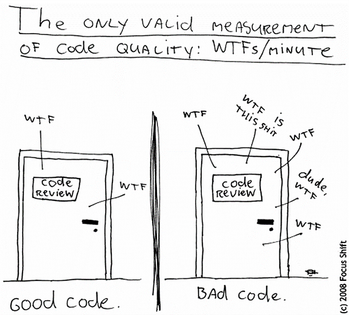
</p>

---

### Clean Code Principles — Naming, Conventions & Best Practices

- Package, class, interface, field, method, and local variable names must be meaningful and follow established conventions.

---

### Clean Code Principles — Naming, Conventions & Best Practices

- Packages
    - lowercase only, with a meaningful hierarchy
    - `bg.sofia.uni.fmi.mjt`
- Classes, abstract classes, interfaces, enums, records
    - nouns starting with an uppercase letter (upper CamelCase)
        - `Student`, `GameBoard`
        - interface names are often gerunds or adjectives
            - `Cloneable`, `Comparable`, `Runnable`, `Serializable`

---

### Clean Code Principles — Naming, Conventions & Best Practices

- Methods
    - verbs starting with a lowercase letter (camelCase), no underscores
        - `reverseString()`, `calculateSalary()`
- Variables
    - start with a lowercase letter (camelCase), no underscores
        - `itemsCount`
- Constants
    - ALL_CAPS with underscores between words
        - `MAX_NAME_LENGTH`

---

### Clean Code Principles — Follow OOP Principles

- Encapsulation
    - Minimise the public surface area
- Inheritance
    - Do not allow code duplication

---

### Clean Code Principles — Follow OOP Principles

- Polymorphism
    - Use polymorphism whenever possible
    - Declare with an interface, initialise with a concrete implementation
    - Prefer interfaces over implementations in public method signatures

---

### Strive for Good OO Design

- Use the default package only as an exception
- A class should do one thing
    - If the class name contains "and", it probably does more
- If a name contains "Helper", "Manager", or "Utility", there *might* be a better design
- A method should do one thing
- Methods should be short: < 20 lines of code

---

### Strive for Good OO Design

- If a method name contains "and", it probably does too much — split it
- If a method has many parameters:
    - it might belong in a different class (the one that provides those values), or
    - group semantically related parameters into a *data object* / `record`
- Do not overuse `static`

---

### Clean Code Principles — Format Your Code

- Format your code consistently
- There is no excuse not to — IDE shortcuts exist:
    - Ctrl+Alt+L (IntelliJ)
    - Ctrl+Shift+F (Eclipse)

---

### Do Not Use Magic Numbers

Replace "magic numbers" in code with appropriately named constants.

<br>

```java
// Bad
for (int i = 0; i < 16; i++) { /* what is 16?! */ }

if (message.startsWith("[ERROR] ")) { /* ?! */ }
```

<br>

```java
// Good
public static final int MAX_PASSWORD_LENGTH = 16;
//  [...]
for (int i = 0; i < MAX_PASSWORD_LENGTH; i++) { /* do something */ }

private static final String ERROR_MESSAGE_PREFIX = "ERROR: ";
//  [...]
if (message.startsWith(ERROR_MESSAGE_PREFIX)) { /* do something */ }
```

---

### Clean Code Principles

```java
// Bad
if (x % 2 == 0)
    return x / 2;
```

<br>

```java
// Good: always wrap if-else and loop bodies in braces,
// even when they contain a single statement
if (x % 2 == 0) {
    return x / 2;
}
```

---

### Clean Code Principles

```java
// Bad
public int calculateSalary()
{

}

// Good: opening brace stays on the same line as the declaration
// Exception: initializer blocks
public int calculateSalary() {

}
```

---

### Clean Code Principles

```java
// Bad
private static long calculateSum(int n){
    long sumOfOddSquares = 0;
    for(int i=0; i< n; i ++){
        if(i%2!=0){
            sumOfOddSquares += Math.pow (i,2);
        }
    }
    return sumOfOddSquares;
}
```

---

### Clean Code Principles

```java
// Good:
// 1. Space between keywords (if, for, while, do, switch) and the opening (
// 2. Space between method name and the opening (
// 3. Spaces around operators
// 4. Space after ,
// 5. Blank lines for breathing room
private static long calculateSum(int n) {
    long sumOfOddSquares = 0;

    for (int i = 0; i < n; i++) {
        if (i % 2 != 0) {
            sumOfOddSquares += Math.pow(i, 2);
        }
    }

    return sumOfOddSquares;
}
```

---

### Clean Code Principles

```java
// Bad
if (x % 2 == 0) {
    return true;
} else {
    return false;
}
```
<br>

```java
// Good: be concise. Less code == fewer bugs
return x % 2 == 0;
```

---

### Clean Code Principles

- Add comments, but do not overdo it
    - Good code is self-explanatory; a comment is only needed where the **why** is non-obvious

---

### Clean Code Principles

- Separate normal logic from exception-handling logic
- Use exceptions instead of error codes and console error messages
- Provide a precise, understandable message when constructing and throwing an exception
- When creating a custom exception class, override the non-default constructors:

  ```java
  Exception(String message)
  Exception(String message, Throwable cause)
  ```

- Never suppress / swallow exceptions
    - Never leave a `catch` block empty, or with only `e.printStackTrace()`

---

### Clean Code Principles

```java
// Bad
try {
    // do something with the file system
} catch (FileNotFoundException e) {
    // I hope someone reads the logs
    e.printStackTrace();
} catch (IOException e) {
    // the admin should see this
    System.err.println("I/O exception accessing the file system.");
}
```

---

### Clean Code Principles

```java
// Good
try {
    // do something with the file system
} catch (FileNotFoundException e) {
    // catalog file is missing —
    // this is OK, first access should create an empty catalog
    createEmptyShoppingCatalog();
} catch (IOException e) {
    // catalog file is there but cannot be opened or read;
    // calling method knows how to handle this
    throw new ShoppingException("Cannot load shopping catalog", e);
}
```

---

### Separate I/O Logic from *Business* Logic

```java
// Bad — swiss knife: all in one
public static void factorial() {
    Scanner sc = new Scanner(System.in);
    int n = -1; long result = 1;
    do {
        System.out.println("Enter a number:");
        try {
            n = Integer.parseInt(sc.nextLine());
        } catch (Exception e) {
            continue;
        }
    } while (n < 0);
    for (int i = 2; i <= n; i++) {
        result *= i;
    }
    System.out.println("n! = " + result);
}
public static void main(String... args) {
    factorial();
}
```

---

### Separate I/O Logic from *Business* Logic

```java
// Good
private static int readAndValidate(Scanner sc) { // handle input
    int n = -1;
    do {
        System.out.println("Enter a number:");
        try {
            n = Integer.parseInt(sc.nextLine());
        } catch (Exception e) {
            continue;
        }
    } while (n < 0);
    return n;
}

private static void printOutput(long result) { // handle output
    System.out.println("n! = " + result);
}
```

---

### Separate I/O Logic from *Business* Logic

```java
// Good
public static long factorial(int n) { // business logic
    long result = 1;
    for (int i = 2; i <= n; i++) {
        result *= i;
    }
    return result;
}

public static void main(String... args) {
    int input = readAndValidate(new Scanner(System.in));
    long result = factorial(input);
    printOutput(result);
}
```

---

### Java Code Conventions

Get familiar with a comprehensive Java code convention and follow it.
Two of the most popular:

<br>

- [Oracle Code Conventions for the Java Programming Language](https://www.oracle.com/technetwork/java/javase/documentation/codeconvtoc-136057.html)

- [Google Java Style Guide](https://google.github.io/styleguide/javaguide.html)

<br><br>

<p align="center">
  
</p>

---

### Static Code Analysis Tools

- There are tools for static code analysis that:
    - automate adherence to code conventions
    - also find bugs

---

### Most Popular Open-Source Tools

- [checkstyle](http://checkstyle.sourceforge.net/index.html)<br>
- [PMD](https://pmd.github.io/)<br>
- [FindBugs](http://findbugs.sourceforge.net/index.html)

<br>

<p align="center">
  
</p>

---

### planetgeek.ch | Clean Code Cheat Sheet

[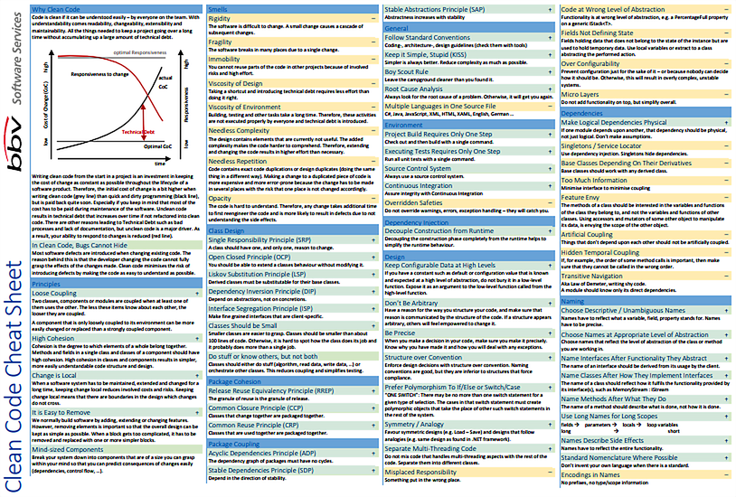](https://www.planetgeek.ch/wp-content/uploads/2014/11/Clean-Code-V2.4.pdf)

---

### The Bible

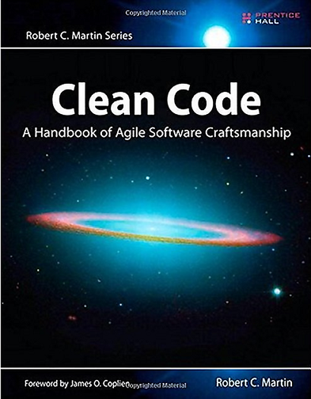

---

### Clean Code

> "Writing clean code is what you must do in order to call yourself a professional.
> There is no reasonable excuse for doing anything less than your best."
>
> &emsp;&emsp;&emsp;&emsp; ― Robert C. Martin, *Clean Code: A Handbook of Agile Software Craftsmanship*

---

## Data Structures

2021-11-03

<p align="center">
  
</p>

---

## Data Structures

- Containers for data
- Core operations:
    - add
    - remove
    - search
    - traverse

---

### Arrays — Advantages

- Extremely simple interface
- Most memory-efficient of all data structures*
- Fast element access by index: O(1)

---

### Arrays — Disadvantages

- Size is fixed at initialisation
- Adding or removing an element (except at the last position) is expensive
- Searching by value is slow:
    - O(N) for an arbitrary array
    - O(log N) for a sorted array

---

### Collections

- Java provides a *collections framework* containing interfaces, implementations, and algorithms for the most commonly used data structures
- Unlike arrays:
    - their size is dynamic
    - they hold only reference types
- Almost all* interfaces and classes are in the `java.util` package

---

### Collections

Benefits of the collections framework:

- No need to reinvent the wheel
- Increased speed and quality of our programs
- Encourages code reuse

---

### Iterators

- Iterators provide a uniform way to traverse the elements of a collection.
- Collections (and arrays) can be traversed with a for-each loop.

---

### `Iterator` and `Iterable` Interfaces

```java
public interface Iterator<E> {
    boolean hasNext();
    E next();
    void remove();
}

public interface Iterable<T> {
    Iterator<T> iterator();
}
```

---

### `java.util.Iterator`

- `remove()` removes from the collection the element last returned by `next()`
- If the collection is modified while being iterated in any way other than calling `remove()` on the iterator, the iterator's behaviour is undefined
    - In particular, `ConcurrentModificationException` may be thrown (even in single-threaded code)

---

### Collections

The fundamental data structures used by collection implementations are:

- Arrays
- Linked lists
- Hash tables
- Trees

<p align="center">
  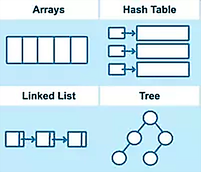
</p>

---

### Big-O Complexity Chart

[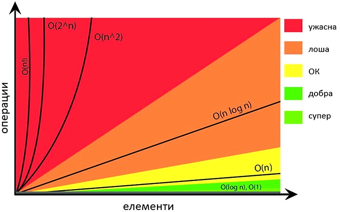](https://www.bigocheatsheet.com/)

---

[](https://www.bigocheatsheet.com/)

---

### Collections

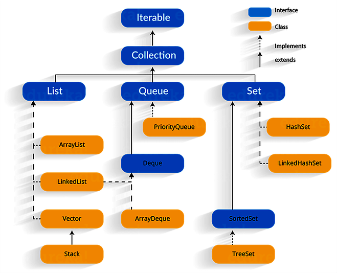

---

### Collections

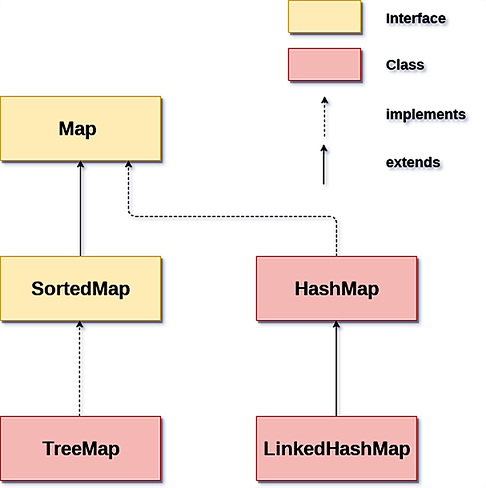

---

### Traversing Collections

```java
List<Float> nums = List.of(4.999f, 0.271f, 7.1f, -1f);
```

<br>

```java
// using a for-each loop
for (float current : nums) {
    System.out.printf("%.2f%n", current);
}
```

<br>

```java
// using an iterator
Iterator<Float> iterator = nums.iterator();
while (iterator.hasNext()) {
    System.out.printf("%.2f%n", iterator.next());
}
```

---

### Traversing a `Map`

Depending on what we need, we can retrieve from a `Map`:

- the set of keys
```java
Set<Integer> keys = map.keySet();
```

<br>

- a collection of values
```java
Collection<String> values = map.values();
```

<br>

- a set of key-value pairs
```java
Set<Entry<Integer, String>> s = map.entrySet();
```

---

### `java.util.Collection`

```java
int size()
boolean isEmpty()
boolean contains(Object element)
boolean add(E element)
boolean remove(Object element)
Iterator<E> iterator()

boolean containsAll(Collection<?> c)
boolean addAll(Collection<? extends E> c)
boolean removeAll(Collection<?> c)
boolean retainAll(Collection<?> c)
void clear()

Object[] toArray()
<T> T[] toArray(T[] a)
```

---

### `java.util.List`

```java
boolean add(E e)
boolean contains(Object o)
E get(int index)
int indexOf(Object o)
boolean remove(Object o)
E remove(int index)
int size()
boolean isEmpty()
Object[] toArray()
List<E> subList(int fromIndex, int toIndex)
```

---

### `List` Implementations

- `ArrayList` — resizable (dynamic) array
- `LinkedList` — doubly linked list
- `Vector` — resizable array, synchronized. Legacy → replaced by `ArrayList`
- `Stack` — extends `Vector`. Legacy → replaced by `Deque`

---

### Algorithmic Complexity of Core Operations

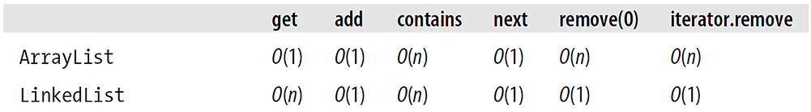

---

### `java.util.Queue`

| Operation | Throws exception | Returns special value |
|:---------|:-----------------|:----------------------|
| Insert   | `add(e)`         | `offer(e)`            |
| Remove   | `remove()`       | `poll()`              |
| Examine  | `element()`      | `peek()`              |

---

### `Queue` Implementations

- `PriorityQueue` — heap
- `LinkedList`
- `ArrayDeque` — resizable (dynamic) array

---

### Algorithmic Complexity of Core Operations

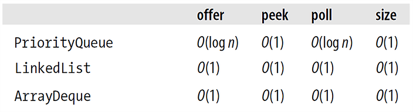

---

### `java.util.Set`

```java
boolean add(E e)
boolean contains(Object o)
boolean remove(Object o)
int size()
boolean isEmpty()
Object[] toArray()
```

---

### `Set` Implementations

- `TreeSet` — backed by `TreeMap` (red-black tree)
- `HashSet` — hash table
- `LinkedHashSet` — hash table + doubly linked list
- `EnumSet` — bit array

---

### `HashSet` Constructors

```java
HashSet(); // default initial capacity (16) and load factor (0.75)
HashSet(Collection<? extends E> c);
HashSet(int initialCapacity);
HashSet(int initialCapacity, float loadFactor);
```

---

### `TreeSet` Constructors

```java
TreeSet(); // natural ordering
TreeSet(Collection<? extends E> c);
TreeSet(Comparator<? super E> comparator);
TreeSet(SortedSet<E> s);
```

---

### `java.lang.Comparable` vs `java.util.Comparator`

```java
// natural ordering
public interface Comparable<T> {
    int compareTo(T o);
}

public interface Comparator<T> {
    int compare(T o1, T o2);
}
```

---

### Consistency of Natural Ordering with `equals()`

The natural ordering of class C is called *consistent with `equals()`* if and only if
`e1.compareTo(e2) == 0` has the same boolean value as `e1.equals(e2)` for every two objects e1 and e2 of C.

<br>
It is strongly recommended (though not required) that natural orderings be consistent with `equals()`.

---

### `LinkedHashSet`

<p align="center">
  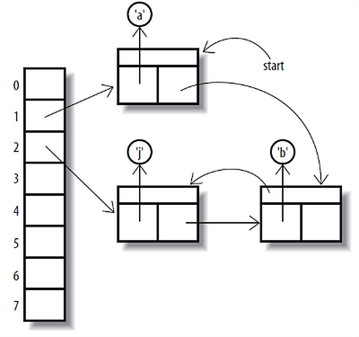
</p>

```java
Set<Character> sc = new LinkedHashSet<>();
Collections.addAll(sc, 'a', 'b', 'j');
```

---

### Algorithmic Complexity of Core Operations

<p align="center">
  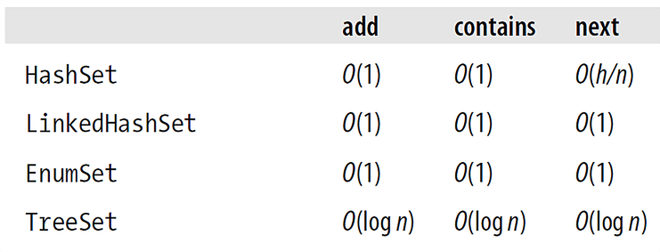
</p>

<small>*h* — capacity of the hash table</small>

---

### Set Operations with `Set`

```java
Set<String> one = new HashSet<>();
one.add("foo");
one.add("bar");
Set<String> two = new HashSet<>();
two.add("foo");
two.add("baba");

Set<String> union = new HashSet<>(one);
union.addAll(two); // union = [baba, bar, foo]

Set<String> intersection = new HashSet<>(one);
intersection.retainAll(two); // intersection = [foo]

Set<String> difference = new HashSet<>(one);
difference.removeAll(two); // difference = [bar]
```

---

### `java.util.Map`

```java
V put(K key, V value) // Adds a key-value pair. If the key already exists,
                      // updates the value and returns the old value.
V get(Object key)
V remove(Object key)
boolean containsKey(Object key)
int size()
boolean isEmpty()
Set<K> keySet()
Collection<V> values()
```

---

### `Map` Implementations

- `HashMap` — hash table
- `LinkedHashMap` — hash table + doubly linked list
- `EnumMap` — bit array
- `TreeMap` — red-black tree

---

### Algorithmic Complexity of Core Operations

<p align="center">
  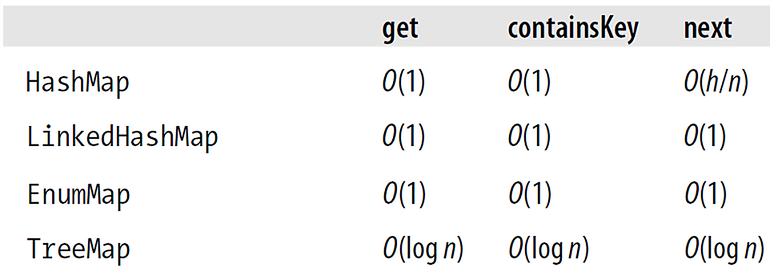
</p>

<small>*h* — capacity of the hash table</small>

---

### Ordered vs. Unordered Collections

- `TreeMap`/`TreeSet` — red-black trees. Maintain natural ordering. Elements must implement `Comparable` (or a `Comparator` must be supplied). Logarithmic complexity for most operations.
- `HashMap`/`HashSet` — hash tables. No natural ordering. Elements must implement `hashCode()` and `equals()`. Constant complexity for most operations.

---

### Java Map/Collection Cheat Sheet

<p align="center">
  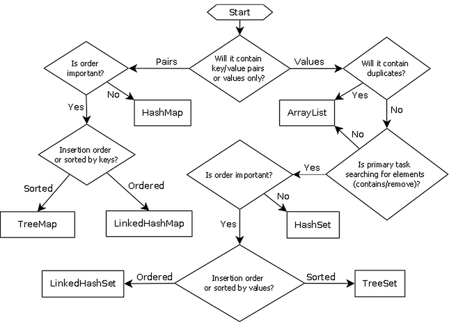
</p>

---

### Clean Code Principles — Declare with Interface, Initialise with Concrete Class

```java
// Bad
ArrayList<String> stringList = new ArrayList<>();
public HashSet<Integer> filterPrimes(HashSet<Integer>);
```

<br>

```java
// Good
List<String> stringList = new ArrayList<>();
public Collection<Integer> filterPrimes(Collection<Integer>);
```

---

### Collections — Operations

Sorting

```java
List<Integer> nums = new ArrayList<>();
nums.add(4);
nums.add(9);
nums.add(0);
nums.add(7);
nums.add(-1);

// nums = [4, 9, 0, 7, -1]
Collections.sort(nums);
// nums = [-1, 0, 4, 7, 9]
Collections.sort(nums, Collections.reverseOrder());
// nums = [9, 7, 4, 0, -1]
```

---

### Collections — Operations

Searching: `indexOf()`, `binarySearch()`

```java
List<Integer> nums = new ArrayList<>(List.of(4, 9, 0, 7, -1));

// nums = [4, 9, 0, 7, -1]
int index = nums.indexOf(7);
// index = 3

Collections.sort(nums);
index = Collections.binarySearch(nums, -1);
// index = 0
```

---

### Collections — Operations

Shuffling: `shuffle()`

```java
List<Integer> nums = new ArrayList<>(List.of(4, 9, 0, 7, -1));

// nums = [4, 9, 0, 7, -1]
Collections.shuffle(nums);
// nums = [?, ?, ?, ?, ?]
```

---

### Collections — Operations

Manipulation: `copy()`, `fill()`, `reverse()`, `swap()`

```java
List<String> from = new ArrayList<>();
from.add("foo");
from.add("bar");
List<String> to = new LinkedList<>();
to.add("a");
to.add("b");

Collections.copy(to, from);
// to = [foo, bar]
```

<br>

```java
List<String> list = new ArrayList<>();
list.add("foo");
list.add("bar");
list.add("baz");

Collections.fill(list, "a");
// list = [a, a, a]
```

---

### Collections — Operations

Manipulation: `copy()`, `fill()`, `reverse()`, `swap()`

```java
List<String> list = new ArrayList<>();
list.add("1");
list.add("2");
list.add("3");

Collections.reverse(list);
// list = [3, 2, 1]

Collections.swap(list, 0, 1);
// list = [2, 3, 1]
```

---

### Collections — Operations

Statistics: `min()`, `max()`, `frequency()`

```java
Set<Integer> nums = Set.of(4, 9, 0, 7, -1);

int min = Collections.min(nums); // -1
int max = Collections.max(nums); // 9
int frequency = Collections.frequency(nums, 7); // 1
```

---

### Finding All Unique Words from a Given Set

```java
public class FindDistinctWords {

  public static void main(String[] words) {
      Set<String> distinctWords = new TreeSet<>();
      for (String word : words) {
          distinctWords.add(word);
      }

      System.out.printf("%d distinct words: %s%n", distinctWords.size(), distinctWords);
  }

}
```

<br>

```bash
$ javac FindDistinctWords.java && \
  java FindDistinctWords "foo" "bar" "foo" "baz" "bar" "foo"
3 distinct words: [bar, baz, foo]
```

---

### Removing Elements from a Collection While Iterating

```java
private static void filter(Collection<String> collection) {
    for (Iterator<String> it = collection.iterator(); it.hasNext();) {
        if (it.next().charAt(1) == 'a') {
            it.remove();
        }
    }
}
```

<br>

```java
Set<String> words = new HashSet<>();
words.add("foo");
words.add("bar");
words.add("baz");

filter(words);
// words = [foo]
```

---

### Immutable vs. Unmodifiable Collections

- Collections that do not support modifying operations (such as `add`, `remove`, and `clear`) are called *unmodifiable*. Collections that are not *unmodifiable* are *modifiable*.

- Collections that additionally guarantee that no changes to their contents are possible are called *immutable*. Collections that are not *immutable* are *mutable*.

- An *unmodifiable* collection is not necessarily *immutable*. If the contained elements are *mutable*, the whole collection is obviously *mutable* even though it is *unmodifiable*.
    - However, if an *unmodifiable* collection contains only *immutable* elements, it can be considered *effectively immutable*.

---

### Unmodifiable Collections

```java
// static factory methods for creating unmodifiable collections (since Java 9)

List<String> list = List.of("Java", "rulez");

Set<Integer> set = Set.of(1, 2, 3, 5, 8);

Map<String, Integer> cities = Map.of(
      "Brussels", 1_139_000,
      "Cardiff", 341_000
);

cities = Map.ofEntries(
      Map.entry("Brussels", 1_139_000),
      Map.entry("Cardiff", 341_000)
);
```

---

### Unmodifiable Collections

```java
Set<String> namesSet = new HashSet<>();
namesSet.add("Paul");
namesSet.add("Anna");

// static factory methods for creating unmodifiable copies (since Java 10)
// Subsequent changes to the original collection are not reflected in the copies.

Set<String> moreNamesYet = Set.copyOf(namesSet);
List<String> copiedNames = List.copyOf(namesSet);
Map<String, Integer> map = Map.copyOf(cities);

moreNamesYet.add("Nicky"); // throws UnsupportedOperationException at runtime
```

---

### Unmodifiable Collections

```java
Set<String> namesSet = new HashSet<>();
namesSet.add("Paul");
namesSet.add("Anna");

// static factory methods for creating an unmodifiable view (since Java 9)
// Subsequent changes to the original collection ARE reflected through the view.

Set<String> namesAgain = Collections.unmodifiableSet(namesSet);

namesSet.add("Martin");

System.out.println(namesAgain.contains("Martin")); // true

namesAgain.add("Nicky"); // throws UnsupportedOperationException at runtime
```

---

### Unmodifiable Collections

- Use less memory than their modifiable counterparts
- Cannot contain `null` elements
- For identical contents, factory methods may return a new instance or a reference to an existing one

---

### Where to Go Next

- [Oracle Collections Tutorial](https://docs.oracle.com/javase/tutorial/collections/index.html)
- [Google Guava](https://github.com/google/guava) — extended collections and utilities
- *Effective Java* by Joshua Bloch — Items 17-20 on minimising mutability and programming to interfaces
