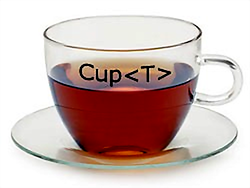
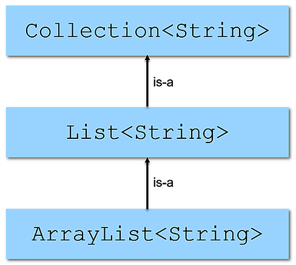
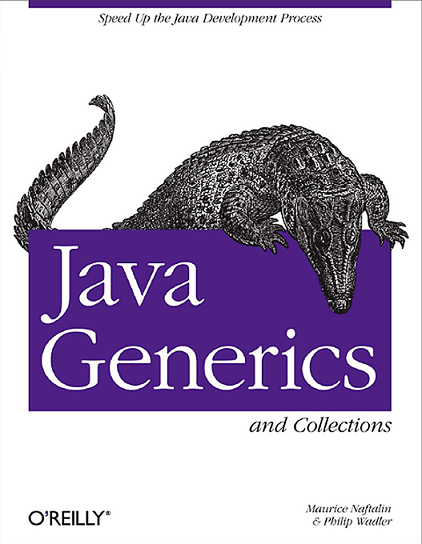

# Generics

2021-11-10

<p align="center">
  
</p>

---

### Last time we covered:

- Clean Code
- Collections

---

### Today we continue with:

- Generics

---

### The Need for Generics

- Generic types allow us to write a single implementation of a class or method that works with different data types
    - this enables code reuse and type safety at compile time

---

### The Need for Generics

```java
List list = new LinkedList();
list.add(Integer.valueOf(1));
Integer i = list.iterator().next(); // will not compile — no type info
```

---

### The Need for Generics

```java
List list = new LinkedList();
list.add(Integer.valueOf(1));
Integer i = (Integer) list.iterator().next(); // explicit type cast
```

<br>

- we must cast explicitly, which is tedious
- we might guess the type incorrectly, causing a `ClassCastException` at runtime

---

### The Need for Generics

- It would be far better if:
    - the programmer could express the intended type, and
    - the compiler could guarantee type correctness

---

### The Need for Generics

```java
List list = new LinkedList();
list.add(Integer.valueOf(1));
Integer i = (Integer) list.iterator().next(); // explicit type cast
```

<br>

```java
List<Integer> list = new LinkedList<>();
list.add(1); // autoboxing; compiler checks type compatibility
Integer i = list.iterator().next(); // no explicit cast needed
```

---

### Generics

```java
List<E>
// Read as "a list of E"
```

<br>

A class or interface whose declaration has one or more type parameters is called a *generic* class or interface.

---

### Example: Non-generic Box

Holds any object

```java
public class Box {
    private Object value;

    public Object getValue() {
        return value;
    }

    public void setValue(Object value) {
        this.value = value;
    }
}
```

---

### Example: Generic Box

```java
public class Box<T> {
    private T value;

    public T getValue() {
        return value;
    }

    public void setValue(T value) {
        this.value = value;
    }
}
```

---

### Creating Instances

```java
// The long way (explicit type argument)
Box<Integer> integerBox = new Box<Integer>();
```

<br>

```java
// Diamond operator (compiler infers type argument)
Box<Integer> integerBox = new Box<>();
```

---

### Type Parameter Naming Convention

- E - Element
- T - Type
- K - Key
- V - Value
- N - Number
- S, U, V etc. - 2nd, 3rd, 4th type

---

### Generic Methods

- Can use the type parameters of the enclosing class or method
- Can introduce new type parameters not declared by the class
- New type parameters are visible only within the method that declares them
- Generic methods can be static, non-static, or constructors

---

### Generic Methods – Examples

```java
public class Pair<K, V> {

    private K key;
    private V value;

    // Generic constructor
    public Pair(K key, V value) {
        this.key = key;
        this.value = value;
    }

    // Generic methods
    public K getKey() { return key; }
    public void setKey(K key) { this.key = key; }
    public V getValue() { return value; }
    public void setValue(V value) { this.value = value; }

}
```

---

### Generic Methods – Examples

```java
public class Util {

    // Generic static method
    public static <K, V> boolean areEqual(Pair<K, V> p1, Pair<K, V> p2) {
        return p1.getKey().equals(p2.getKey()) &&
                   p1.getValue().equals(p2.getValue());
    }

}
```

---

### Generic Methods – Invocation

```java
Pair<Integer, String> p1 = new Pair<>(1, "apple");
Pair<Integer, String> p2 = new Pair<>(2, "pear");

// Full syntax (explicit type witness)
boolean areEqual = Util.<Integer, String>areEqual(p1, p2);

// Short syntax (type inference)
areEqual = Util.areEqual(p1, p2);
```

---

### Covariance, Contravariance, and Invariance

- *Variance* describes how subtyping between complex types relates to subtyping between their components
- An informal but memorable definition:
    - *Covariance*: subtypes are accepted
    - *Contravariance*: supertypes are accepted

---

### Covariance, Contravariance, and Invariance

- In Java, arrays are covariant. This has two consequences:
    - `T[]` can hold elements of type `T` and its subtypes
    - `S[]` is a subtype of `T[]` when `S` is a subtype of `T`

<br>

```java
Integer[] intArr = new Integer[5];
Number[] numArr = intArr; // OK — covariance

numArr[0] = 1.23; // Not OK: compiles but throws ArrayStoreException at runtime
```

---

### Generic Types and Inheritance

- `Integer` is-a `Object`
- `Integer` is-a `Number`
- `Double` is-a `Number`
- However, `Box<Integer>` is-not-a `Box<Number>`. Their common parent is `Object`
- A parameterized type is therefore *invariant*
    - What would go wrong if it were not?

---

### Generic Types and Inheritance

- A subtype of a generic class or interface is obtained by extending or implementing it
- When the type argument is the same, the *is-a* relationship holds

---

### Example from the Collections Framework

<p align="center">
  
</p>

---

### Bounded Generic Types

You can restrict a type parameter to be compatible only with a given type or its subtypes/implementations (upper bound).

<br>

```java
public <T extends Number> List<T> fromArrayToList(T[] a) {
    // [...]
}

// Multiple bounds use &; at most one can be a class (must come first),
// the rest must be interfaces. Note: extends is used even for interfaces.
public <T extends Number & Comparable<T>> List<T> anotherMethod(T[] a) {
    // [...]
}
```

---

### The Problem: No Common Parent

Suppose you need a method that prints all elements of a collection.
Without generics:

<br>

```java
private void printCollection(Collection c) {
    for (Object e : c) {
        System.out.println(e);
    }
}
```

---

### The Problem: No Common Parent

A naive generic version might look like this:

<br>

```java
void printCollection(Collection<Object> c) {
    for (Object e : c) {
        System.out.println(e);
    }
}

// This is actually less useful than the raw version.
// While the raw version accepts any collection,
// this one only accepts Collection<Object>.
// As we have seen, Collection<Object> is NOT a supertype
// of Collection<T> for any T, so calling it with a
// Collection<Integer> would not compile.
```

---

### The Solution: Wildcards

- Do all `Collection<T>` variants share a common parent other than `java.lang.Object`?
- Yes — it is written `Collection<?>` and read "collection of unknown type". This is called a *wildcard* type
- Wildcards allow generic types to support covariance and contravariance

---

### The Solution: Wildcards

```java
// This method can be called with any collection
void printCollection(Collection<?> c) {
    for (Object e : c) {
        System.out.println(e);
    }
}
```

---

### Generic Types with Wildcards

- `?` – represents an unknown type
- Can be used as the type of:
  - a method parameter
  - a class field
  - a local variable
  - a return type
- Cannot be used as a type argument when:
  - calling a generic method
  - creating an instance of a generic class

---

### Upper-Bounded Wildcards

We want to write a method that sums elements in a list of `Integer`, `Double`, `Float`, or `Number`:

<br>

```java
public static double sumOfList(List<? extends Number> list) {
    double sum = 0.0;
    for (Number current : list) {
        sum += current.doubleValue();
    }
    return sum;
}
```

---

### Lower-Bounded Wildcards

We want a method that adds `Integer` objects to a list.
The method should work with collections of `Integer`, `Number`, or `Object`:

<br>

```java
public static void addNumbers(List<? super Integer> list) {
    for (int i = 1; i <= 10; i++) {
        list.add(i);
    }
}
```

---

### Unbounded Wildcards

- A list of elements of unknown type — `List<?>`
- `List<?>` is equivalent to `List<? extends Object>`
- Use when:
  - the implementation only needs methods from `java.lang.Object`
  - you care only about list properties (e.g. size), not the element type

---

### The Get & Put Principle

- Use `extends` wildcard when you will only **get** values from a structure (covariant / read-only)
- Use `super` wildcard when you will only **put** values into a structure (contravariant / write-only)
- Use no wildcard when you will do both

<br>

In other words: covariant types are read-only, contravariant types are write-only.

---

### Generics vs C++ Templates

- Generics superficially resemble C++ templates, but differ in key ways:
    - *Syntactically*: in Java, adjacent `>>` need no space

    ```c++
    // C++: space between the two >> was mandatory before C++11
    list<list<string> > list;

    // Java: spaces around < > are optional
    List<List<String>> list;
    ```

    - *Semantically*: Java uses **erasure** — type information is discarded at runtime. C++ uses **expansion** — a separate class version is generated per concrete type argument.

---

### Type Erasure

- The Java compiler erases all type argument information; it is not available at runtime
- All type parameters in generic classes and interfaces are replaced…

---

### Erasure of Unbounded or Lower-Bounded Type Parameters → `java.lang.Object`

```java
public class Box<T> {
    private T value;
    public T getValue() { return value; }
    public void setValue(T value) { this.value = value; }
}

// After erasure:
public class Box {
    private Object value;
    public Object getValue() { return value; }
    public void setValue(Object value) { this.value = value; }
}
```

---

### Erasure of Upper-Bounded Type Parameters → the Bound Type

```java
class Shape { /* ... */ }
class Circle extends Shape { /* ... */ }
class Rectangle extends Shape { /* ... */ }
```

<br>

```java
public static <T extends Shape> void draw(T shape) { /* ... */ }

// After erasure:
public static void draw(Shape shape) { /* ... */ }
```

---

### Raw Types

```java
Box rawBox = new Box();
```

<br>

A raw type is the name of a generic class or interface without any type arguments.
The raw type of `Box<T>` is `Box`.
Raw types remove the compiler's ability to detect type errors. They exist for backward compatibility — avoid them.

---

### Raw Types

A parameterized type can be safely assigned to its raw type.
The reverse compiles with an unchecked warning:

<br>

```java
Box<String> stringBox = new Box<>();
Box rawBox = stringBox; // OK

Box rawBox2 = new Box(); // raw type

// warning: unchecked conversion
Box<Integer> intBox = rawBox2;
```

---

### Raw Types

Calling a generic method through a raw type reference also produces an unchecked warning:

<br>

```java
Box<String> stringBox = new Box<>();
Box rawBox = stringBox;

rawBox.setValue(8); // warning: unchecked invocation to setValue(T)
```

---

### Raw Types and Type Compatibility

```java
List raw;
// warning: List is a raw type.
// References to generic type List<E> should be parameterized

List<Object> objects;
List<String> strings = new ArrayList<>();

raw = strings;     // OK: List-of-Strings is-a List
objects = strings; // will not compile: incompatible types
```

---

### Prefer `List` Over Arrays

```java
// Fails at runtime
Object[] array = new Long[1];
array[0] = "I don't fit in"; // throws ArrayStoreException

// Won't compile — caught at compile time
List<Object> list = new ArrayList<Long>(); // incompatible types
list.add("I don't fit in");
```

---

### Restrictions on Generic Classes and Interfaces

Cannot instantiate a type parameter directly.
Cannot declare a static field of a type parameter type:

<br>

```java
public static <E> void append(List<E> list) {
    E elem = new E(); // compile-time error
    list.add(elem);
}

public class MobileDevice<T> {
    private static T os; // compile-time error
}
```

---

### Restrictions on Generic Classes and Interfaces

Cannot cast to a parameterized type.
Cannot use `instanceof` with generic types at runtime:

<br>

```java
public static <E> void rtti(List<E> list) {
    if (list instanceof ArrayList<Integer>) { // compile-time error
        // ...
    }
}
```

---

### Restrictions on Generic Classes and Interfaces

Cannot create arrays of parameterized types:

<br>

```java
// compile-time error
List<Integer>[] arrayOfLists = new List<Integer>[2];

// pretend this is allowed:
Object[] stringLists = new List<String>[10];
stringLists[0] = new ArrayList<String>(); // OK

// ArrayStoreException should be thrown, but runtime cannot detect it
stringLists[1] = new ArrayList<Integer>();
```

---

### Restrictions on Generic Classes and Interfaces

Cannot define two overloaded methods whose signatures become identical after type erasure:

<br>

```java
public class Example {
    // Compilation error: 'print(Set<String>)' clashes with
    // 'print(Set<Integer>)': both methods have same erasure
    public void print(Set<String> strSet) { }

    public void print(Set<Integer> intSet) { }
}
```

---

### Further Reading

<p align="center">
  
</p>
