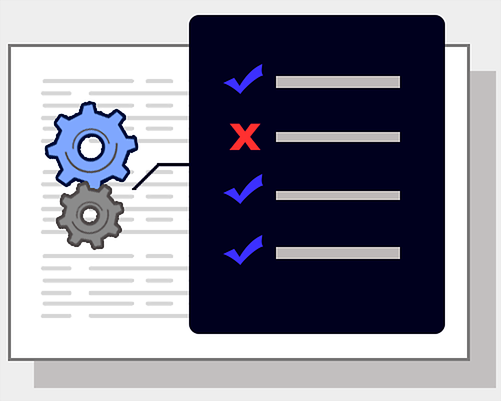
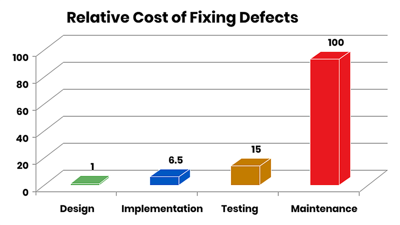
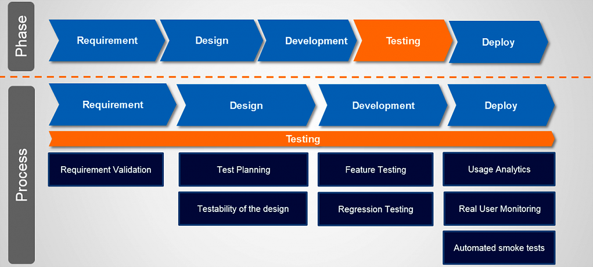
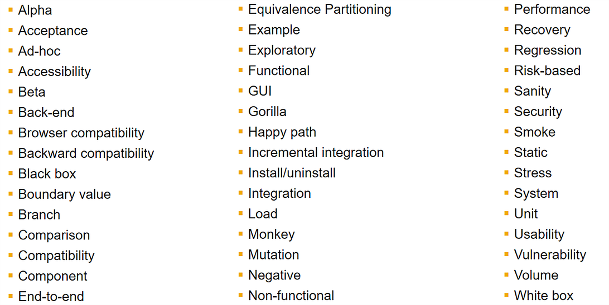
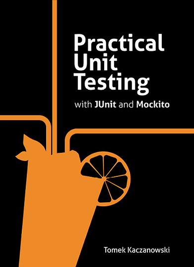

# Unit Testing & Mocking

2021-11-17

<p align="center">
  
</p>

---

### Last time we covered:

- Generics

---

### Today we will look at:

- How software is tested, and why it matters
- What unit testing is
- JUnit
- Test-Driven Development (TDD)
- Stubbing and mocking

---

### Why do we need to test our code?

> Chuck Norris doesn't need unit tests because his code always works. ALWAYS.
>
>&emsp;&emsp;&emsp;&emsp;— Wisdom of the Internet ;)

---

### When to test?

<p align="center">
  
</p>

---

### Testing is a process, not a phase

<p align="center">
  
</p>

---

### Main types of tests

- Manual
    - In professional software development, the absence of automated tests is effectively the absence of tests altogether

- Automated
    - functional
    - non-functional

---

### Main types of tests

- Functional tests
    - unit tests
    - integration tests

- Non-functional tests
    - performance tests
    - stress tests
    - crash tests
    - security tests
    - usability tests

---

### More types of tests

<p align="center">
  
</p>

---

### Unit Testing

- A unit test is code that executes a specific, "atomic" (indivisible in a meaningful way) piece of functionality
- A unit test targets a small fragment of code — typically one method or at most one class

---

### Unit Testing

- Unit tests verify that the code behaves as expected
- They ensure the code continues to work as expected when we modify it to fix a bug, refactor, or extend functionality

---

### A few definitions

- *Production code* (a.k.a. *code under test*) — the code that implements user requirements and satisfies client scenarios

- The percentage of production code exercised by automated tests is called *test coverage* or *code coverage*. High test coverage gives us confidence to develop new features without heavy manual testing

---

### A few definitions

- *Test-Driven Development* (TDD) is a methodology in which test code is written before production code, so that once a test passes ("goes green"), the corresponding use case is considered done
- A *test fixture* is a fixed state of the software under test that serves as the precondition for running the tests

---

### A few definitions

- An *integration test* tests the integration of several classes (components)
- A *performance test* measures the performance (efficiency) of software in a reproducible way

---

# JUnit

---

### JUnit Framework

- JUnit is the most popular and *de facto* standard testing framework in Java
- Open source project on [GitHub](https://github.com/junit-team/junit5)
- Current version: [JUnit 5](https://junit.org/junit5/)

<p align="center">
  
</p>

---

### Why do we need testing frameworks?

- They make it easier to write and run tests
- They standardise test development and maintenance

---

### JUnit

- JUnit is annotation-based
- Every JUnit test is a method annotated with `@Test`, contained in a class used exclusively for testing
- Such a class is called a *test case*

---

### A JUnit test example

```java
public class Calc {
    public int multiply(int a, int b) {
        return a * b;
    }
}
```

<br>

```java
import org.junit.jupiter.api.Test;

import static org.junit.jupiter.api.Assertions.assertEquals;

public class CalcTest {
    @Test
    void testMultiplyByZeroShouldReturnZero() {
        var calc = new Calc();
        assertEquals(0, calc.multiply(10, 0), "10 x 0 must be 0");
        assertEquals(0, calc.multiply(0, 10), "0 x 10 must be 0");
        assertEquals(0, calc.multiply(0, 0), "0 x 0 must be 0");
    }
}
```

---

### Naming conventions

- The test class name is conventionally derived from the class under test by adding the suffix `Test`
- A popular convention for test method names is to start with `test`, followed by the method name and a short description of the scenario, e.g. `testLoginWithInvalidUserPassword` — we follow this convention in the course
- The test name should clearly describe the scenario

---

### Static methods of the `Assertions` class

- JUnit provides static assertion methods in `org.junit.jupiter.api.Assertions`
- We will cover the most commonly used ones; all are available in the [documentation](https://junit.org/junit5/docs/current/api/org.junit.jupiter.api/org/junit/jupiter/api/Assertions.html)

---

### Static methods of the `Assertions` class

- `fail(String message)` — fails the test unconditionally
    - Useful to verify that certain code is unreachable, or as a placeholder for a test not yet written
- `assertTrue(boolean condition, String message)` — asserts the boolean condition is true
- `assertFalse(boolean condition, String message)` — asserts the boolean condition is false
- `assertNull(Object o, String message)` — asserts the object is null
- `assertNotNull(Object o, String message)` — asserts the object is not null
- `assertSame(expected, actual, String message)` — asserts both references point to the same object
- `assertNotSame(expected, actual, String message)` — asserts both references point to different objects

---

### Static methods of the `Assertions` class

- `assertEquals(expected, actual, String message)` — asserts two objects are equal
    - arrays are compared by reference, not by content
- `assertEquals(expected, actual, delta, String message)` — asserts equality of floating-point numbers within a delta tolerance
- `assertArrayEquals(expected, actual, String message)` — asserts two arrays are equal by length and content; both null is considered equal
- `assertIterableEquals(Iterable<?> expected, Iterable<?> actual, String message)` — (new in JUnit 5) asserts both `Iterable`s return the same elements in the same order; they do not need to be the same type (e.g. `LinkedList` vs `ArrayList`)

---

### Static methods of the `Assertions` class

- In all assert methods, the `String message` parameter is optional
- Best practice: always provide it with a specific, detailed, and meaningful message
- This is especially important when different developers write the production code and the tests

---

### JUnit annotations: `@Test`

```java
import static java.time.Duration.ofMillis;
import static org.junit.jupiter.api.Assertions.*;

public class InvestmentWalletTest {
    @Test
    void testDepositSuccessful() {
        assertEquals(5.0, wallet.deposit(5.0), 0.001, "If balance is 0, return the amount deposited");
    }

    @Test
    void testDepositNegativeAmount() {
        assertThrows(IllegalArgumentException.class, () -> wallet.deposit(-1.0),
            "Deposit amount cannot be negative");
    }

    @Test
    void testDepositPerformance() {
        assertTimeout(ofMillis(100), () -> wallet.deposit(1250.0),
            "Deposit too slow"); // "Deposit too slow ==> execution exceeded timeout of 100 ms by 33 ms"
    }
}
```

---

### JUnit lifecycle annotations: `@BeforeEach` and `@AfterEach`

```java
public class InvestmentWalletTest {

    @BeforeEach
    void setUp() {
        // runs before each test method
        // used to prepare the test environment
    }

    @AfterEach
    void tearDown() {
        // runs after each test method
        // used to clean up the test environment
    }
}
```

---

### JUnit lifecycle annotations: `@BeforeAll` and `@AfterAll`

```java
public class InvestmentWalletTest {

    @BeforeAll
    static void setUpTestCase() {
        // runs once before all tests start
        // used for (potentially expensive) environment initialisation
        // methods with this annotation must be static
    }

    @AfterAll
    static void tearDownTestCase() {
        // runs once after all tests finish
        // used to release resources created in @BeforeAll
        // methods with this annotation must be static
    }
}
```

---

### Test execution order

- JUnit assumes all test methods can run in any order
- Well-written tests must not depend on a specific execution order
    - i.e. tests must not depend on other tests

---

### Test execution order

- You can explicitly define the execution order using `@TestMethodOrder` at class level, for example via the `@Order` annotation on each test:

  ```java
  @TestMethodOrder(MethodOrderer.OrderAnnotation.class)
  public class OrderedTest {

      @Test
      @Order(3)
      void testNullValues() {} // will execute third

      @Test
      @Order(1)
      void testEmptyValues() {} // will execute first

      @Test
      @Order(2)
      void testValidValues() {} // will execute second
  }
  ```

---

### Test execution order

- You can also order tests lexicographically by method name using `MethodOrderer.MethodName.class`:

  ```java
  @TestMethodOrder(MethodOrderer.MethodName.class)
  public class OrderedTest {

      @Test
      void testNullValues() {} // will execute second

      @Test
      void testEmptyValues() {} // will execute first

      @Test
      void testValidValues() {} // will execute third
  }
  ```

---

### JUnit: advanced features

- Test classes and methods can be grouped semantically into *test suites*
- Tests can be temporarily disabled with the `@Disabled` annotation
- Tests can be conditionally executed based on environmental conditions using *assumptions*
- Human-friendly names can be given to test classes and/or methods with `@DisplayName`
- A test can be run repeatedly using `@RepeatedTest`
- *Parameterised* and *dynamic* tests are supported

---

### Where do unit tests live?

- Unit tests are usually placed in a separate project or a separate source directory to keep them apart from production code
- There is no single universal standard — it depends on which other tools (e.g. build tools) you want to integrate with

---

### Where do unit tests live?

- Maven layout

  ```bash
  fancy-project
      ├─ src/main/java
      │   └─ (...)
      └─ src/test/java
          └─ (...)
  ```

- Alternative layout

  ```bash
  fancy-project
      ├─ src
      │   └─ (...)
      └─ test
          └─ (...)
  ```

---

### How are tests run?

- Via IDE
- Via the command line
- Via build systems (Maven, Gradle)
- Via Continuous Integration (CI) systems (Jenkins, GitHub Actions)
- For now, we will run them from the IDE

---

### Code coverage plug-ins

- [Code coverage runner](https://www.jetbrains.com/help/idea/code-coverage.html) for IntelliJ IDEA
- [EclEmma](https://www.eclemma.org/) for Eclipse
    - based on the open source [JaCoCo](https://www.jacoco.org/jacoco/) project

---

### Best practices

- Do not test trivial code such as getters/setters
- Test `private` methods only indirectly
- Aim for 70–80% code coverage
- Write short, clear, and fast unit tests

---

# JUnit 4 vs. JUnit 5

The main differences, migration steps, and advantages of the new version can be found [here](https://blogs.oracle.com/javamagazine/post/migrating-from-junit-4-to-junit-5-important-differences-and-benefits)

---

# Stubbing and Mocking

---

### Unit testing classes with dependencies

- A class often uses other classes: it has member fields that are references to objects of another class
- This is called *class composition*
- It is completely expected and normal :)
- How do we unit test such classes?
- Let's look at an example

---

### Unit testing classes with dependencies

```java
public class UserService {

    private UserRepository repository;

    public User register(String email, String password) {
        if (repository.exists(email)) {
            throw new UserAlreadyExistsException();
        }

        User user = new User(email, password);
        repository.save(user);
        return user;
    }

}
```

---

### Unit testing classes with dependencies

- Let `UserRepository` be an interface responsible for storing `User` objects (in-memory, file system, database, etc.)
- Let `UserService` be a class that manages `User` objects and contains the business logic of our application

---

### Test cases for `register()`

- The `register()` method has 2 exit points — so we have 2 scenarios to cover
- [TC1] `register()` throws an appropriate exception when the email address already exists in the repository
- [TC2] `register()` saves the appropriate user in the repository when the email address does not exist
- How do we unit test the `UserService` class?

---

### Unit testing classes with dependencies

- In unit testing we are only interested in the functional correctness of the class under test
- We need tools to "isolate" the composed classes
- Composed classes can be hard to instantiate
- For example, `UserRepository` requires connectivity to a database

---

### Unit testing classes with dependencies

- Good unit testing is based on isolation
- Isolation is achieved through so-called *stub* or *mock* objects

---

### Stubbing

- A *stub* is a class that responds to given method calls with pre-defined answers
- In unit testing they help us deal with the composed-class problem

---

### Stubbing

- Stubs usually implement an interface in a minimal way and are passed to the class under test
- Outside unit testing, they can also serve as placeholders for code not yet developed

---

### `PositiveUserRepositoryStubImpl`

```java
public class PositiveUserRepositoryStubImpl implements UserRepository {

    @Override
    public boolean exists(String email) {
        return true;
    }

    @Override
    public void save(User user) {
        // Do nothing
    }
}
```

---

### `InMemoryUserRepositoryStubImpl`

```java
public class InMemoryUserRepositoryStubImpl implements UserRepository {

    private Map<String, User> users = new HashMap<>();

    @Override
    public boolean exists(String email) {
        return users.containsKey(email);
    }

    @Override
    public void save(User user) {
        users.put(user.getEmail(), user);
    }

}
```

---

### The stub way

```java
@Test
public void testRegisterThrowsAppropriateException() {
    var service = new UserService(new PositiveUserRepositoryStubImpl());

    assertThrows(UserAlreadyExistsException.class, () -> service.register("test@test.com", "weak"),
            "UserAlreadyExistsException expected");
}
```

---

### Stub testing lifecycle

1. **Setup data** — prepare the object under test and its stub collaborators
2. **Exercise** — invoke the method we want to test
3. **Verify state** — use assertions to verify the object's state
4. **Teardown** — release any used resources

---

### Characteristics of stubs

- Can contain non-trivial logic (e.g. `InMemoryUserRepositoryStubImpl`) (+)
- The number of stubs grows exponentially (-)
- Cannot verify whether a given method on the stub was called a certain number of times (-)

---

### Mocking

- A *mock* is a configured object with pre-defined answers to given method calls
- Mocks are dynamic wrappers for composed classes
- Like stubs, they help us deal with the composed-class problem

---

### The mock way

```java
@Test
public void testRegisterThrowsAppropriateException() {
    UserRepository mock = mock(UserRepository.class);
    when(mock.exists("test@test.com")).thenReturn(true);

    var service = new UserService(mock);

    assertThrows(UserAlreadyExistsException.class, () -> service.register("test@test.com", "weak"),
        "UserAlreadyExistsException expected");
}
```

---

### Mock testing lifecycle

1. **Setup data** — prepare the object under test and its mock collaborators
2. **Setup expectations** — configure the desired responses
3. **Exercise** — invoke the method we want to test
4. **Verify expectations** — assert that the correct methods on the mock were called
5. **Verify state** — use assertions to verify the object's state
6. **Teardown** — release any used resources

---

### To mock or not to mock?

```java
public class Cinema {
    private Map<String, Projection> projections;

    public Cinema(Map<String, Projection> projections) {
        this.projections = projections;
    }

    public boolean buyTicket(String projection, int amount) {
        if (!projections.containsKey(projection)) {
            return false;
        }
        // [...]
        return true;
    }

}
```

---

### Do not mock

```java
@Test
public void testBuyTicket() {
    var projections = Map.of("foo", new Projection("foo"));
    var cinema = new Cinema(projections);

    boolean actual = cinema.buyTicket("bar", 3);
    assertFalse(actual);
}
```

---

### To mock or not to mock?

```java
public class Cinema {
    private ProjectionService service;

    public Cinema(ProjectionService service) {
        this.service = service;
    }

    public boolean buyTicket(String projection, int amount) {
        if (!service.contains(projection)) {
            return false;
        }
        // [...]
        return true;
    }
}
```

---

### Mock

```java
@Test
public void testBuyTicket() {
    ProjectionService mock = mock(ProjectionService.class);
    when(mock.contains("bar")).thenReturn(false);

    var cinema = new Cinema(mock);

    boolean actual = cinema.buyTicket("bar", 3);
    assertFalse(actual);
}
```

---

### Use mocks when:

- The composed class accesses an external resource (network, database, file system, etc.)
- The logic in the composed class is non-trivial
- Setting up the test environment is not trivial

---

### Do not use mocks when:

- The composed class is a value object that can be passed in directly
- The test environment can be set up trivially

---

### Mocking libraries

- [Mockito](https://github.com/mockito/mockito)
- [EasyMock](https://github.com/easymock/easymock)
- [PowerMock](https://github.com/powermock/powermock)
    - *Putting it in the hands of junior developers may cause more harm than good.*

---

### Mockito

- We will use Mockito (4.x) as our mocking library
- It originated as an extension of EasyMock's functionality
- One of the 10 most popular Java libraries overall
- Open-source

<p align="center">
  
</p>

---

### Setup

- Mockito is an external library
- Download it from [Maven Central](https://mvnrepository.com/artifact/org.mockito/mockito-core/4.0.0)
- Download the `mockito-core` jar and its 3 dependencies, as well as [mockito-junit-jupiter](https://mvnrepository.com/artifact/org.mockito/mockito-junit-jupiter/4.0.0)
- If using an IDE, add these jars to your project's classpath
- Alternatively, use Maven or Gradle (recommended)

---

### Setup

```bash
fancy-project
    ├─ src/
    │   └─ (...)
    ├─ test/
    │   └─ (...)
    └─ lib/
        ├─ byte-buddy-1.12.1.jar
        ├─ byte-buddy-agent-1.12.1.jar
        ├─ mockito-junit-jupiter-4.0.0.jar
        ├─ mockito-core-4.0.0.jar
        └─ objenesis-3.2.jar
```

---

### `mock()` and `verify()`

```java
import static org.mockito.Mockito.*;

List<String> mockedList = mock(List.class);

mockedList.add("one");
mockedList.clear();
mockedList.get(0);

verify(mockedList).add("one");
verify(mockedList, atLeastOnce()).clear();
verify(mockedList, never()).add("two");
```

---

### `when()`

```java
LinkedList<String> mockedList = mock(LinkedList.class);

when(mockedList.get(0)).thenReturn("first");
when(mockedList.get(1)).thenThrow(new RuntimeException());

mockedList.get(0);
mockedList.get(1);
```

---

### Argument matchers

```java
when(mockedList.get(anyInt())).thenReturn("element");

mockedList.get(999);
```

---

### The `@Mock` annotation

```java
@ExtendWith(MockitoExtension.class)
public class UserServiceTest {
    @Mock
    private UserRepository repositoryMock;

    @Test
    public void testRegisterThrowsAppropriateException() {
        when(repositoryMock.exists("test@test.com")).thenReturn(true);

        var service = new UserService(repositoryMock);

        assertThrows(UserAlreadyExistsException.class, () -> service.register("test@test.com", "weak"),
            "UserAlreadyExistsException expected");
    }
}
```

---

### Best practices

- Do not create test class hierarchies
- Mock only what is needed for the specific test
- Do not mock value objects
- Keep it short and simple (KISS)
- Redesign when you cannot test it

---

### Further reading

- [JUnit 5 User Guide](https://junit.org/junit5/docs/current/user-guide/index.html)
- [JUnit 5 Javadoc](https://junit.org/junit5/docs/current/api/)
- [Unit Testing with JUnit](http://www.vogella.com/tutorials/JUnit/article.html)
- [Mocks aren't stubs](https://martinfowler.com/articles/mocksArentStubs.html) by Martin Fowler
- [Writing good tests](https://github.com/mockito/mockito/wiki/How-to-write-good-tests) by Mockito team

---

### Further reading

<p align="center">
  
</p>
