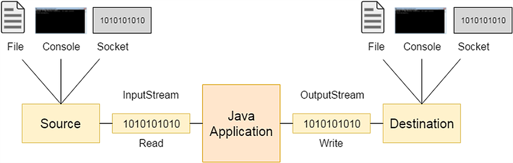
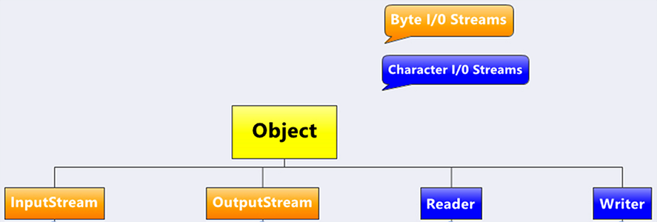
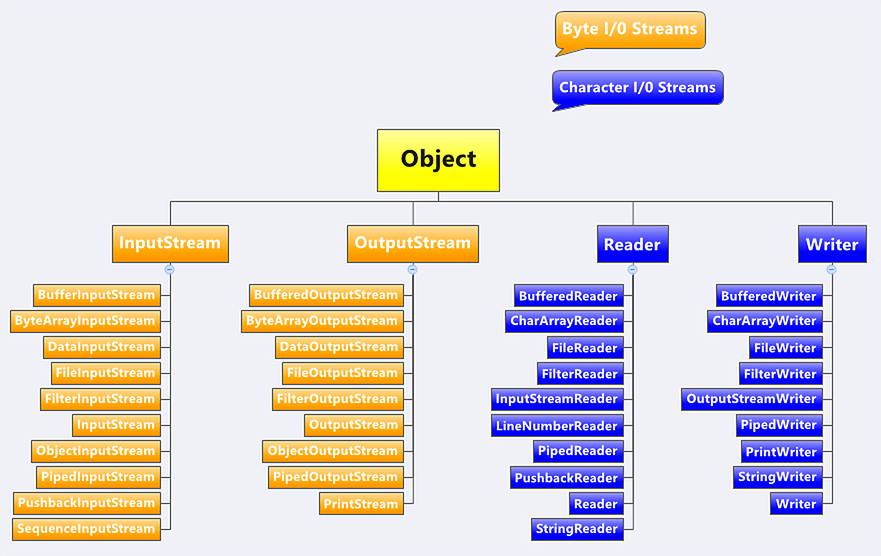
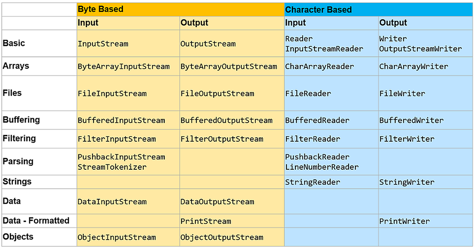
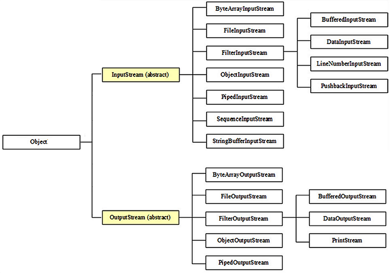
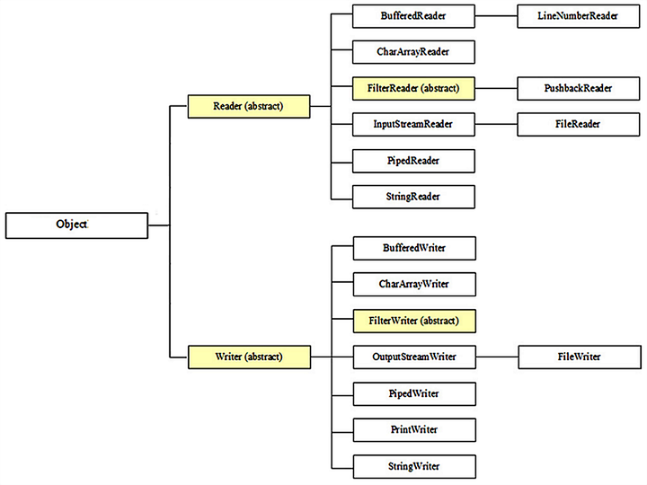
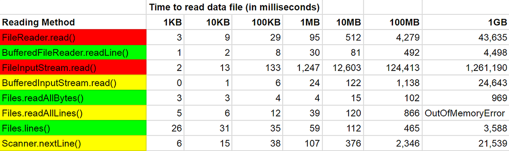
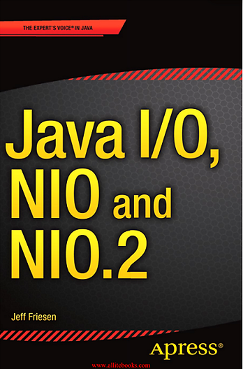

# I/O Streams and File System

2021-11-24

<p align="center">
  
</p>

---

### Previously, we covered:

- How software is tested and why it matters
- What unit testing is
- JUnit
- Stubbing and mocking
- Mockito

---

### Today, we will explore:

- I/O streams
- Working with the file system

---

### What is a production line?

<p align="center">
  
</p>

---

### I/O Streams

- The concept of input/output in Java is based on *streams*
- A *stream* is an abstraction for an infinite flow of data
- Data can be read from a stream or written to a stream
- In Java, streams can be byte-based or character-based

---

### Data Source and Data Destination

<br>

<p align="center">
  
</p>

---

### Abstract Classes at the Root of the I/O Hierarchy

<br>

<p align="center">
  
</p>

Located in the `java.io` package.

---

### I/O Streams: by Data Source / Destination

The abstract classes `InputStream`, `OutputStream`, `Reader`, and `Writer` have many subclasses, each created for different purposes:

- File access
- Network access
- In-memory buffer access
- Inter-thread communication (Pipes)

---

### I/O Streams: by Additional Capabilities

- Reading and writing text
- Reading and writing primitive data types
- Reading and writing objects
- Parsing
- Buffering
- Compression
- Encryption

---

### Types of Streams

<p align="center">
  
</p>

---

### Types of Streams by Use Case

<p align="center">
  
</p>

---

### Types of Byte Streams

<p align="center">
  
</p>

---

### Types of Character Streams

<p align="center">
  
</p>

---

### I/O Stream Lifecycle

Streams are:

- Created
- Used
- Closed

---

### Wrapping Lower-Level I/O Streams into Higher-Level Ones

More specialised I/O stream types:

- are often created as wrappers around more basic stream types
- and add capabilities such as buffering, filtering, or higher-level abstraction
- For this reason, most streams have overloaded constructors that accept a stream as an argument

<br>

Calling `.close()` on a wrapper stream automatically closes the streams it wraps.

---

### Byte Streams vs. Character Streams for Character Processing

- **Byte Streams** — operate on "atomic" units of up to 8 bits (1 byte)
- **Character Streams** — operate on "atomic" units (characters) of up to 16 bits (2 bytes)

---

### Byte Streams — Example

```java
InputStream in = new ByteArrayInputStream("Ivan / Спасов".getBytes());

int current;
while ((current = in.read()) != -1) {
    // read() reads the next byte from the input stream.
    // The byte value is returned as an int in the range 0 to 255.
    // If no byte is available because the end of the stream
    // has been reached, -1 is returned.
    System.out.print((char) current);
}

in.close();

// output:
// Ivan / СпаÑов
```

---

### Byte Streams — Encoding Details

- A Latin-alphabet character fits in up to 8 bits
- A Cyrillic character requires more than 8 bits
- `'I'` = 73₁₀ = 01001001₂ — 7 bits, padded to 1 byte with leading zeros
- `'С'` = 1057₁₀ = 10000100001₂ — 11 bits

---

### Character Streams — Example

```java
Reader in = new InputStreamReader(new ByteArrayInputStream("Ivan / Спасов".getBytes()));

int current;
while ((current = in.read()) != -1) {
    System.out.print((char) current);
}

in.close();

// output:
// Ivan / Спасов
```

---

### Example with `InputStream`

```java
InputStream inputStream = new FileInputStream("c:\\data\\input-text.txt");

int data;
while ((data = inputStream.read()) != -1) {
    // doSomethingWithData(data);
}

inputStream.close();
```

---

### `java.io.InputStream`

```java
int          available();
void         close();
void         mark(int readlimit);
boolean      markSupported();
abstract int read();
int          read(byte[] b);
int          read(byte[] b, int off, int len);
byte[]       readAllBytes();
int          readNBytes(byte[] b, int off, int len);
void         reset();
long         skip(long n);
long         transferTo(OutputStream out);
```

---

### `java.io.OutputStream`

```java
void          close();
void          flush();
void          write(byte[] b);
void          write(byte[] b, int off, int len);
abstract void write(int b);
```

---

### Example with `OutputStream`

```java
OutputStream os = new FileOutputStream("test.txt");

os.write("Hello FMI!".getBytes());
os.flush();
os.close();
```

<br>

When constructing a `FileOutputStream`, if the file does not exist, an attempt is made to create it.

---

### `FileOutputStream`: append vs. overwrite

```java
// appends to a file
OutputStream output = new FileOutputStream("c:\\data\\output-text.txt", true);

// overwrites a file
OutputStream output = new FileOutputStream("c:\\data\\output-text.txt", false);
```

---

### Example with `DataInputStream`

```java
DataInputStream input = new DataInputStream(new FileInputStream("binary.data"));

int    aByte   = input.read();
int    anInt   = input.readInt();
float  aFloat  = input.readFloat();
double aDouble = input.readDouble();
// etc.

input.close();
```

---

### Example with `ObjectOutputStream`

```java
ObjectOutputStream objectOutputStream =
        new ObjectOutputStream(new FileOutputStream("persons.dat"));

Person object = new Person();
objectOutputStream.writeObject(object);
objectOutputStream.close();
```

---

### `java.io.Serializable`

`Serializable` is a marker interface indicating that instances of a class can be *serialised* (converted to a sequence of bytes) and *deserialised* (reconstructed from a sequence of bytes). Classes whose objects will be written to or read from a file, or sent/received over a network, must be `Serializable`.

---

### `java.io.Serializable`

```java
import java.io.Serializable;

public class Person implements Serializable {
    // the particular version of the class definition is identified by
    // the serial version unique identifier: IDEs can generate these
    private static final long serialVersionUID = 1234L;

    private String name;
    private int age;

    public Person(String name, int age) {
        this.name = name;
        this.age = age;
    }
}
```

---

### Is there a problem in this code?

```java
InputStream inputStream = new FileInputStream("c:\\data\\input.txt");

int data;
while ((data = inputStream.read()) != -1) {
    // doSomethingWithData(data);
}

inputStream.close();
```

---

### What about here?

```java
InputStream input = null;
try {

    input = new FileInputStream("c:\\data\\input.txt");
    int data;
    while ((data = input.read()) != -1) {
        // doSomethingWithData(data);
    }

} catch (IOException e) { // do something with e...

} finally {

    if (input != null) {
        input.close();
    }

}
```

---

### Try-with-resources

- A `try` block that declares one or more resources and automatically closes each resource at the end of the block
- A resource can be any object whose class implements the `java.lang.AutoCloseable` interface (which includes all classes implementing `java.io.Closeable`)

---

### Try-with-resources Example

```java
static String readFirstLineFromFile(String path) throws IOException {

    try (BufferedReader br = new BufferedReader(new FileReader(path))) {
        return br.readLine();
    }

}
```

<br>

Whatever is declared in the parentheses after `try` is automatically `.close()`d when the `try` block exits.

---

### `java.io.Reader`

```java
abstract void close();
void          mark(int readAheadLimit);
boolean       markSupported();
int           read();
int           read(char[] cbuf);
abstract int  read(char[] cbuf, int off, int len);
int           read(CharBuffer target);
boolean       ready();
void          reset();
long          skip(long n);
```

---

### `java.io.Writer`

```java
Writer        append(char c);
Writer        append(CharSequence csq);
Writer        append(CharSequence csq, int start, int end);
abstract void close();
abstract void flush();
void          write(char[] cbuf);
abstract void write(char[] cbuf, int off, int len);
void          write(int c);
void          write(String str);
void          write(String str, int off, int len);
```

---

### Example with `BufferedReader`

```java
try (var bufferedReader = new BufferedReader(new FileReader("data/data.txt"))) {
    String line;
    while ((line = bufferedReader.readLine()) != null) {
        // process line
    }
}
```

---

### Line Separator in Text Files

Different operating systems use different characters or sequences to mark end-of-line in a text file:

- Windows: `\r\n`
- UNIX/Linux: `\n`
- macOS: `\n` (`\r` before macOS X)

To ensure your Java code works correctly on any OS, use one of:

- `System.lineSeparator()`, or
- `PrintWriter.println()`, or
- `BufferedWriter.newLine()`

---

### The Three System Streams

- `System.in`  (`InputStream`)
- `System.out` (`PrintStream`)
- `System.err` (`PrintStream`)

---

### `java.util.Scanner`

```java
Scanner scanner = new Scanner(System.in);
int i = scanner.nextInt();
String str = scanner.nextLine();
// [...]
```

---

### `java.util.Formatter`

```java
StringBuilder sb = new StringBuilder();
// Send all output to the Appendable object sb
Formatter formatter = new Formatter(sb, Locale.US);

// Explicit argument indices may be used to re-order output.
formatter.format("%4$2s %3$2s %2$2s %1$2s", "a", "b", "c", "d");
// -> " d  c  b  a"

// Optional locale as the first argument can be used to get
// locale-specific formatting of numbers. The precision and width
// can be given to round and align the value.
formatter.format(Locale.FRANCE, "e = %+10.4f", Math.E);
// -> "e =    +2,7183"
```

---

### `java.util.Formatter` (continued)

```java
// The '(' numeric flag may be used to format negative numbers
// with parentheses rather than a minus sign. Group separators
// are automatically inserted.
formatter.format("Amount diff since last statement: $ %(,.2f", balanceDelta);
// -> "Amount diff since last statement: $ (6,217.58)"

// Writes a formatted string to System.out
System.out.format("Local time: %tT", Calendar.getInstance());
// -> "Local time: 13:34:18"

// Writes formatted output to System.err
System.err.printf("Unable to open file '%1$s': %2$s", fileName, exception.getMessage());
// -> "Unable to open file 'food': No such file or directory"
```

---

## Questions?

---

### The File System

- Hierarchical structure
- Consists of directories and files
- Root directory
- Current (working) directory
- Paths
    - Relative
    - Absolute
- Symbolic links

---

### Java API for Working with the File System

NIO.2 (NIO = Non-blocking I/O)

- Package [`java.nio.file`](https://docs.oracle.com/en/java/javase/17/docs/api/java.base/java/nio/file/package-summary.html)
    - [`java.nio.file.Path`](https://docs.oracle.com/en/java/javase/17/docs/api/java.base/java/nio/file/Path.html)
    - [`java.nio.file.Files`](https://docs.oracle.com/en/java/javase/17/docs/api/java.base/java/nio/file/Files.html)

---

### `java.nio.file.Path`

```java
// Path represents a file or directory location.
// The file or directory may or may not actually exist on disk.
// Instances are created via static factory methods on Path (since Java 11)
// or on the legacy Paths class.

Path pathToUserHomeDir = Path.of("C:\\Users\\joe");          // C:\Users\joe
Path pathToAFile       = Path.of("C:\\Users\\joe\\orders.txt"); // C:\Users\joe\orders.txt
Path relPathToAFile    = Path.of("Users", "joe", "orders.txt"); // Users\joe\orders.txt

Path linuxPathToAFile  = Paths.get("/home", "joe", "file.txt"); // /home/joe/file.txt
Path linuxRelativePath = Paths.get("documents", "FileIO.odp");  // documents/FileIO.odp
```

---

### `java.nio.file.Path` — Separators

- The default name separator in paths is OS-dependent:
    - UNIX, Linux, and macOS: forward slash `/`
    - Windows: backslash `\\`
- It can be obtained in Java code via `File.separator` or `FileSystem.getSeparator()`

---

### `java.nio.file.Path`

| Method         | Returns on UNIX/Linux | Returns on Windows |
|:---------------|:----------------------|:-------------------|
| toString()     | /home/joe/foo         | C:\home\joe\foo    |
| getFileName()  | foo                   | foo                |
| getName(0)     | home                  | home               |
| getNameCount() | 3                     | 3                  |
| subpath(0, 2)  | home/joe              | home\joe           |
| getParent()    | /home/joe             | \home\joe          |
| getRoot()      | /                     | C:\                |

---

### `java.nio.file.Path`: Conversions

```java
// Converts the path to an absolute path (starting from the root directory).
Path toAbsolutePath()

// Converts the path to a real path:
//   - absolute
//   - symbolic links resolved
//   - . and .. removed
Path toRealPath()

// Appends a relative path to this path.
Path resolve(Path anotherPath)

Path p1 = Paths.get("/home/joe/foo");
Path p2 = p1.resolve("bar"); // result: /home/joe/foo/bar
```

---

### `java.nio.file.Path`: Comparison

```java
boolean equals(Path anotherPath)
boolean startsWith(Path anotherPath)
boolean endsWith(Path anotherPath)
```

---

### Legacy: `java.io.File`

A file descriptor analogous to `java.nio.file.Path`, present in Java versions before 7.  
Still used in many APIs.

<br>

```java
// creation
File absoluteFile = new File("c:\\Users\\joe\\file.txt");
File absoluteFile = new File("c:\\Users\\joe", "file.txt");
File parentFile   = new File("c:\\Users\\joe");
File absoluteFile = new File(parentFile, "file.txt");
URI  fileUri      = URI.create("file:///home/joe/file.txt");
File absoluteFile = new File(fileUri);

// conversion to and from java.nio.file.Path
Path absolutePath = absoluteFile.toPath();
File absoluteFile = absolutePath.toFile();
```

---

### `java.nio.file.Files`: Metadata

```java
long size(Path path)

boolean isRegularFile(Path path)
boolean isDirectory(Path path)
boolean isSymbolicLink(Path path)
boolean isHidden(Path path)

FileTime getLastModifiedTime(Path path)
FileTime setLastModifiedTime(Path path, FileTime time)

UserPrincipal getOwner(Path path)

Object getAttribute(Path path, String attribute)
Path   setAttribute(Path path, String attribute, Object value)
```

---

### `java.nio.file.Files`: Other Checks

```java
boolean exists(Path path)
boolean notExists(Path path)
boolean isReadable(Path path)
boolean isWritable(Path path)
boolean isExecutable(Path path)
boolean isSameFile(Path path1, Path path2)
```

---

### `java.nio.file.Files`: Deleting Files and Directories

```java
void delete(Path path)
// throws NoSuchFileException if path does not exist
// throws DirectoryNotEmptyException if path is a non-empty directory

boolean deleteIfExists(Path path)
// returns false if path does not exist
// throws DirectoryNotEmptyException if path is a non-empty directory
```

---

### `java.nio.file.Files`: Copying Files and Directories

```java
Path copy(Path source, Path target, CopyOption... options)

// Directory contents are not copied.
// options can be one or more of:
//    StandardCopyOption.COPY_ATTRIBUTES
//        — copies file/directory attributes such as last-modified time
//    StandardCopyOption.REPLACE_EXISTING
//        — if target is an existing file, it is overwritten
//          instead of throwing FileAlreadyExistsException
```

---

### `java.nio.file.Files`: Moving / Renaming Files and Directories

```java
Path move(Path source, Path target, CopyOption... options)

// A directory can only be moved within the same file system.
// options can be one or more of:
//    StandardCopyOption.ATOMIC_MOVE
//        — the move is atomic; if not possible,
//          AtomicMoveNotSupportedException is thrown
//    StandardCopyOption.REPLACE_EXISTING
//        — if target is an existing file, it is overwritten
//          instead of throwing an exception
```

---

### `java.nio.file.Files`: Creating Directories

```java
Path createDirectory(Path dir)
// creates a directory at path dir,
// provided the parent directory already exists

Path createDirectories(Path dir)
// creates a directory at path dir,
// creating any missing parent directories as needed
```

---

### `java.nio.file.Files`: Iterating a Directory

```java
DirectoryStream<Path> newDirectoryStream(Path dir)
// creates a stream from which the files and subdirectories
// of directory dir can be read as Path instances.
// DirectoryStream resembles a collection (it extends Iterable)
// rather than an I/O stream.

Path dir = Path.of("/somedir");
try (DirectoryStream<Path> stream = Files.newDirectoryStream(dir)) {

    for (Path fileOrSubDir : stream) {
        // use fileOrSubDir
    }

} catch (IOException | DirectoryIteratorException e) {
    // handle exceptions
}
```

---

### Iterating a Directory with Glob Patterns

```java
DirectoryStream<Path> newDirectoryStream(Path dir, String glob)
// creates a stream containing only files and subdirectories
// that match the glob pattern.
// For example, iterate all .java files:

Path dir = Path.of("/somedir");

try (DirectoryStream<Path> stream = Files.newDirectoryStream(dir, "*.java")) {
    // [...]
}
```

---

### Glob Patterns (Wildcards)

| Pattern                 | Semantics                                                                             |
|:------------------------|:--------------------------------------------------------------------------------------|
| `*`                     | matches any number of characters (including none) within a single path element        |
| `**`                    | like `*`, but crosses path element boundaries (can match `/` or `\\`)                 |
| `?`                     | matches exactly one character                                                         |
| `{s1, …, sN}`           | matches any of the sub-patterns                                                       |
| `[c1...cN]`             | matches any of the listed characters                                                  |
| `[c1-c2]`               | matches any character in the range from c1 to c2                                      |
| `[!c]`                  | matches any character except c                                                        |
| `\`                     | escapes special characters, including `\\`                                            |
| any other character     | matches itself                                                                        |

---

### Glob Pattern Examples

| Pattern          | Semantics                                                         |
|:-----------------|:------------------------------------------------------------------|
| `/home/*/file`   | matches `/home/joe/file` but not `/home/joe/work/file`            |
| `/home/**/file`  | matches `/home/joe/work/file` (and others)                        |
| `{temp*, tmp*}`  | matches any name starting with `temp` or `tmp`                    |
| `[fmi]`          | matches one of the letters `f`, `m`, or `i`                       |
| `[fF]`           | matches `f` or `F`                                                |
| `[!a].txt`       | matches one character that is not `'a'`, followed by `.txt`       |
| `\\`             | matches a single backslash                                        |
| `alabala`        | matches the literal string `alabala`                              |

---

### Reading or Writing an Entire File with `java.nio.file.Files`

```java
// Suitable for small files. For larger ones, use buffered streams.
byte[]       readAllBytes(Path file);
List<String> readAllLines(Path file, Charset cs);

Path write(Path file, byte[] bytes, OpenOption... options);
Path write(Path path, Iterable<? extends CharSequence> lines, Charset cs, OpenOption... options);

// Read/write entire file as a String (since Java 11, UTF-8 by default)
String readString(Path file);
String readString(Path file, Charset cs);

Path writeString(Path file, CharSequence lines, OpenOption[] options);
Path writeString(Path file, CharSequence lines, Charset cs, OpenOption[] options);
```

---

### File Reading Performance Comparison

<p align="center">
  
</p>

---

### Walking a Directory Tree

```java
// Walk a directory tree recursively and process each path
try (Stream<Path> paths = Files.walk(Path.of("/somedir"))) {
    paths.filter(Files::isRegularFile)
         .forEach(System.out::println);
}

// Find files matching a predicate (like glob, but more flexible)
try (Stream<Path> paths = Files.find(Path.of("/somedir"), Integer.MAX_VALUE,
        (path, attrs) -> attrs.isRegularFile() && path.toString().endsWith(".java"))) {
    paths.forEach(System.out::println);
}
```

---

### Other Interesting Java I/O APIs

- Free disk space information
- Temporary files and directories
- Advanced filtering streams
    - Inflater/Deflater streams
        - Working with ZIP files
    - Encrypting/decrypting streams

---

### Free Disk Space Information

- A *partition* is an OS-specific portion of storage with a file system
- Determining available disk space is important for some applications (e.g. installers)
- Java provides an OS-independent API via `FileSystems` and `FileStore` in `java.nio.file`

  ```java
  // iterate all partitions of the default file system
  Iterable<FileStore> partitions = FileSystems.getDefault().getFileStores();
  for (FileStore fs : partitions) {
      System.out.println("Partition: " + fs.name());
      System.out.println("Total space: " + fs.getTotalSpace());
      System.out.println("Unallocated space: " + fs.getUnallocatedSpace());
      System.out.println("Usable space: " + fs.getUsableSpace());
  }
  ```

---

### Temporary Files and Directories

`java.nio.file.Files` contains static utility methods for working with temporary files and directories.

<br>

```java
// creates a new empty file in dir with a name starting with prefix and ending with suffix
Path createTempFile(Path dir, String prefix, String suffix, FileAttribute<?>... attrs)

// creates a new empty file in the system temp directory
Path createTempFile(String prefix, String suffix, FileAttribute<?>... attrs)

// creates a new subdirectory in dir with a name starting with prefix
Path createTempDirectory(Path dir, String prefix, FileAttribute<?>... attrs)

// creates a new subdirectory in the system temp directory
Path createTempDirectory(String prefix, FileAttribute<?>... attrs)
```

---

### Inflater/Deflater Streams — Working with ZIP Files

Classes for working with ZIP files are in the `java.util.zip` package.

- `ZipFile` — reads and interacts with `ZipEntry` instances in a ZIP archive
- `ZipEntry` — abstraction for an element (file or directory) in a ZIP archive
- `ZipInputStream` — subclass of `InflaterInputStream` → `FilterInputStream` → `InputStream`; reads entries from a ZIP file
- `ZipOutputStream` — subclass of `DeflaterOutputStream` → `FilterOutputStream` → `OutputStream`; writes entries to a ZIP file

---

### Encrypting and Decrypting Streams

- Classes are in the `javax.crypto` package and form the *Java Cryptographic Extension (JCE) framework*
- Key classes:
    - `Cipher` — represents a cryptographic cipher; supports algorithms such as AES, DES, RSA
    - `CipherInputStream` — subclass of `FilterInputStream` → `InputStream`
    - `CipherOutputStream` — subclass of `FilterOutputStream` → `OutputStream`

---

### How to Unit-Test Code That Works with Files?

- Bundle static test files with the test project
- Dynamically create test files before tests run and delete them afterwards
- Replace direct file I/O (file streams) with other I/O streams (e.g. `ByteArrayInputStream` or `StringReader`)
    - This usually requires refactoring, but is the safest and simplest approach

---

### Clean Code Principles for Stream and File Code

- Always close resources (streams, files) you create — guaranteed
- Use try-with-resources whenever possible
- Use `var` (judiciously)

  ```java
  var input = new ByteArrayInputStream("Shorter is better".getBytes());
  ```

---

### Summary

Java offers a rich variety of APIs for working with the file system.  
They differ in their target scenarios, trade-offs between flexibility, performance, and complexity of use.

<br>

<p align="center">
  
</p>

<small>APIs ordered from simpler to more complex</small>

---

### Further Reading

<p align="center">
  
</p>
