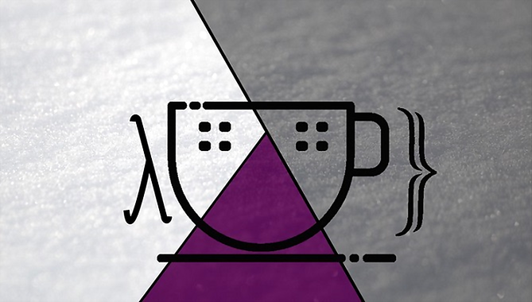
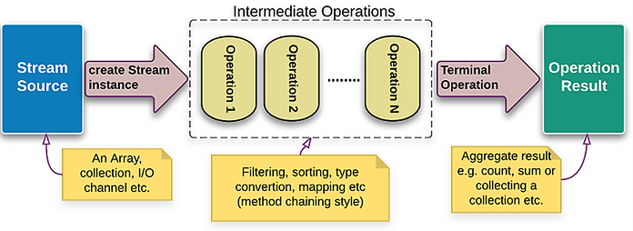

# Lambda Expressions and Stream API

2021-12-01

<p align="center">
  
</p>

---

### Last Lecture: I/O Streams and Files

- Input/output streams
- Working with the file system

---

### Today's Topics

- Lambda expressions
- Stream API

---

### Functional Interfaces

- A *functional interface* is an interface with exactly one abstract method
- Also known as *SAM interfaces* (Single Abstract Method)
- Can have any number of static or `default` methods in addition to the single abstract one
- May be annotated with the optional `@FunctionalInterface` annotation

---

### Motivation: Named Comparator Class

```java
public class NamesSorter {
    public static void main(String[] args) {
        List<String> names = List.of("Peter", "Anna", "Mike", "Xenia");
        Collections.sort(names, new NamesComparator());
        System.out.println(names);
    }
}

class NamesComparator implements Comparator<String> {
    @Override
    public int compare(String o1, String o2) {
        return o1.compareTo(o2);
    }
}

// A separate class is required just to implement the SAM interface
```

---

### Motivation: Anonymous Inner Class

```java
// An anonymous inner class reduces the boilerplate,
// but is still verbose
public class NamesSorter {
    public static void main(String[] args) {
        List<String> names = List.of("Peter", "Anna", "Mike", "Xenia");
        Collections.sort(names, new Comparator<String>() {
            @Override
            public int compare(String a, String b) {
                return a.compareTo(b);
            }
        });
        System.out.println(names);
    }
}
// Can we pass just a function definition as an argument?
```

---

### Motivation: Lambda Expression

```java
Collections.sort(names, new Comparator<String>() {
    @Override
    public int compare(String a, String b) {
        return a.compareTo(b);
    }
});

// define just the function
Collections.sort(names, (String a, String b) -> {
    return a.compareTo(b);
});

// omit {} and return
Collections.sort(names, (String a, String b) -> a.compareTo(b));

// infer argument types
Collections.sort(names, (a, b) -> a.compareTo(b));
```

---

### Lambda Expression

- A function that has no name and is not a method of a class is called a *lambda function* or *lambda expression*
- The term comes from the lambda calculus — a universal model of computation introduced by Alonzo Church in the 1930s

---

### Lambda Expressions: Syntax

`parameters -> body`

- The parameter list is enclosed in parentheses; parameters are comma-separated; it may be empty `()`
- Parameter types can be:
    - explicitly stated
    - inferred: via `var` or omitted entirely
- When there is a single parameter whose type can be omitted, the parentheses may also be omitted
- The body is enclosed in `{}` and may contain zero, one, or more statements separated by `;`
    - When the body is a single expression, the `return` keyword may be omitted
    - When the body contains more than one statement, an explicit `return` is required

---

### Lambda Expressions: Examples

```java
// one parameter, explicit type
(String name) -> System.out.println("Hello " + name);

// type inference
(name) -> System.out.println("Hello " + name);

// omit parentheses for single parameter
name -> System.out.println("Hello " + name);

// three parameters
(int a, int b, double c) -> a + b + c;

// type inference
(a, b, c) -> a + b + c;

// empty body
() -> {};
```

---

### Lambda Expressions: More Examples

```java
// omit {} and return — single expression body
(a, b) -> a + b;

// multiple statements in the body
(a, b) -> { a = 5; b = 2; return a + b; };

// multi-line body
(a, b) -> {
    a = 5;
    b = 2;
    return a + b;
};
```

---

### Functions with Side Effects

- A side effect is any action inside a function that changes state external to it:
    - modifying data outside the function
    - performing I/O
    - throwing an exception
    - calling another function that has a side effect
- Every `void` method in Java produces a side effect

---

### Functions with Side Effects: Example

```java
public class BankAccount {

    private int balance = 100;

    public int transfer(int amount) {
        balance += amount;
        return balance;
    }

}
```

<br>

```java
BankAccount account = new BankAccount();
account.transfer(10); // 110
account.transfer(10); // 120
```

---

### Pure Functions

- Pure functions produce no side effects
- Given the same arguments they always return the same result

---

### Pure Functions: Benefits

- Their result can be cached and reused
- A function call can be replaced by its result (*referential transparency*)
- Pure functions compose easily
- Pure functions are straightforward to reason about
- Their computation can be parallelised safely

---

### Pure Functions: Example

```java
public static int add(int a, int b) {
    return a + b;
}
```

<br>

```java
add(3, 5) // 8
add(3, 5) // 8
```

---

### Higher-Order Functions

- Functions that accept a function as an argument or return a function as a result are called *higher-order functions*
- They provide a mechanism for composing logic by combining functions

---

### Lambda Expressions as Types

- Java is statically typed — lambda expressions have a type too
- The type of a lambda expression is a functional interface
- At compile time the lambda must match the single abstract method of that interface (parameter types and return type)
- Variables of a functional interface type can be assigned lambda expressions; method parameters of a functional interface type accept lambda arguments

---

### Standard Functional Interfaces

The JDK provides many standard functional interfaces in `java.util.function`.
The four most commonly used are:

<br>

| Interface               | Lambda notation |
| ----------------------- |---------------- |
| `Supplier<T>`           | `() -> T`       |
| `Consumer<T>`           | `(T) -> void`   |
| `Predicate<T>`          | `(T) -> boolean`|
| `Function<T, R>`        | `(T) -> R`      |

---

### `Supplier<T>: () -> T`

Represents an operation with no arguments that returns a result.
Contains one abstract method: `T get()`.

<br>

```java
Supplier<Integer> supplyYear = () -> 2021;
System.out.println(supplyYear.get()); // 2021
```

---

### `Consumer<T>: (T) -> void`

Represents an operation that accepts a single argument and returns no result.
Unlike most functional interfaces, `Consumer<T>` operates via side effects.
Contains one abstract method: `void accept(T t)`.
Also provides `default Consumer<T> andThen(Consumer<T> after)` for chaining.

```java
Consumer<Double> inEUR = s -> System.out.println("EUR: " + s);
Consumer<Double> inUSD = s -> System.out.println("USD: " + s);

inEUR.accept(10.0);                  // EUR: 10.0
inEUR.andThen(inUSD).accept(10.0);   // EUR: 10.0
                                     // USD: 10.0
```

---

### `Predicate<T>: (T) -> boolean`

Represents a predicate (boolean-valued function) of one argument.

```java
// evaluates this predicate on the given argument
boolean test(T t);

// returns a predicate that is the logical negation of this predicate
default Predicate<T> negate();

// returns a composed predicate representing short-circuit AND
default Predicate<T> and(Predicate<? super T> other);

// returns a composed predicate representing short-circuit OR
default Predicate<T> or(Predicate<? super T> other);

// returns a predicate that tests equality via Objects.equals
static <T> Predicate<T> isEqual(Object targetRef);
```

---

### `Predicate<T>`: Example

```java
Predicate<Integer> isLessThan10  = i -> i < 10;
Predicate<Integer> isGreaterThan0 = i -> i > 0;
System.out.println(isLessThan10.and(isGreaterThan0).test(5));  // true
System.out.println(isLessThan10.and(isGreaterThan0).test(10)); // false
```

---

### `Function<T, R>: (T) -> R`

Represents a function that accepts one argument and produces a result.

```java
// applies this function to the given argument
R apply(T t);

// returns a composed function: first this, then after
default <V> Function<T,V> andThen(Function<? super R,? extends V> after);

// returns a composed function: first before, then this
default <V> Function<V,R> compose(Function<? super V,? extends T> before);

// returns a function that always returns its input argument
static <T> Function<T,T> identity();
```

---

### `Function<T, R>`: Example

```java
Function<Integer, Integer> square      = i -> i * i;
Function<Integer, Integer> subtractOne = i -> i - 1;
System.out.println(square.andThen(subtractOne).apply(3)); // 8
System.out.println(square.compose(subtractOne).apply(3)); // 4

// z1(x) = square(subtractOne(x))  — subtractOne applied first
Function<Integer, Integer> z1 = square.compose(subtractOne);

// z2(x) = subtractOne(square(x))  — square applied first
Function<Integer, Integer> z2 = square.andThen(subtractOne);
```

---

### Other Standard Functional Interfaces

The remaining 39 interfaces in `java.util.function` are variations of the four above,
designed to achieve one or more of:
- better performance by avoiding autoboxing through primitive specialisations (`int`, `long`, `double`)
- support for two input arguments and/or shorter notation

```java
// shorter notation without generics, avoids autoboxing
IntFunction<R>

// function of two arguments
BiFunction<T, U, R>

// two parameters of type T, returns T
BinaryOperator<T>
```

---

### Lambda Expression Context

The compiler infers the type of a lambda expression from its usage context:
- variable initialisation or assignment
- method or constructor parameter
- method return value
- cast expression

The same lambda can have different types in different contexts:

```java
Function<String, Integer> func = x -> 1;
Comparable<Double>        comp = x -> 1;
```

---

### Variable Capture

Lambda expressions can access variables declared outside them:
- local variables
- instance fields of the enclosing class
- static fields of the enclosing class

---

### Variable Capture: Effectively Final

- If a lambda uses a local variable from the enclosing scope, that variable must be `final` or *effectively final* (never reassigned after initialisation)
- This restriction exists because a lambda may be passed as an argument and executed in a different context (e.g. a different thread), so its result must not depend on mutable external state
- The lambda may also outlive the local variable (e.g. when a method returns a lambda)

---

### Variable Capture: Example

```java
int x = 7;
Function<Integer, Integer> multiply = i -> i * x;
// x++; // would cause a compilation error on the line above
```

---

### The `this` Keyword in Lambdas

The keyword `this` inside a lambda refers to the instance of the *enclosing class* (also called the *enclosing instance* or *enclosing scope*), not to the lambda itself.

---

### Lambda Expressions: Best Practices

- Lambdas should not modify the source data (*non-interference*)
- Lambdas should avoid relying on mutable external state (*stateless*)
- Keep lambdas as short as possible — prefer one-liners

---

### Method References

When a lambda simply delegates its parameters to an existing method, a method reference is a more concise alternative:

```java
Comparator<String> comp1 = (s1, s2) -> s1.compareTo(s2);
```

<br>

Method references use the `::` syntax:

```java
Comparator<String> comp2 = String::compareTo;
Predicate<String>  filter = "Ivan"::equalsIgnoreCase;
```

---

### Method References: Kinds

Reference to a static method (`ClassName::methodName`)

```java
String::valueOf
```

<br>

Reference to a method on a specific instance (`instance::methodName`)

```java
"FPRocks!"::equals
```

<br>

Reference to a method on an arbitrary instance of a class (`ClassName::methodName`)

```java
String::toLowerCase
```

---

### Method References: Kinds (continued)

Constructor reference (`ClassName::new`)

```java
String::new
String[]::new
```

<br>

Superclass method reference (`super::methodName`)

```java
super::equals
```

---

### Java Stream API

- Lambda expressions and functional interfaces extend Java with elements of functional programming
- They enable passing behaviour (functions) as parameters to data-processing libraries optimised for performance
    - An application developer can focus on business logic while leaving performance concerns to library authors
- The primary such library is `java.util.stream`

---

### `java.util.stream`

- The types in `java.util.stream` — collectively the Java Stream API — are designed for efficient sequential or parallel processing of finite or infinite data streams
- Algorithms that operate on streams are expressed as a *pipeline* of operations on stream elements

---

### Creating Streams from Collections, Arrays, and Strings

```java
Stream.empty()           // creates an empty stream
Stream.of(T... values)   // creates a stream from the given elements

Collection.stream()          // stream from a collection
Collection.parallelStream()  // parallel stream from a collection

Arrays.stream(T[] array)     // stream from an array

IntStream streamOfChars = "abc".chars(); // stream of characters

// splits a string into a stream by a regex delimiter
Stream<String> streamOfString =
        Pattern.compile(", ").splitAsStream("a, b, c");
```

---

### Primitive Streams

`Stream<T>` is generic and cannot be used with primitive types.
Three specialised interfaces cover the most common cases:

  - `IntStream`
  - `LongStream`
  - `DoubleStream`

Instances are created via the static `of()`, `range()`, and `rangeClosed()` methods:

```java
IntStream intStream = IntStream.of(1, 2, 3);
int[] intArray = {1, 2, 3};
IntStream intStreamFromArray = IntStream.of(intArray);
LongStream longsRange       = LongStream.range(1, 3);       // [1, 3)
LongStream longsRangeClosed = LongStream.rangeClosed(1, 3); // [1, 3]
```

---

### Primitive Streams: Statistical Methods

`IntStream`, `LongStream`, and `DoubleStream` add statistical terminal operations:

- `average()`
- `max()`
- `min()`
- `sum()`

---

### Creating Streams from Files and Directories

```java
// java.nio.file.Files

// stream of lines from a text file
Stream<String> lines(Path path)

// stream of entries in a directory (one level deep)
Stream<Path> list(Path dir)

// stream of all paths in a directory tree
Stream<Path> walk(Path start, FileVisitOption... options)

// stream of paths matching a predicate, up to a given depth
Stream<Path> find(Path start, int maxDepth,
        BiPredicate<Path, BasicFileAttributes> matcher,
        FileVisitOption... options)
```

---

### Creating Streams from a `BufferedReader`

```java
// java.io.BufferedReader

// stream of lines read from this reader (typically a file)
Stream<String> lines()
```

---

### Creating Streams of Random Numbers

```java
// java.util.Random

// infinite stream of random doubles in [0, 1)
DoubleStream doubles()

// infinite stream of random ints
IntStream ints()

// infinite stream of random longs
LongStream longs()
```

---

### Creating Streams via Iteration

```java
// java.util.Stream

// infinite sequential stream: seed, f(seed), f(f(seed)), ...
static <T> Stream<T> iterate(T seed, UnaryOperator<T> f)

// finite sequential stream: seed, f(seed), ... while hasNext returns true
static <T> Stream<T> iterate(T seed,
                              Predicate<T> hasNext,
                              UnaryOperator<T> f)

Stream.iterate(1, i -> ++i)              // 1, 2, 3, 4, 5, ...
Stream.iterate(1, i -> i < 4, i -> ++i) // 1, 2, 3
```

---

### Creating Streams via `Supplier`

```java
// java.util.Stream

// infinite stream; each element is produced by the Supplier
static <T> Stream<T> generate(Supplier<T> supplier)

Stream.generate(() -> 1) // infinite stream: 1, 1, 1, 1, ...
```

---

### Concatenating Streams

```java
// java.util.Stream

// creates a stream that is the concatenation of two streams
static <T> Stream<T> concat(Stream<? extends T> a, Stream<? extends T> b)

Stream<Integer> stream1 = List.of(1, 2).stream();
Stream<Integer> stream2 = List.of(2, 3, 4).stream();
Stream.concat(stream1, stream2) // 1, 2, 2, 3, 4
```

---

### Stream Operations

- Methods on `Stream` that accept a functional interface parameter are called *operations*
- Stream API provides a set of higher-order functions for declarative data processing

---

### Two Kinds of Stream Operations

- *Intermediate* operations — return a `Stream`
- *Terminal* operations — return a non-`Stream` result or produce a side effect

Processing is typically organised as a **pipeline**:
1. A stream is created from a source
2. A chain of intermediate operations transforms the stream
3. A terminal operation produces the final result and closes the stream

---

### Stream Pipeline

<p align="center">
  
</p>

```java
List<Person> people = // ...
List<Person> result = people.stream()
        .filter(p -> p.getFirstName().equals("Nikolay"))
        .filter(p -> p.getAge() < 25)
        .sorted(Comparator.comparing(Person::getLastName))
        .toList();
```

---

### Intermediate Operations: Overview

Intermediate operations return a `Stream` whose elements may be the same or transformed.
The element type may also change.
They fall into three categories: *filtering*, *mapping*, and *sorting*.

---

### Filtering: `filter`

```java
// Accepts a predicate (T -> boolean) and returns a stream
// containing only the elements for which the predicate is true.

employees.filter(e -> e.getAge() < 25);
```

---

### Filtering: `limit`

```java
// Accepts an integer N and returns a stream containing only
// the first N elements. Especially useful for capping infinite streams.

employees.limit(100);
```

---

### Filtering: `distinct`

```java
// Returns a stream with duplicate elements removed.
// Equality is determined by equals().

employees.distinct();
```

---

### Filtering: `skip`, `dropWhile`, `takeWhile`

```java
// skip: discards the first N elements
employees.skip(10);

// dropWhile: discards elements while the predicate is true,
// then passes all remaining elements
employees.dropWhile(e -> e.getAge() < 18);

// takeWhile: passes elements while the predicate is true,
// then discards the rest
employees.takeWhile(e -> e.getName().startsWith("A"));
```

---

### Mapping: `map`

Mapping operations are the only intermediate operations that transform elements.
`map` accepts a function `(T -> V)` and returns a stream of the same size with elements of the new type.

```java
employees.map(e -> e.getName());

// primitive-specialised variants: mapToInt, mapToLong, mapToDouble
employees.mapToInt(e -> e.getAge());
employees.mapToDouble(Employee::getSalary);
```

---

### Mapping: `flatMap`

Accepts a function `(T -> Stream<V>)` and returns a flat stream instead of a stream of streams.

```java
// Returns a 1-dimensional stream with all employee salaries and bonuses
employees.flatMap(e -> Stream.of(e.getSalary(), e.getBonus()));
```

<br>

Primitive-specialised variants: `flatMapToInt`, `flatMapToLong`, `flatMapToDouble`

---

### Sorting: `sorted`

```java
// natural order (elements must implement Comparable)
employees.sorted();

// custom Comparator
employees.sorted(Comparator.comparingDouble(Employee::getSalary));
```

<br>

Note: sorting operations must process **all** elements before emitting any output.
They are expensive in both time and memory — use them only for small streams.

---

### Terminal Operations: `forEach`

Accepts a `Consumer<T>` and produces no return value (operates via side effects).

```java
// prints the name and age of each employee
employees.forEach(e -> System.out.println(e.getName() + " " + e.getAge()));
```

---

### Terminal Operations: `reduce`

Accepts a `BinaryOperator<T>` and folds the stream into a single result.

```java
// sum of all employee salaries
employees.mapToDouble(Employee::getSalary)
         .reduce((res, el) -> res + el);
```

<br>

- Specialised reduce operations: `min()`, `max()`
- Additional reduce operations on `IntStream`/`LongStream`/`DoubleStream`: `sum()`, `average()`

---

### `reduce`: General Form

The general form allows the result to differ from the element type `(V, T) -> V`:

```java
double result = employees.reduce(
    0.0,                               // identity / initial value
    (res, el) -> res + el.getSalary(), // accumulator
    (left, right) -> left + right);    // combiner (for parallel streams)
```

---

### `collect`

A reduce operation whose result is a mutable container such as a collection:

```java
List<Integer> list = Stream.of(1, 2, 3, 4, 5)
                           .collect(ArrayList::new,   // supplier
                                    ArrayList::add,   // accumulator
                                    ArrayList::addAll); // combiner
System.out.println(list); // [1, 2, 3, 4, 5]
```

---

### `collect` with Collectors

The `Collectors` utility class provides ready-made `Collector` objects for common scenarios:

```java
// Collectors.toList() — mutable list (legacy style)
List<Integer> list = Stream.of(1, 2, 3, 4, 5)
                           .collect(Collectors.toList());

// toList() — unmodifiable list (Java 16+, preferred)
List<Integer> list = Stream.of(1, 2, 3, 4, 5)
                           .toList();
```

---

### More Collectors

`Collectors` also provides useful aggregation helpers:
- `groupingBy` — groups elements by a classifier function
- `joining` — concatenates stream elements into a `String`

```java
// result type: Map<Department, List<Employee>>
employees.collect(Collectors.groupingBy(Employee::getDepartment));

// result: all employee names separated by ", "
employees.map(Employee::getName)
         .collect(Collectors.joining(", "));
```

---

### Short-Circuiting Operations

Operations that stop traversing the stream early. Particularly useful with infinite streams.

- `findFirst()` — returns the first element
- `findAny()` — returns any element (may differ in parallel streams)
- `allMatch(T -> boolean)` — true if all elements satisfy the predicate
- `anyMatch(T -> boolean)` — true if at least one element satisfies the predicate
- `noneMatch(T -> boolean)` — true if no element satisfies the predicate
- `limit(int n)` — intermediate operation that caps the stream at `n` elements

---

### Terminal Operation: `count`

```java
long count = Stream.of(1, 2, 3, 4, 5).count();
System.out.println(count); // 5

// equivalent via collector
long count2 = Stream.of(1, 2, 3, 4, 5)
                    .collect(Collectors.counting());
System.out.println(count2); // 5
```

---

### `java.util.Optional`

- A generic container that may or may not hold a value
- Several Stream API methods return `Optional<T>` instead of `T`
- Avoids explicit `null` checks and `NullPointerException`

```java
// check whether a value is present
boolean isPresent = optionalEmployee.isPresent();

// execute an action only when the value is present
optionalEmployee.ifPresent(System.out::println);
```

---

### `java.util.Optional`: Retrieving the Value

```java
// returns the value, or throws NoSuchElementException if absent
Employee e = optionalEmployee.get();

// returns the value, or a default if absent
optionalEmployee.orElse(Employee.UNKNOWN);

// throws a given exception if absent
optionalEmployee.orElseThrow(NoSuchElementException::new);

int result = Stream.of(1, 2, 3, 4, 5)
                .filter(i -> i > 10)
                .findAny()
                .orElse(-1);
System.out.println(result); // -1
```

---

### Stream Pipeline Execution

- Execution can be sequential or parallel
- Convert between modes:
    - sequential → parallel: `parallel()`
    - parallel → sequential: `sequential()`
- Intermediate operations execute *lazily* — only when a terminal operation is reached
- Terminal operations execute *eagerly* — they trigger the entire pipeline

---

### Stream vs. Collection

- Streams are **not** a replacement for collections
- Collections are responsible for storing and providing access to data
- Streams are a tool for describing computations over data

---

### Stream Characteristics

- Have no storage of their own; they draw from a source (collection, file, etc.)
- Functional in nature — they do not modify the source data
- Collections always have a finite size; streams can be infinite
- Elements are consumed once, similar to an iterator
- Support lazy evaluation
- Support parallel execution

---

### Stateless vs. Stateful Stream Operations

Stream operations fall into two categories:
- **Stateless** — do not retain state between elements: `filter()`, `map()`, `flatMap()`
- **Stateful** — may carry state across elements: `distinct()`, `limit()`, `sorted()`, `reduce()`, `collect()`

---

### Parallel Execution Considerations

- Stateless operations are safe for parallel execution
- Stateful operations:
    - Applied to an infinite stream (except `limit()`), they never terminate
    - May produce different results depending on whether execution is sequential or parallel
    - Have a performance cost because they often require multiple passes over all elements

---

### Parallel Execution: Recommendations

- Small streams are typically faster to process sequentially
- If stateful operations cannot be replaced with stateless ones, design the code carefully for parallel execution — or avoid parallelism altogether

---

### Where to Go Next

- [The Java 8 Stream API Tutorial — Baeldung](https://www.baeldung.com/java-8-streams)
- [Package java.util.stream — Java 17 API](https://docs.oracle.com/en/java/javase/17/docs/api/java.base/java/util/stream/package-summary.html)
- [Package java.util.function — Java 17 API](https://docs.oracle.com/en/java/javase/17/docs/api/java.base/java/util/function/package-summary.html)
