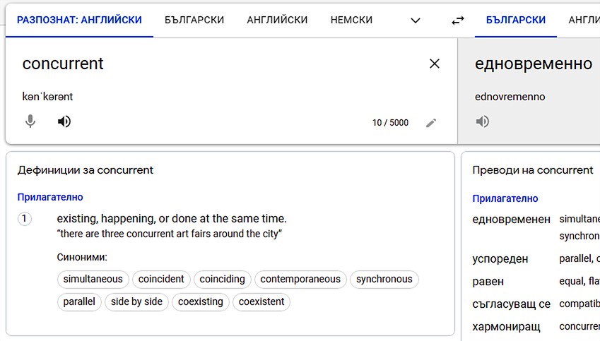
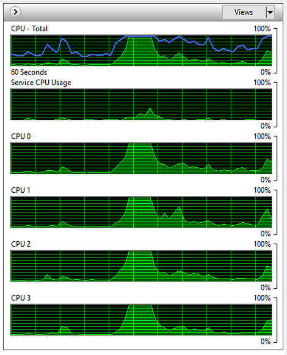
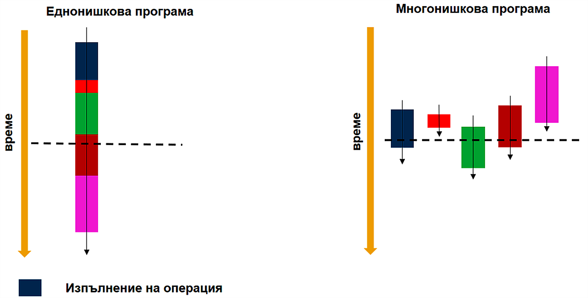
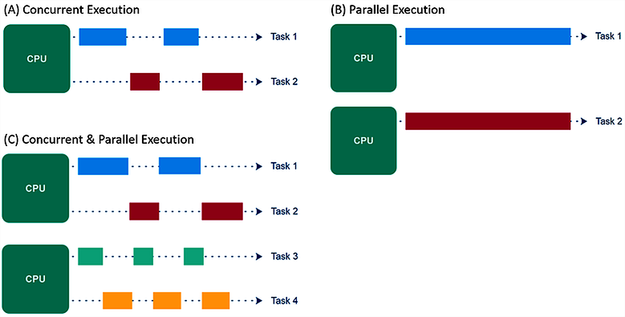
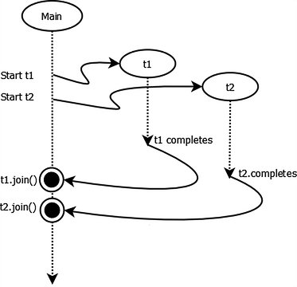
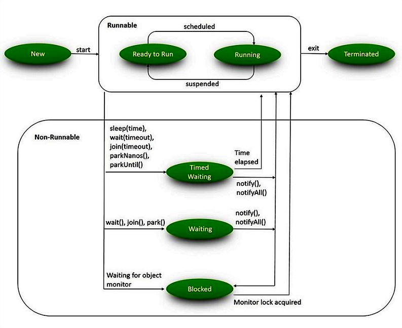
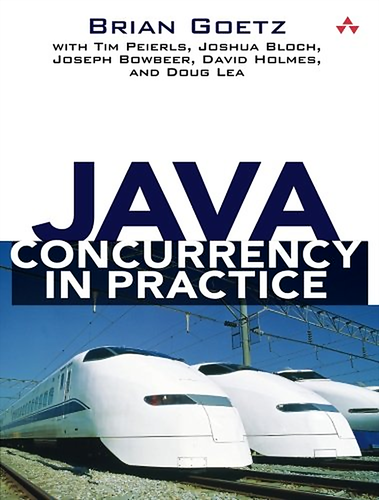

# Multithreaded Programming in Java

2021-12-15

---

### Last Lecture Recap

- Lambda expressions
- Stream API

---

### Today's Topics

- Concurrent and parallel execution of programs
- Multithreading
    - Threads and their lifecycle
    - Atomic data types
    - Inter-thread communication and synchronisation

---

### What Does *Concurrent* Mean?

<p align="center">
  
</p>

---

### Concurrency

- Concurrency is the ability to do more than one thing at the same time
    - Multiple tasks start, execute, and complete in overlapping time periods, in unpredictable order
    - For example: editing a document while listening to music from one app and downloading a file from a third — *simultaneously*
- Concurrency does not necessarily imply multiple applications. Simultaneous execution of parts of a single application is also called concurrency
    - For example: a text editor formats text, performs spell-checking, and responds to keyboard events — *simultaneously*

---

### Units of Concurrency

Concurrency is a broad term that can be applied at different levels.

- *Multiprocessing* — multiple processors executing instructions concurrently. The unit is a processor (CPU)
- *Multitasking* — multiple tasks/processes executing simultaneously on one processor. The unit is a process
- *Multithreading* — multiple parts of the same program execute concurrently. The unit is a thread

---

### Processes and Threads

- A *process* is a program in execution
    - It has its own address space, call stack, and handles to resources (e.g., open files)
- A *thread* is a path of execution inside a process
    - Every process has at least one thread, called *main*
    - Each thread can create additional threads
    - Threads within a process share its resources — in particular, memory and open files. However, each thread has its own call stack

---

### Processes vs. Threads

|               | Processes   | Threads                |
|:------------- |:------------|:---------------------- |
| Start-up      | Slow        | Relatively fast        |
| Isolation     | Yes         | No                     |
| Communication | Slow        | Fast                   |

---

### Concurrency: A Brief History

- Ancient past: before operating systems existed
- Single-tasking operating systems
- Multi-tasking operating systems — processes, inter-process communication
    - Resource utilisation
    - Fairness
    - Convenience
- Single- and multi-processor systems, hyper-threading (2002), multi-core processors (2005)

---

### Hyper-threading and Multi-Core Processors

<p align="center">
  
</p>

---

### Concurrent vs. Parallel Execution

- Concurrency does not necessarily imply parallel execution
- When we say "multiple tasks executing simultaneously" we really mean "multiple tasks progressing within the same time interval"
    - The OS switches between tasks so frequently that it appears to the user as if they run at exactly the same physical instant
    - True parallel execution is impossible on a computer with a single-core, non-hyperthreaded processor

---

### Single- and Multi-threaded Programs

<p align="center">
  
</p>

---

### Concurrent vs. Parallel Execution

<p align="center">
  
</p>

---

### Benefits of Multithreading

- Significantly increased program performance through full utilisation of available resources such as the CPU
- Improved user experience (more responsive UIs)
- Simpler architecture
    - A complex, asynchronous workflow can be decomposed into several simple, sequential workflows running in separate threads

---

### Concurrency Problems

- Thread interference (Race Conditions)
    - When multiple threads simultaneously read and write shared data and those operations overlap in time
    - The result then depends on the order of reads and writes, which is unpredictable

---

### Concurrency Problems

- Memory inconsistency
    - When different threads "see" the same data differently at the same moment
        - This occurs when one thread changes the value of shared data, but the change has not yet "reached" other threads, which continue to see the old value
        - The cause: the compiler, JVM, and CPU apply optimisations (reordering instructions, caching RAM values in registers or CPU cache, etc.)

---

### Multithreading Drawbacks

- Code becomes more complex and less intuitive
- More OS resources are consumed for the extra threads (e.g., memory)
- A new source of hard-to-reproduce and hard-to-debug errors due to race conditions and memory inconsistency
- [*Liveness*](https://en.wikipedia.org/wiki/Liveness), [*Starvation*](https://www.baeldung.com/cs/deadlock-livelock-starvation), and performance risks
- Multithreading frameworks as a "black box"

---

### Thread Management in Java

- Lifecycle: creation, starting, execution, termination
    - Current state inspection
- Synchronisation
- Inter-thread communication

---

### Creating a Thread

- Every Java program starts with one thread (`main`)
- To create a new thread in Java, either extend `java.lang.Thread` or implement `java.lang.Runnable`
- The logic (instructions to execute) lives in the `run()` method

---

### Creating a Thread — Examples

```java
// Option 1: extend java.lang.Thread
public class CustomThread extends Thread {
    public void run() {
        System.out.println("Hello world!");
    }
}
Thread customThread = new CustomThread();

// Option 2: implement java.lang.Runnable
public class CustomRunnable implements Runnable {
    public void run() {
        System.out.println("Hello world, from a Runnable!");
    }
}
Thread customThread = new Thread(new CustomRunnable());
```

---

### Creating a Thread — Modern Alternatives

```java
// Anonymous class
Thread customThread2 = new Thread() {
    @Override
    public void run() {
        System.out.println("Hello world, from an anonymous class!");
    }
};

// Lambda (preferred in Java 17)
Thread customThread3 =
    new Thread(() -> System.out.println("Hello world, from a lambda!"));
```

---

### Starting a Thread

- To start a thread, call its `start()` method
    - `start()` internally invokes `run()` in a new OS thread
    - Calling `run()` directly does **not** start a new thread — it runs on the calling thread

---

### Stopping a Thread

- A thread cannot be forcibly stopped once it has started
- A thread terminates automatically when its `run()` method returns
- A thread cannot be restarted after it has terminated

---

### `Thread` vs. `Runnable`

Using `Runnable` gives more flexibility:

- The class can still extend another class (single inheritance is not blocked)
- The implementation can be run in:
    - A new thread (via `start()`)
    - A thread pool (covered later)
    - The current thread (by calling `run()` directly)

---

### Thread API — Naming and Groups

You can give a thread a human-readable name via `setName()`. Names are not unique.
Threads can also be logically grouped with `ThreadGroup`. The group can only be set via the constructor.

```java
customThread.setName("Cool thread #1");

// Constructor accepting a group and a name
ThreadGroup coolThreads = new ThreadGroup("Cool thread group");
Thread coolThread1 = new Thread(coolThreads, "Cool thread #1");
Thread coolThread2 = new Thread(coolThreads, "Cool thread #2");
```

---

### Thread API — Key Methods

```java
// Pause — the thread "sleeps" and receives no CPU time for the given interval
Thread.sleep(long milliseconds);

// Reference to the currently executing thread
Thread.currentThread();

// The stack trace of the thread
thread.getStackTrace();

// Check whether the thread has not yet finished
boolean isAlive();
```

---

### Thread Priority

```java
// Hint to the thread scheduler about how much CPU time this thread should receive.
// Scale: 1 (MIN) to 10 (MAX). Default is 5 (NORM).
// Higher number = higher priority.
void setPriority(int prio);

// Hint to the scheduler that the current thread is willing to yield its CPU time
// to another thread of at least the same priority.
static void yield();

// NB: A well-written application must NOT rely on thread priorities
//     or yield() for correctness.
```

---

### Joining Another Thread

A thread can pause until another thread finishes by calling `join()`.

<p align="center">
  
</p>

---

### `join()` Methods

```java
// The calling thread blocks until the target thread terminates.
void join() throws InterruptedException;

// If the thread finishes or the specified time elapses,
// the calling thread continues execution.
void join(long millis) throws InterruptedException;
```

---

### Daemon Threads

- Threads in Java fall into two categories:
    - Standard (non-daemon) threads
    - Daemon threads

---

### Standard Threads

- Execute tasks that are central to the program's purpose
- The JVM runs as long as at least one non-daemon thread is alive

---

### Daemon Threads

- Execute tasks that are not critical to the program
- The JVM terminates daemon threads when no non-daemon threads remain
- Threads inherit the daemon mode from the thread that created them, or it can be set explicitly

```java
// Set before starting the thread
thread.setDaemon(true);
```

---

### Thread State

- A thread can be in different states at different points during its execution
- The `getState()` method returns the current state of a thread

---

<p align="center">
  
</p>

---

### `Thread.State`

Enum listing all possible states:

- `NEW` — created but not yet started
- `RUNNABLE` — executing or ready to execute
- `BLOCKED` — waiting to acquire a monitor lock
- `WAITING` — waiting indefinitely for another thread's signal
- `TIMED_WAITING` — waiting for a specified time
- `TERMINATED` — execution has completed

---

### Thread Safety

- A fundamental concept in multithreaded programming
- A class is *thread-safe* if it behaves correctly under concurrent access from multiple threads
- Concerns management of access to object state — specifically, *shared mutable* state

---

### Thread Safety

- Thread safety protects data from uncontrolled concurrent access
- Thread-safe classes encapsulate whatever synchronisation is needed, so their callers do not have to worry about it

---

### Thread Safety

- When more than one thread accesses an object's state and at least one thread can modify it, all threads must synchronise their access to that state
- Encapsulation and data hiding help achieve thread safety

---

### Atomicity

- *Atomic* operations vs. *compound* operations
- A compound operation is not atomic even if each individual step is — *race conditions* arise in the gaps between steps

---

### Race Condition Examples

- *Check-then-act* race condition
    - Lazy initialisation
- *Read-modify-write* race condition
    - Counter increment

```java
// check-then-act race condition
if (ref == null) {
    ref = new Something();
}
return ref;

// read-modify-write race condition
i++; // equivalent to i = i + 1,
     // which actually consists of three non-atomic operations
```

---

### Atomic Data Types

- Classes in the `java.util.concurrent.atomic` package
- Provide atomic implementations of primitive types, arrays of primitives, and an atomic reference abstraction
- `AtomicBoolean`, `AtomicInteger`, `AtomicLong`, `AtomicIntegerArray`, `AtomicLongArray`, `AtomicReference<T>`

---

### Atomic Data Types — How They Work

- Provide the ability to perform compound operations atomically
- Use special CPU instructions ("compare-and-swap", [CAS](https://en.wikipedia.org/wiki/Compare-and-swap)), which allow avoiding lock-based synchronisation — making them very fast

---

### Atomic Operations — Basic Usage

```java
// All implementations have get() and set() for accessing the stored variable.
AtomicInteger atomicInt = new AtomicInteger();
atomicInt.set(2021);
System.out.println(atomicInt.get()); // 2021
```

---

### Atomic Operations — Examples

```java
// Thread-safe equivalent of ++i
System.out.println(atomicInt.incrementAndGet()); // 2022

// Thread-safe equivalent of i += x
System.out.println(atomicInt.addAndGet(5)); // 2027

AtomicReference<String> atomicRef = new AtomicReference<>();
// atomicRef itself is not null, but the value it wraps is

// Thread-safe equivalent of: if (ref == expected) { ref = update; }
// NB: compares references with ==, not equals()
atomicRef.compareAndSet(null, "Happy new year!");
System.out.println(atomicRef.get()); // Happy new year!
```

---

### Concurrent Access to Shared Resources

---

### Synchronised (Critical) Section

- When two or more threads concurrently access a resource that can be modified, synchronisation is required
- Achieved with the `synchronized` keyword. The section consists of:
    - A monitor — a logical "lock"
    - A code block that executes exclusively for one thread at a time for a given monitor

---

### Synchronised Section — Example

```java
public void depositMoney(BankAccount acc, double amount) {
    // Critical section — only one thread per account 'acc'
    // can execute the code inside this synchronised block at a time
    synchronized (acc) {
        acc.deposit(amount);
    }

    // Non-critical section — many threads can be here simultaneously
    System.out.println("Deposit completed");
}
```

---

### Synchronised Section — Semantics

- Every object has an implicit internal *monitor* (*lock*) — any object can serve as a monitor
- Only one thread per monitor can execute the guarded code at a time (mutex = mutual exclusion)
- Every access to state that can be modified by another thread must always occur inside a synchronised section using the **same** monitor

---

### How the Monitor Is Managed

The JVM manages the monitor implicitly:

- On entry, if free: marked as "owned" by the entering thread
- On entry, if not free: the thread blocks and waits
- On exit: the lock is released; blocked threads can attempt to acquire it

---

### Synchronised Method

When you want to guard the entire method body, Java offers a more concise syntax:

```java
public void doSomeWork() {
    synchronized (this) {
        // Critical section — only one thread per 'this' instance
    }
}

// Equivalent shorthand
public synchronized void doSomeWork() {
    // Critical section — only one thread per 'this' instance
}
```

---

### Synchronised Section or Method?

- Prefer the **synchronised method** only when the method is short and the entire body needs to be guarded
- Prefer the **synchronised block** when:
    - Only a small part of the method requires synchronisation
    - You need a monitor other than `this`

---

### Reentrant Locks

The lock is *reentrant*: the thread that already owns it can enter other critical sections guarded by the **same** monitor without blocking.

```java
class Demo {
    public void method1() {
        synchronized (this) {
            // The executing thread already owns the lock,
            // so it can call method2() without deadlocking
            method2();
        }
    }

    public synchronized void method2() {
        // ...
    }
}
```

---

### Using a Dedicated Monitor Object

- You can synchronise access using a dedicated private field as the lock
- Useful when a class needs separate monitors for different pieces of state

```java
private final Object dedicatedMonitor = new Object();
```

---

### Multiple Monitors

A single thread can hold many monitors at once, as long as each is free:

```java
// Holding multiple locks is bad practice and should be avoided when possible
public void multipleLocks() {
    synchronized (lock1) {
        // owns lock1
        synchronized (lock2) {
            // owns lock1 & lock2
            synchronized (lock3) {
                // owns lock1, lock2 & lock3
            }
        }
    }
}
```

---

### Synchronisation Across Multiple Instances

- When all instances of a class must share a single lock, use a static field as the monitor

---

### Class-Level Monitors

Every instance has a reference to its `Class` object, which can be used as a class-wide lock:

```java
BankAccount.class  // static access
this.getClass()    // via 'this'
```

---

### Static Synchronised Methods

```java
// Explicit synchronisation on the class object
static void incrementOpCount() {
    synchronized (BankAccount.class) {
        opCount++;
    }
}

// Equivalent shorthand
static synchronized void incrementOpCount() {
    opCount++;
}
```

---

### Thread-Safe Objects by Design

Some objects are thread-safe by default:

- Local objects (local variables of a method — not shared between threads)
- Stateless objects
- Immutable objects
- Effectively-final objects (read-only after publication)

---

### Compound Operations

Combining several thread-safe operations into a larger compound operation gives **no** guarantee that the compound executes atomically.

```java
public synchronized void withdraw(double amount) {
    this.balance -= amount;
}

public synchronized double getBalance() {
    return balance;
}

// Bug: this method must also be synchronised
public void verifyAndWithdraw(double amount) {
    if (getBalance() >= amount) {
        withdraw(amount);
    }
}
```

---

### Deadlock

Occurs when two or more threads block each other — each holds a lock that another thread needs, while waiting for a lock held by one of the others.

<p align="center">
  
</p>

---

### Deadlock

- Threads cannot be terminated from the outside
- Locks cannot be forcibly taken away
- The only escape from a deadlock is restarting the JVM

---

### Preventing Deadlock

- Always acquire monitors in the same order across all threads
- Use a single shared monitor where possible
- Avoid holding more than one monitor at a time
- Order monitors by a consistent criterion (e.g., object identity hash code)

---

### Inter-Thread Communication

---

### Busy Wait

An inefficient (and potentially incorrect) form of inter-thread communication is *busy wait*: polling in a loop until a condition becomes true.

```java
// Each month a new thread tries to withdraw the monthly payment
// from the borrower's account
public void withdrawCreditPayment(double monthFee) {
    while (this.balance < monthFee) {
        // Spin until there is enough balance to cover the payment
        Thread.sleep(1_000);
    }
    balance -= monthFee;
}
```

---

### Waiting with `wait()`

```java
// A thread can declare that it wants to wait for an event in another thread
// using the wait() method on java.lang.Object
public synchronized void withdrawCreditPayment(double monthFee) {
    while (this.balance < monthFee) {
        try {
            // Release the monitor 'this' and enter WAITING state
            this.wait();
        } catch (InterruptedException e) {
            Thread.currentThread().interrupt();
        }
    }
    balance -= monthFee;
}
```

---

### `java.lang.Object.wait()`

- `wait()` must always be called inside a synchronised section on the monitor being waited on
    - Otherwise, `java.lang.IllegalMonitorStateException` is thrown
- `wait()` atomically releases the current monitor and transitions the thread to `WAITING` state

---

### `wait()` — Guarded Wait Pattern

- `wait()` can be called with a timeout argument — the thread wakes up when notified or when the time elapses
- Always re-check the condition in a `while` loop after waking up — this is the *guarded wait* pattern

```java
synchronized (lock) {
    while (!conditionMet()) {
        lock.wait();
    }
    // proceed
}
```

---

### Notifying with `notify()`

```java
// A thread can notify waiting threads that an event has occurred
// using notify() on java.lang.Object

// When money is deposited, notify threads waiting on this account
public synchronized void deposit(double amount) {
    this.balance += amount;
    this.notify(); // notify after updating state
}
```

---

### `java.lang.Object.notify()`

- Wakes up one thread waiting on the corresponding monitor
- Must always be called inside a synchronised section on the same monitor
- Does **not** release the monitor — the notified thread must wait until the monitor is released

---

### `notify()` vs. `notifyAll()`

- `notify()` — wakes up one arbitrary waiting thread. Useful only when you are certain only one thread can make progress, and you want to avoid the cost of waking all
- `notifyAll()` — wakes up all waiting threads. Use this when more than one thread might be able to continue after the notification. Threads then compete for the monitor and run sequentially inside the synchronised section

---

### `notify()` vs. `notifyAll()`

- If there are multiple threads waiting on the same monitor, you cannot control which thread(s) are woken first
- In practice, `notifyAll()` is the safer choice. A properly implemented `while` loop in the waiting thread ensures the same correctness as `notify()` — woken threads that cannot proceed simply go back to sleep

---

### Interrupting a Thread

- One thread can signal another to stop execution
- What action is taken is entirely up to the programmer — the signal may be ignored
- A thread can check whether it has been interrupted
- Methods like `sleep()` and `join()` throw `InterruptedException` when the thread receives an interrupt signal while they are executing

```java
customThread.interrupt();

Thread.interrupted()    // static — clears the interrupted flag after reading
isInterrupted()         // instance — does NOT clear the flag
```

---

### Virtual Threads (Java 21 Preview)

- *Virtual threads* are lightweight threads managed by the JVM rather than the OS
- Designed for high-throughput concurrent applications
- Created with `Thread.ofVirtual()`:

```java
Thread vt = Thread.ofVirtual().start(() ->
    System.out.println("Running in a virtual thread")
);
vt.join();
```

- Ideal for I/O-bound workloads; not a silver bullet for CPU-bound work

---

### Where to Go Next

- [Java Concurrency in Practice](https://jcip.net/) — Brian Goetz et al. — the definitive reference

<p align="center">
  
</p>
