# Multithreading with Java (Part II)

2021-12-22

---

### Last Lecture Recap

- Concurrent and parallel program execution
- Multithreading
    - Threads and their lifecycle
    - Atomic data types
    - Inter-thread communication and synchronisation

---

### Today's Topics

- Thread pools / Executors API
- Concurrent collections
- Network programming

---

### Runnable vs. Callable

```java
// java.lang
@FunctionalInterface
public interface Runnable {

    void run();

}

// java.util.concurrent
@FunctionalInterface
public interface Callable<V> {

    V call() throws Exception;

}
```

---

### Future\<V\>

```java
// java.util.concurrent
public interface Future<V> {

    boolean cancel(boolean mayInterruptIfRunning);

    boolean isCancelled();

    boolean isDone();

    V get() throws InterruptedException, ExecutionException;

    V get(long timeout, TimeUnit unit)
        throws InterruptedException, ExecutionException,
               TimeoutException;

}
```

---

### Thread Reuse

---

### Thread Pool (Executor)

- A concurrency concept where threads are recycled after execution to avoid the overhead of creating new ones for every task.
- Individual `Runnable` or `Callable` objects are treated as *tasks* and queued; when a thread becomes available it picks up the next task according to pool configuration.

<p align="center">
  
</p>

---

### Executors API

```java
// central interface
java.util.concurrent.Executor

void execute(Runnable command)

// extends Executor to also support Callable tasks that can return a result
java.util.concurrent.ExecutorService

<T> Future<T> submit(Callable<T> task)

// tasks can be scheduled with a delay or at a fixed rate
java.util.concurrent.ScheduledExecutorService

ScheduledFuture<?> schedule(Runnable r, long delay, TimeUnit tu)
ScheduledFuture<?> scheduleAtFixedRate(Runnable r, long initialDelay, long period, TimeUnit tu)
ScheduledFuture<?> scheduleWithFixedDelay(Runnable r, long initialDelay, long delay, TimeUnit tu)
```

---

### Creating an Executor

```java
// factory class for creating thread pools
java.util.concurrent.Executors

// single-threaded pool: tasks run sequentially
static ExecutorService newSingleThreadExecutor()

// fixed number of threads: excess tasks wait in queue until a thread is free
static ExecutorService newFixedThreadPool(int n)

// reuses available threads, creates new ones when needed;
// threads idle for more than one minute are removed
static ExecutorService newCachedThreadPool()

// pool for delayed or periodic task execution
static ScheduledExecutorService newScheduledThreadPool(int size)
```

---

### Stopping a Thread Pool

An `Executor` must always be explicitly stopped with `shutdown()`.

---

### Thread-Safe Collections: Synchronised Collections

- The Collections API provides synchronised implementations such as `Vector` and `Hashtable`.
- `java.util.Collections` offers factory methods to wrap any collection in a synchronised wrapper.
- Synchronised collections are too slow for high-concurrency scenarios and do not support atomic compound operations.

<br>

```java
static <T> Collection<T> synchronizedCollection(Collection<T> c)
```

---

### Thread-Safe Collections: Concurrent Collections

- Located in the `java.util.concurrent` package.
- Designed specifically for concurrent access.
- Key features:
    - Lock-free parallel reads
    - Fail-safe iterators
    - Atomic operations (e.g. `putIfAbsent()`)

---

### `CopyOnWriteArrayList`

- A thread-safe alternative to synchronised `ArrayList` implementations.
- Lock-free parallel reads.
- Fail-safe snapshot iterator.
- Every mutation triggers a full copy of the underlying array.
- Atomic operation: `boolean addIfAbsent(E e)`.
- Best suited when reads vastly outnumber writes; otherwise it is highly inefficient.

---

### `ConcurrentHashMap`

- A thread-safe alternative to synchronised `HashMap` variants.
- Lock-free parallel reads.
- Parallel (but segmented/limited) writes.
- Fail-safe, weakly-consistent iterator.
- Atomic operation: `V putIfAbsent(K key, V value)`.
- The most widely used class in `java.util.concurrent`; almost always the right replacement for legacy synchronised map wrappers.

---

### `BlockingQueue`

A blocking queue implementation (Producer-Consumer queue).
It blocks when:
- The queue is **empty** and a consumer tries to read — unblocks on first write.
- The queue is **full** and a producer tries to write — unblocks on first read.
- `ArrayBlockingQueue` is the primary implementation, backed by a fixed-capacity array.

<br>

```java
BlockingQueue<String> queue = new ArrayBlockingQueue<>(4);
```

---

### Multithreading Topics Beyond This Course

- Visibility & stale data. Volatile variables. Non-atomic 64-bit operations.
- Explicit locks.
- Synchronisers: Semaphores, Latches, Barriers, Exchangers.

---

### Further Reading

<p align="center">
  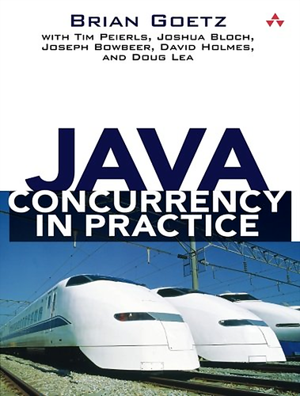
</p>

---

### Theory vs. Practice

<p align="center">
  
</p>

---

# Network Programming with Java

2021-12-22

<p align="center">
  
</p>

---

### Topics

- Network models: client-server, peer-to-peer
- Network protocols: IP, UDP, TCP
- Network communication in Java
    - Blocking I/O (`java.net`)
    - Non-blocking I/O (`java.nio`)
- Network scalability

---

### Client-Server Model

Client-server is a distributed computing model where responsibilities are split between resource/service providers (servers) and service consumers (clients).

<br>

<p align="center">
  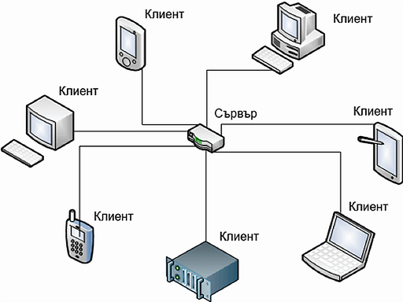
</p>

---

### Peer-to-Peer Model

Peer-to-peer is a distributed application architecture where every participant (peer, node) acts as both client and server simultaneously, sharing tasks equally.

<p align="center">
  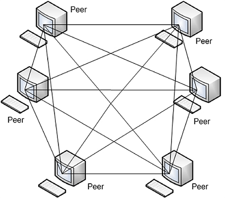
</p>

---

### Types of Clients

- By available functionality:
    - Rich clients
    - Thin clients
- By protocol:
    - Web clients — browsers (Chrome, Firefox)
    - Mail clients — POP/SMTP (MS Outlook, Thunderbird)
    - FTP clients — FileZilla, WinSCP
    - ...

---

### Types of Servers

- File server (Windows, Samba, UNIX NFS, OpenAFS)
- DB server (MySQL, PostgreSQL, Oracle, MS SQL Server, MongoDB)
- Mail server (MS Exchange, Gmail)
- Name server (DNS)
- FTP server (ftpd, IIS)
- Print server
- Game server
- Web server (Apache, nginx, MS IIS)
- Application server (Tomcat, TomEE, GlassFish, WildFly)
- ...

---

### Client-Server: Advantages and Disadvantages

- **Advantages**
    - High security: access control is enforced in one place (the server).
    - Data consistency: all clients see the same data at any point in time.
    - Changes propagate quickly — on the very next client request.
- **Disadvantages**
    - Single Point of Failure (SPOF): if the server is down, no one can communicate.
    - Performance degrades as the number of clients grows.
    - The server is idle 70–95% of the time.

---

### Peer-to-Peer: Advantages and Disadvantages

- **Advantages**
    - No SPOF.
    - Performance does not degrade as the number of participants grows.
- **Disadvantages**
    - Security concerns: data copies are distributed across the network.
    - Risk of intentional content modification and version divergence across nodes.
    - No centralised content control; content can be lost.
    - Maintenance is complex.

---

### Open Systems Interconnection (OSI) Model

<p align="center">
  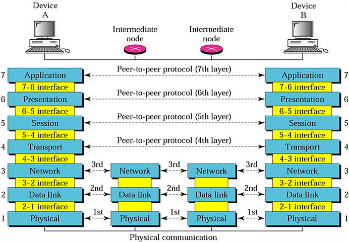
</p>

---

### OSI Model: Network Protocols

<table style="font-size:0.7em; line-height=0.3em;">
  <tr>
    <th style="font-weight: bold; padding-right: 12px;">#</th>
    <th style="font-weight: bold;">Layer</th>
    <th style="font-weight: bold;">Description</th>
    <th style="font-weight: bold;">Protocols</th>
  </tr>
  <tr>
    <td>7</td>
    <td>Application</td>
    <td>Allows user applications to request services and server applications to register and provide services on the network.</td>
    <td>DNS, FTP, HTTP, NFS, NTP, DHCP, SMTP, Telnet</td>
  </tr>
  <tr>
    <td>6</td>
    <td>Presentation</td>
    <td>Data conversion, compression, and encryption.</td>
    <td>TLS/SSL</td>
  </tr>
  <tr>
    <td>5</td>
    <td>Session</td>
    <td>Session creation, maintenance, and termination. Security. Logical ports.</td>
    <td>Sockets</td>
  </tr>
  <tr>
    <td>4</td>
    <td>Transport</td>
    <td>Ensures message integrity, correct sequencing, delivery acknowledgement, and detection of lost or duplicate messages.</td>
    <td>TCP, UDP</td>
  </tr>
  <tr>
    <td>3</td>
    <td>Network</td>
    <td>Manages packets in the network: routing, fragmentation, and logical addressing.</td>
    <td>IPv4, IPv6, IPX, ICMP</td>
  </tr>
  <tr>
    <td>2</td>
    <td>Data Link</td>
    <td>Frame transmission between nodes. Frame sequencing. Acknowledgements. Error detection. MAC addressing.</td>
    <td>ATM, X.25, DSL, IEEE 802.11</td>
  </tr>
  <tr>
    <td>1</td>
    <td>Physical</td>
    <td>Transmits and receives raw bit streams over the physical medium. Encoding/decoding. Physical connector management.</td>
    <td>IEEE 802.11, IEEE 1394, Bluetooth</td>
  </tr>
</table>

---

### java.net | Introduction

The `java.net` package provides classes that operate at various OSI layers.

- Network and data-link layer
    - `NetworkInterface` — access to the machine's network adapters
    - `InetAddress` — IP addresses
- Transport layer
    - TCP — `Socket` and `ServerSocket`
    - UDP — `DatagramPacket`, `DatagramSocket`, and `MulticastSocket`
- Application layer
    - `URL` and `URLConnection` — access to HTTP and FTP resources
    - (since Java 11) `java.net.http` — convenient HTTP client API

---

### java.net | Network Adapters

- A network adapter connects a computer system to a network.
- Adapters can be physical or virtual (software). Examples of virtual adapters: the *loopback* interface and interfaces created by virtual machines.
- A system can have multiple physical and/or virtual network adapters.
- Java provides access to all network adapters through `java.net.NetworkInterface`.

---

### IP Address

- Every computer connected to a network is identified by a logical address.
- The most common logical address protocols are IPv4 and IPv6.
- IPv4 addresses are 32-bit numbers; IPv6 addresses are 128-bit numbers.

<br>

<p align="center">
  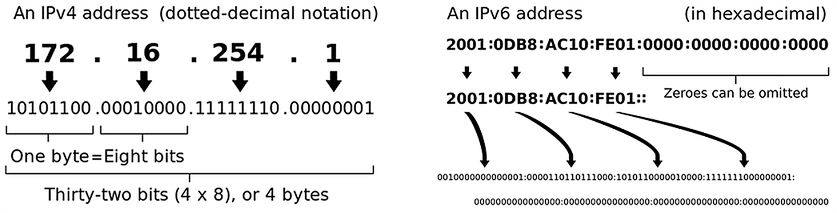
</p>

---

### Ports

- A computer typically has a single physical connection to the network, shared by all applications. Ports allow the OS to demultiplex incoming data to the correct application.
- Every transmitted network packet contains the destination IP address and port number.
- Ports are identified by a 16-bit number used by TCP and UDP to route data to the right application.
- Port numbers range from 0 to 65 535.
- Ports 0–1023 are *well-known ports*; using them requires administrator privileges.

---

### Addressing in the Network | `java.net.InetAddress`

- Instances are created via static factory methods of the class.
- Use `NetworkInterface` to enumerate all network adapters or retrieve a specific one.

```java
// Create an instance by hostname or textual IP address
InetAddress address = InetAddress.getByName("www.google.com");
System.out.println(address.getHostAddress()); // 172.217.169.164

InetAddress address2 = InetAddress.getByName("62.44.101.138");
System.out.println(address2.getHostName());     // www.fmi.uni-sofia.bg
System.out.println(address2.isReachable(5_000)); // true

InetAddress localhost = InetAddress.getLocalHost();

NetworkInterface.networkInterfaces()
    .forEach(n -> {
        System.out.println("Display name: " + n.getDisplayName());
        System.out.println("Name: " + n.getName());
    });
```

---

### Sockets

- UDP and TCP are implemented via *sockets*.
- A socket is one endpoint of a two-way network connection between two applications.
- Each socket is identified by a combination of IP address and port number.

---

### UDP Protocol

- Allows applications to send messages called *datagrams* via a simple, connection-less communication model.
- There is no handshake between the two communicating parties, so there is no guarantee of delivery or message ordering.

---

### UDP Protocol

- A datagram is represented by `java.net.DatagramPacket`.
- `DatagramSocket` is a connection-less socket for sending and receiving datagram packets via its `send` and `receive` methods.

---

### TCP Protocol

- Builds on top of the IP protocol (hence also called TCP/IP, "TCP over IP").
- Transmits data reliably: with error checking, guaranteed delivery, and preserved packet ordering.

---

### TCP Protocol

- Implemented with sockets — `ServerSocket` and `Socket` — which allow a server and client to exchange messages.

---

### TCP vs. UDP

| Characteristic               | TCP                          | UDP                           |
|:-----------------------------|:-----------------------------|:------------------------------|
| Connection                   | connection-based             | connection-less               |
| Reliability                  | high                         | low                           |
| Packet ordering              | guaranteed                   | not guaranteed                |
| Delivery speed               | lower than UDP               | higher than TCP               |
| Error checking               | yes, with recovery           | yes, but without recovery     |
| Delivery acknowledgement     | yes                          | no                            |

---

### Client-Server Implementation with Sockets

---

### `java.net.ServerSocket`

```java
ServerSocket()               // unbound; call bind() before use
ServerSocket(int port)       // bound to the given port (0 = auto-assigned)
ServerSocket(int port, int backlog)              // max pending connection queue size
ServerSocket(int port, int backlog, InetAddress bindAddr)

void bind(SocketAddress endpoint)
void bind(SocketAddress endpoint, int backlog)

Socket accept()              // blocks until a client connects
```

---

### `java.net.Socket`

```java
Socket()                                        // unconnected socket
Socket(String host, int port)                   // connects on construction
Socket(InetAddress address, int port)

void connect(SocketAddress endpoint)
void connect(SocketAddress endpoint, int timeout)

InputStream getInputStream()   // read from the connection
OutputStream getOutputStream() // write to the connection
```

---

### Sockets

<p align="center">
  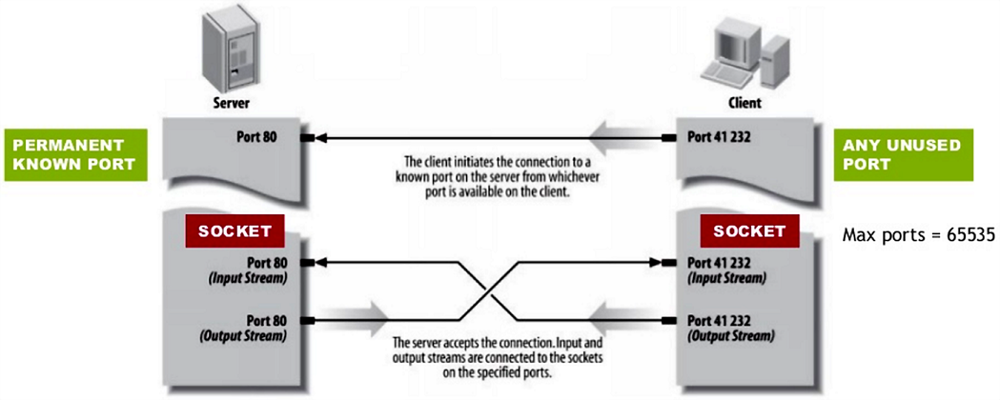
</p>

---

### java.net | TCP Communication Flow

<p align="center">
  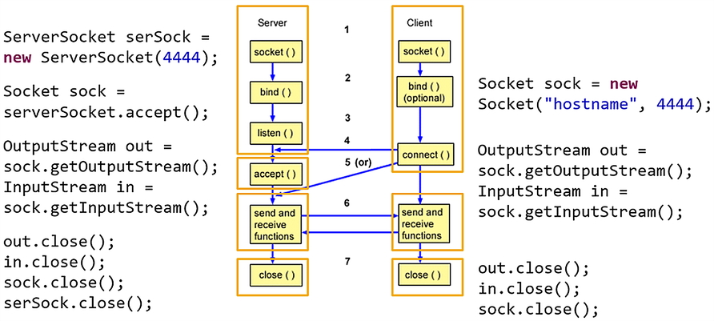
</p>

---

### java.net | Blocking Network Communication

<p align="center">
  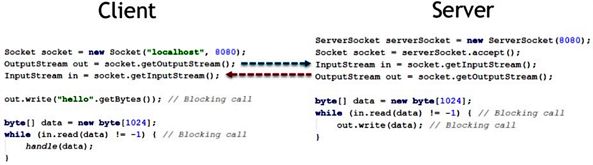
</p>

---

### java.net | Client-Server Architecture

<p align="center">
  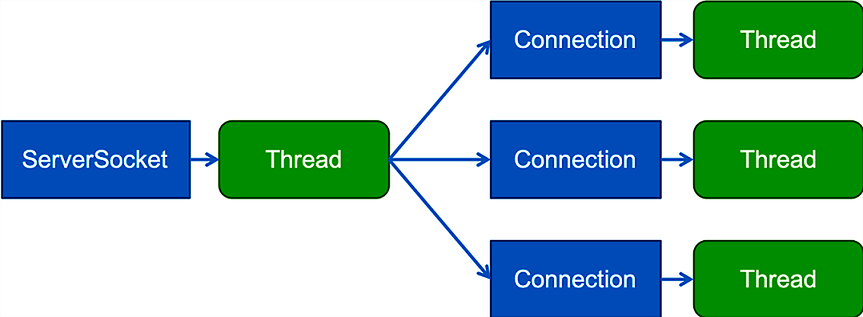
</p>

---

### java.net | Multithreaded Architecture

<p align="center">
  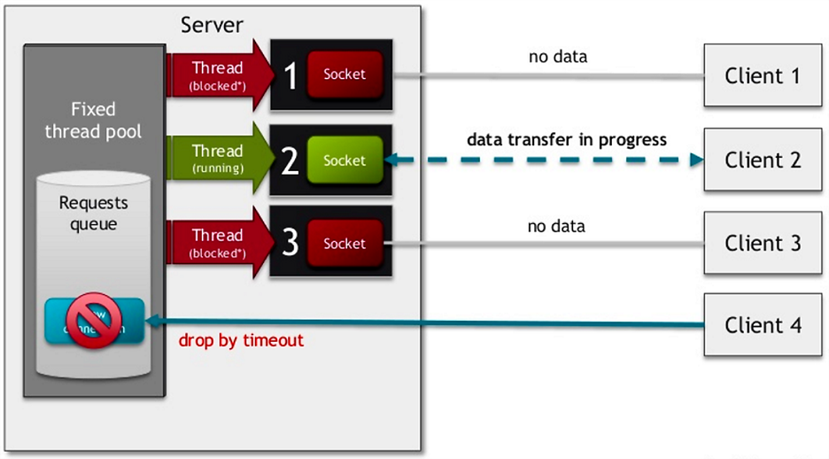
</p>

---

### java.net | Advantages and Disadvantages

- **Advantages**
    - Relatively simple code — uses the familiar I/O Stream API.
    - No need to handle partial reads — the thread blocks until the full message arrives.
- **Disadvantages**
    - Inefficient thread usage — many threads sit in waiting/blocked state due to blocking operations.
    - Extra memory consumed by idle threads.
    - Performance penalty from context switching between threads.
    - Limited number of concurrent connections because the server thread pool is finite.

---

### Non-Blocking I/O (NIO) for Network Programming

- The Java NIO API provides an alternative to `java.net` that supports non-blocking (asynchronous) I/O operations.
- It enables network applications that efficiently handle a very large number of concurrent clients and requests.

---

### java.nio | Core Abstractions

- **Buffer** — a block of memory used as temporary storage for data being read or written.
- **Channel** — an abstraction for a communication connection.
- **Selector** — a component with which multiple channels are registered, allowing a single thread to handle many channels.

---

### java.nio | Buffers

- A buffer is a container for data that will be written to or read from a channel.
- It is a fixed-size array of a primitive type that tracks its own state: how much data it holds, how much space remains, and how far reading/writing has progressed.
- `Buffer` is abstract; concrete subclasses exist for all non-boolean primitive types: `ByteBuffer`, `CharBuffer`, `ShortBuffer`, `IntBuffer`, `LongBuffer`, `FloatBuffer`, `DoubleBuffer`.
- NIO communication is buffer-based, whereas classic `java.io` communication is stream-based.

---

### java.nio.Buffer

- The state of a buffer is defined by four attributes:
    - *capacity*: maximum number of elements; set at creation, never changes.
    - *limit*: the first index that should not be read or written.
    - *position*: index of the next element to be read or written.
    - *mark*: a saved position to which the buffer can be reset.
- Invariant: `0 <= mark <= position <= limit <= capacity`

---

### java.nio.Buffer

```java
int capacity()
int position()
Buffer position(int newPosition)
int limit()
Buffer limit(int newLimit)
Buffer mark()
Buffer reset()
```

---

### java.nio.Buffer

```java
// Prepare buffer for draining (reading).
// Sets limit = position, then position = 0.
Buffer flip()

// Prepare buffer for a fresh fill (writing).
// Sets limit = capacity, then position = 0.
Buffer clear()

// Prepare buffer for re-reading the same data.
// Limit is unchanged; position is reset to 0.
Buffer rewind()
```

---

### java.nio.ByteBuffer

```java
byte get()
byte get(int index)
ByteBuffer put(byte b)
ByteBuffer put(int index, byte b)
```

---

### java.nio | How Buffers Work

<p align="center">
  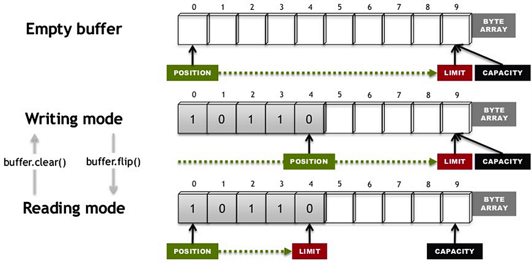
</p>

---

### java.nio | Direct vs. Indirect Buffers

- Buffers are either *direct* or *indirect*.

<br>

```java
ByteBuffer direct   = ByteBuffer.allocateDirect(1024); // direct buffer
ByteBuffer indirect = ByteBuffer.allocate(1024);       // indirect buffer
```

---

### java.nio | Direct vs. Indirect Buffers

- A **direct** buffer uses native I/O operations for reading and writing, bypassing the JVM heap.
    - It occupies a contiguous, pinned region of memory; the GC cannot move it.
    - More expensive to allocate, but faster for large, long-lived buffers.
- An **indirect** buffer is a regular Java byte array on the heap.
    - The JVM (GC) manages its memory — allocation and reclamation are predictable.
    - Less efficient for most I/O operations than a direct buffer of the same size.

---

### Java I/O Performance

<p align="center">
  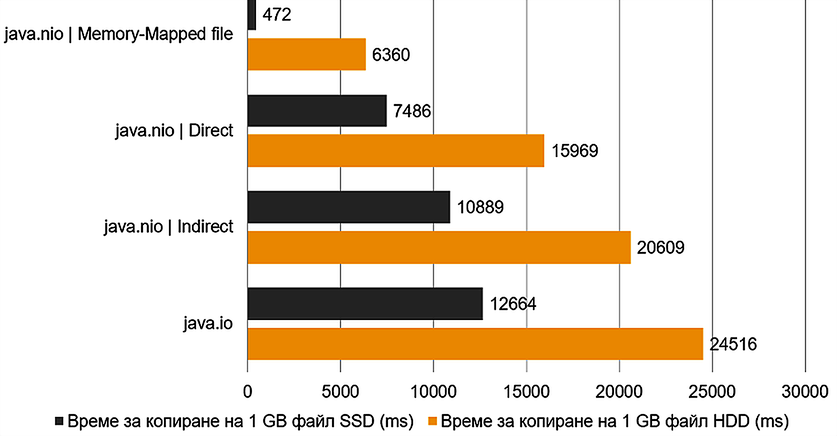
</p>

---

### Channels

- Channels are an abstraction for a connection ("pipe") that efficiently transports data between byte buffers and an entity at the other end of the channel (typically a file or socket).
- Channels provide low-overhead access to native I/O services of the operating system; buffers are the internal endpoints that channels use to send and receive data.

---

### java.nio.channels.ServerSocketChannel

```java
// Opens a server-socket channel
static ServerSocketChannel open()

// Accepts a connection made to this channel's socket
SocketChannel accept()

// Binds the channel's socket to a local address
// and configures the socket to listen for connections
ServerSocketChannel bind(SocketAddress local)

// Retrieves a server socket associated with this channel
ServerSocket socket()
```

---

### java.nio.channels.SocketChannel

```java
// Opens a socket channel
static SocketChannel open()
// Opens and connects a socket channel to a remote address
static SocketChannel open(SocketAddress remote)

// Connects this channel's socket
boolean connect(SocketAddress remote)

// Retrieves the socket associated with this channel
Socket socket()

// Reads bytes from this channel into the given buffer
int read(ByteBuffer dst)
// Writes bytes to this channel from the given buffer
int write(ByteBuffer src)
```

---

### Selector and SelectionKey

Selectors enable *readiness selection* — choosing channels that are ready for I/O — which is the foundation of multiplexed I/O: one thread serving a large number of channels.

<p align="center">
  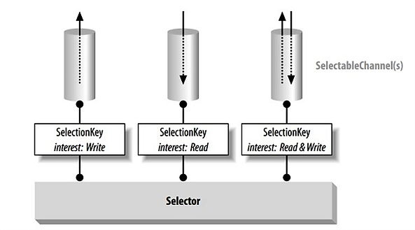
</p>

---

### Selector and SelectionKey

1. Register one or more channels with a `Selector` instance.
2. Registration returns a `SelectionKey` representing the channel-selector relationship.
3. The key records which operations on the channel the application is interested in, and tracks the channel's readiness to perform them.
4. Calling `selector.select()` updates the readiness state of all registered keys.
5. Retrieve the set of keys whose channels are ready for an operation.
6. Iterate over that set and service each ready channel.

---

### java.nio.channels.Selector

```java
// Opens a selector
static Selector open()

// Selects a set of keys whose corresponding channels are ready for I/O
int select()

// Returns the set of ready keys
Set<SelectionKey> selectedKeys()
```

---

### java.nio.channels.SelectionKey

```java
public static final int OP_READ
public static final int OP_WRITE
public static final int OP_CONNECT
public static final int OP_ACCEPT

SelectableChannel channel();
Selector selector();
int interestOps();
int readyOps();

boolean isReadable()
boolean isWritable()
boolean isConnectable()
boolean isAcceptable()

Object attach(Object ob)
Object attachment()
```

---

### java.nio.channels.ServerSocketChannel

```java
// ServerSocketChannel listens for incoming TCP connections,
// just like ServerSocket, but in non-blocking mode.

ServerSocketChannel serverSocketChannel = ServerSocketChannel.open();
serverSocketChannel.bind(new InetSocketAddress(9999));
serverSocketChannel.configureBlocking(false);

while (true) {
    SocketChannel socketChannel = serverSocketChannel.accept();
    // [...]
}
```

---

### java.nio | SocketChannel | Registration

```java
// A SocketChannel represents a single TCP connection.
// It must be put into non-blocking mode before registering with a Selector.

Selector selector = Selector.open();
socketChannel.configureBlocking(false);
socketChannel.register(selector, SelectionKey.OP_READ | SelectionKey.OP_WRITE);
```

---

### java.nio | SocketChannel | Interest Ops

When registering a `SocketChannel`, specify which events to be notified about:

- `OP_READ` — data is available to read from the channel.
- `OP_WRITE` — the channel is ready to accept writes.
- `OP_CONNECT` — the channel has finished the connection sequence to the remote host.
- `OP_ACCEPT` — a new incoming connection request has arrived.

---

### java.nio | SocketChannel | Notification

```java
// Receiving notifications for multiple channels
while (true) {
    int readyChannels = selector.select();
    if (readyChannels == 0) { continue; }

    Set<SelectionKey> selectedKeys = selector.selectedKeys();
    Iterator<SelectionKey> keyIterator = selectedKeys.iterator();
    while (keyIterator.hasNext()) {
        SelectionKey key = keyIterator.next();
        if (key.isReadable()) {
            // A channel is ready for reading
        }
        keyIterator.remove();
    }
}
```

---

### java.nio | SocketChannel | Reading

```java
// Reading data from a channel
if (key.isReadable()) {
    SocketChannel sc = (SocketChannel) key.channel();
    while (true) {
        buffer.clear();
        int r = sc.read(buffer);
        if (r <= 0) { break; }
        buffer.flip();
        sc.write(buffer);
    }
} else if (key.isWritable()) {
    // [...]
}
```

---

### java.nio | SocketChannel | Writing

```java
// Use a SocketChannel to send data over a TCP connection

SocketChannel socketChannel = SocketChannel.open();
socketChannel.connect(new InetSocketAddress("127.0.0.1", 9999));

String newData = "Current time: " + System.currentTimeMillis();
ByteBuffer buf = ByteBuffer.allocate(48);

buf.put(newData.getBytes(StandardCharsets.UTF_8));
buf.flip();
while (buf.hasRemaining()) {
    socketChannel.write(buf);
}
```

---

### java.nio | Sending Data

<p align="center">
  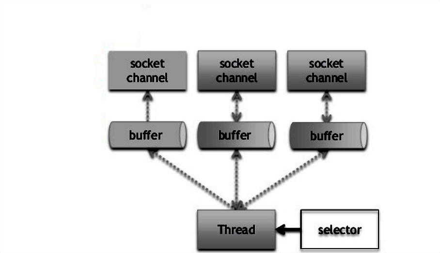
</p>

---

### java.nio | Sending Data

<p align="center">
  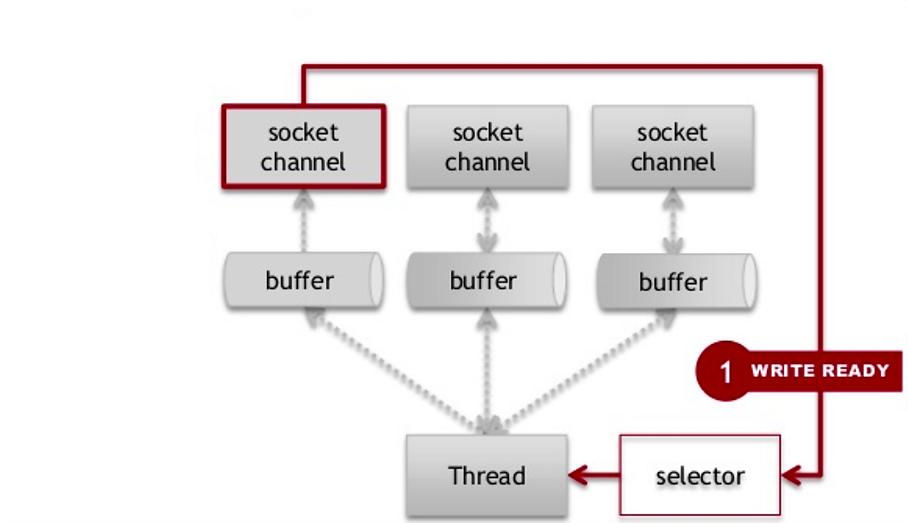
</p>

---

### java.nio | Sending Data

<p align="center">
  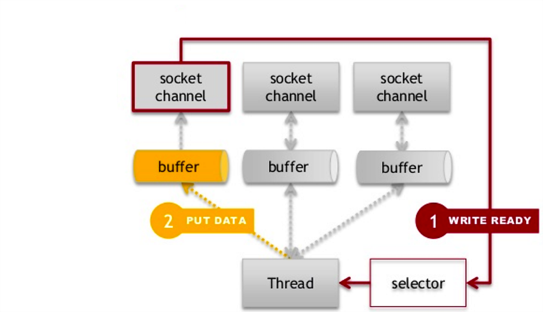
</p>

---

### java.nio | Sending Data

<p align="center">
  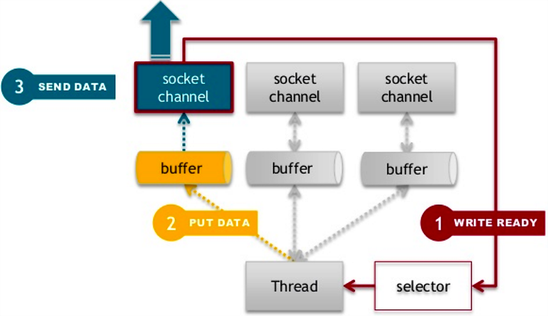
</p>

---

### java.nio | Receiving Data

<p align="center">
  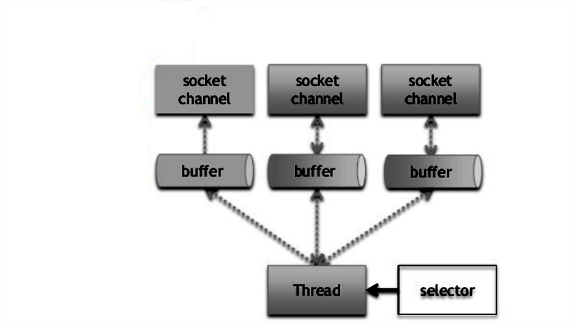
</p>

---

### java.nio | Receiving Data

<p align="center">
  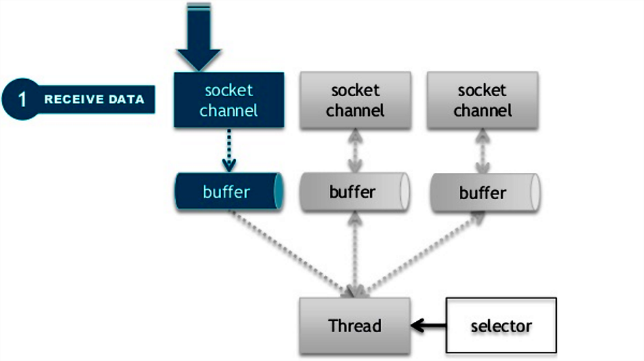
</p>

---

### java.nio | Receiving Data

<p align="center">
  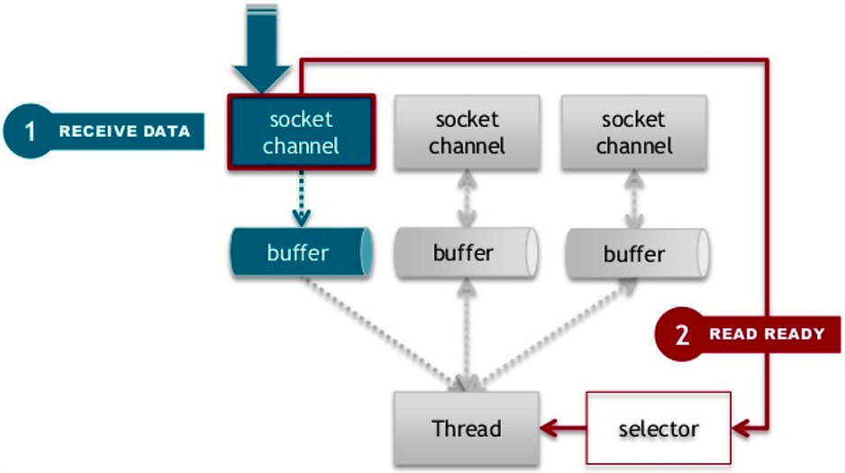
</p>

---

### java.nio | Receiving Data

<p align="center">
  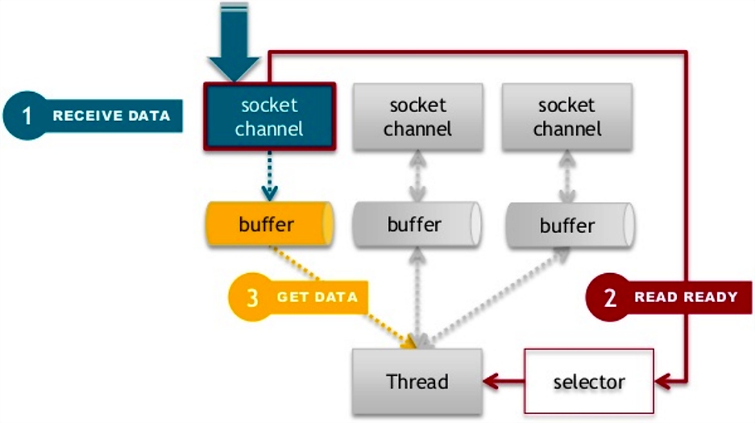
</p>

---

### java.nio | Architecture

- A `Selector` thread handles multiple channels from a single thread.
- Reduces the number of threads needed — no dedicated thread per connection.
- Asynchronous (non-blocking) operations.

---

### java.nio | Architecture

<p align="center">
  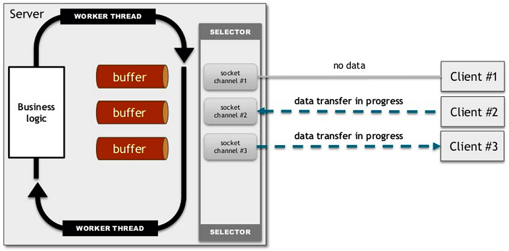
</p>

---

### java.nio | Architecture

<p align="center">
  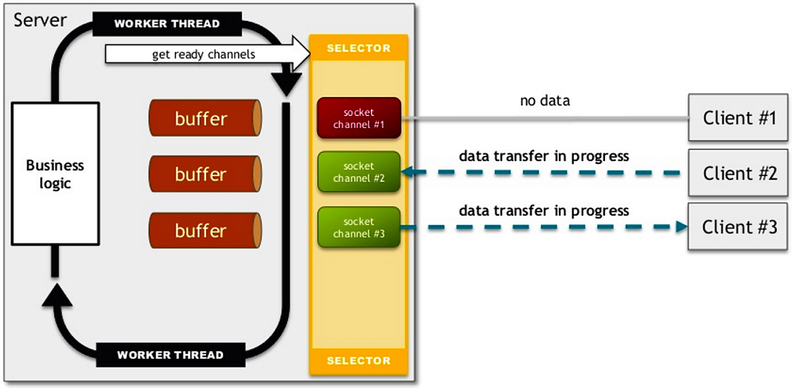
</p>

---

### java.nio | Architecture

<p align="center">
  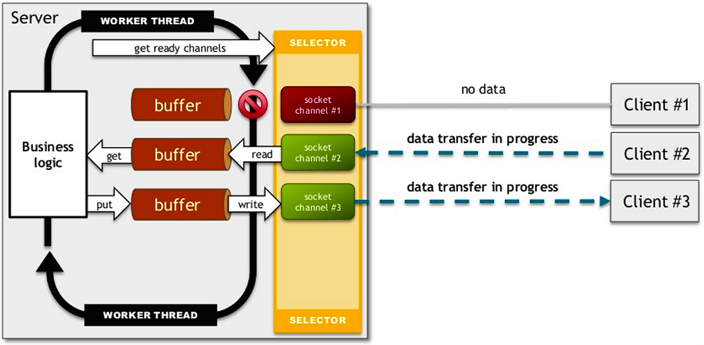
</p>

---

### java.nio | Architecture

<p align="center">
  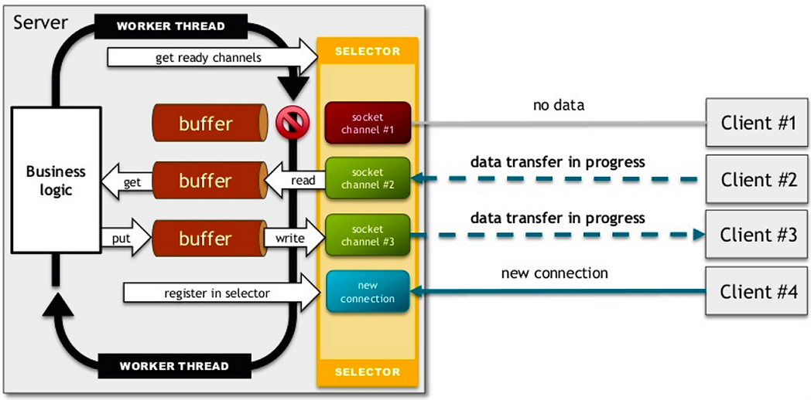
</p>

---

### IO vs. NIO

<p align="center">
  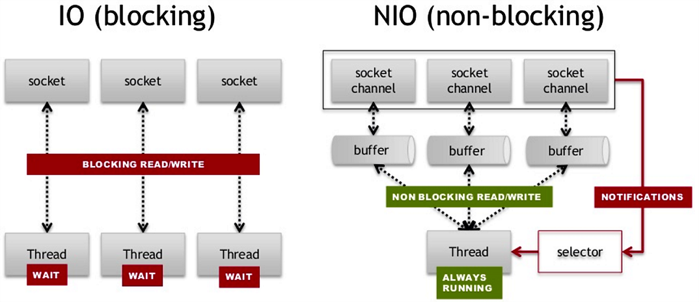
</p>

---

### java.net.http | Modern HTTP Client (Java 11+)

```java
HttpClient client = HttpClient.newHttpClient();

HttpRequest request = HttpRequest.newBuilder()
    .uri(URI.create("https://api.example.com/data"))
    .GET()
    .build();

HttpResponse<String> response = client.send(request,
    HttpResponse.BodyHandlers.ofString());

System.out.println(response.statusCode());
System.out.println(response.body());
```

---

### Where to Go Next

- [Java NIO — Ron Hitchens (O'Reilly)](images/10.18-java-nio-oreilly.jpg)
- [Netty in Action — Maurer & Wolfthal](https://www.manning.com/books/netty-in-action) — high-performance async network library
- [Java Network Programming — Elliotte Harold](https://www.oreilly.com/library/view/java-network-programming/9781449365936/)

---

### Further Reading

<p align="center">
  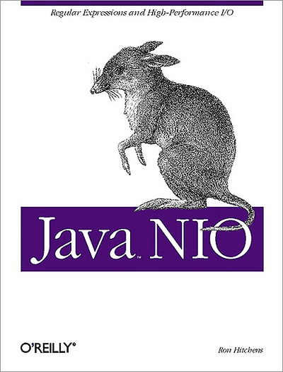
</p>
