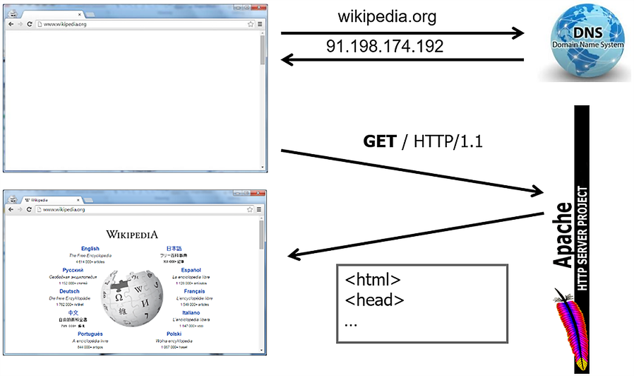
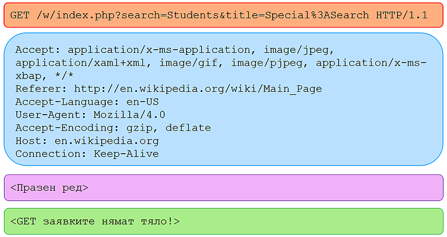
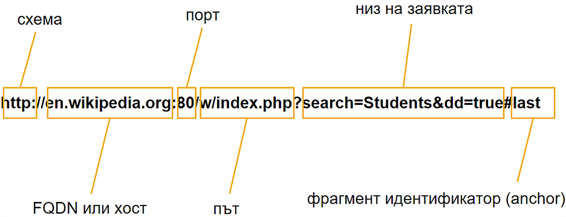
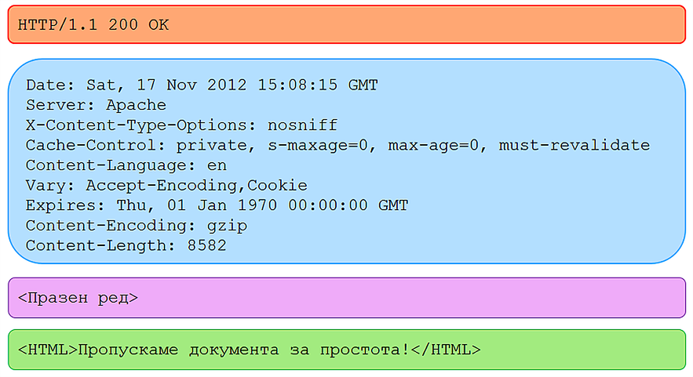
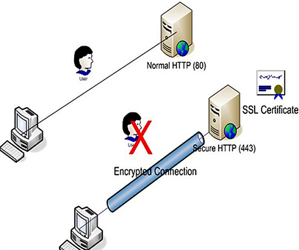
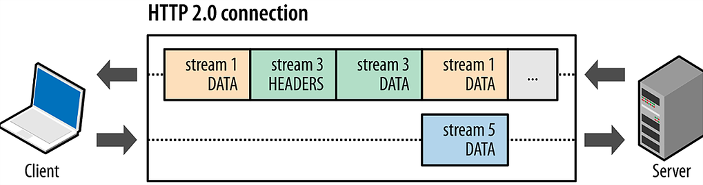
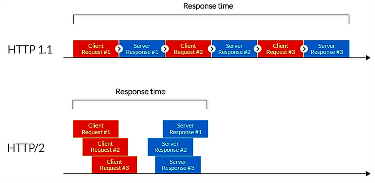

# HTTP, REST, and JSON

2022-01-05

---

### Last Lecture: Recap

- Thread pools / Executors API
- Concurrent collections
- Network programming

---

### Today's Topics

- HTTP
- REST
- JSON
- Java libraries for HTTP and JSON

---

### How Does the Internet Work?

<p align="center">
  
</p>

---

### HTTP Characteristics

- HTTP (Hypertext Transfer Protocol) is an application-layer protocol
- TCP/IP is almost always used as the transport protocol; UDP is rarely used
- Request-response model — serves as a communication channel in client-server architecture, following strict rules about the order and format of messages between participants
- HTTP servers listen on port 80 by default

---

### HTTP Characteristics (cont.)

- *Stateless* — every client request is independent of all others
- The server does not logically correlate a series of requests from the same client
- This means there is no built-in session management mechanism in the protocol

---

### HTTP Transaction at a Glance

1. The client opens a communication channel (TCP socket)
2. The client sends a request to the server
3. The server returns a response to the client
4. The server closes the socket

---

### HTTP Message Types: Requests and Responses

- *Request* — initiated by the client; it provides the server with information about which resource the client wants to access and what operation to perform on it (along with optional input parameters). Any software application that follows the protocol rules can be a client (referred to as a *User-Agent* in HTTP)
- *Response* — sent by the web server as a result of processing a client request. A web server is a software application that acts as a provider of services over its resources

---

### HTTP Request Structure

- Start line
- Headers
- Body (optional data)

---

### HTTP Request: Start Line

- HTTP Method (Verb) — specifies the type of operation the client wants to perform on the requested resource
- URL (Uniform Resource Locator) — unique locator of the requested resource
- HTTP Version — the protocol version to use for communication

<br>

```http
GET en.wikipedia.org/w/index.php HTTP/1.1
```

---

### HTTP Request: Headers and Body

- *Headers* — multiple headers can be defined, each on its own line in the format: `Header-Name: Header-Value`
- *Body* — optional, may contain multiple lines including empty ones

<br>

```http
Connection: Keep-Alive
Host: en.wikipedia.org
```

---

### HTTP Request — Example

<p align="center">
  
</p>

---

### HTTP Resources

A Uniform Resource Locator (URL) is a standardised address for a given network resource (document or page).

<p align="center">
  
</p>

---

### Core HTTP Methods

- `GET` — retrieves a resource from the server
- `HEAD` — identical to GET, but the response has no body — only headers are returned

---

### Core HTTP Methods (cont.)

- `POST` — sends data (e.g. from an HTML form) to the server for processing; data is contained in the request body. In a REST context: creates a resource (*create*)
- `PUT` — replaces/updates a given resource (*update*)
- `PATCH` — partially updates a given resource (*partial update*)
- `DELETE` — removes a given resource

---

### HTTP Response Structure

- Start line — contains 3 space-separated elements:
    - HTTP Version
    - Status code — describes the result of executing the request
    - Reason phrase — a short explanation of the status code
- Headers
- Body (optional) — responses typically return data; most commonly an HTML document based on the client request

---

### HTTP Response — Example

```http
HTTP/1.1 200 OK
Date: 2018-10-18T19:08:15Z
Server: Apache
```

---

### HTTP Response — Diagram

<p align="center">
  
</p>

---

### HTTP Status Codes

- Three-digit codes identifying the result of processing a client request
- Grouped into 5 categories based on the hundreds digit

---

### HTTP Status Codes: 1xx — Informational

Indicate that the request was received and understood. Do not indicate success or failure. Used as "intermediate" codes — the request arrived, but the server is still not done.

<br>

```text
100 Continue
101 Switching Protocols
```

---

### HTTP Status Codes: 2xx — Success

The server successfully processed the client request.

<br>

```text
200 OK
201 Created
204 No Content
206 Partial Content
```

---

### HTTP Status Codes: 3xx — Redirection

The resource is available, but is located at a different address.

<br>

```text
301 Moved Permanently
304 Not Modified
307 Temporary Redirect
```

---

### HTTP Status Codes: 4xx — Client Error

The request contains an error made by the client.

<br>

```text
400 Bad Request
401 Unauthorized
403 Forbidden
404 Not Found
408 Request Timeout
422 Unprocessable Entity
```

---

### HTTP Status Codes: 5xx — Server Error

The server encountered an error while processing a valid request.

<br>

```text
500 Internal Server Error
501 Not Implemented
503 Service Unavailable
```

---

### HTTP Headers: General Headers

Can be used in both requests and responses. Contain metadata about the message itself or the communication method.

<br>

```http
Connection: keep-alive
Date: 2018-11-17T16:08:15Z
```

---

### HTTP Headers: Request Headers

Specific to requests and may contain data about the request itself or the client.

<br>

```http
Accept: text/html
Accept-Charset: utf-8
Accept-Language: en-US
User-Agent: Mozilla/4.0
```

---

### HTTP Headers: Response Headers

Contain metadata about the server and the format of the message.

<br>

```http
Server: Apache
Allow: GET, HEAD
```

---

### HTTP Headers: Entity Headers

Information about the actual content (body) and/or the resource requested by the client.

<br>

```http
Content-Language: en
Content-Encoding: gzip
Content-Length: 8582
Last-Modified: 2018-11-15T12:45:26Z
```

---

### HTTP Headers: User-Agent

A *User-Agent* is software that performs actions on behalf of a user: email clients, web browsers, messengers (Skype, WhatsApp).

Example User-Agent string for Google Chrome:

<br>

```http
Mozilla/5.0 (Windows NT 6.1; Win64; x64) AppleWebKit/537.36 (KHTML,
    like Gecko) Chrome/38.0.2125.101 Safari/537.36
```

---

### HTTP Sessions — Mechanisms

Because HTTP has no built-in session support, servers that need to correlate requests from the same client typically use one of the following approaches:

- *Cookies* — small text files generated by the server and sent to the client in headers; the information in them identifies the session
- *Hidden form fields* — an HTML page contains a form with a hidden field (`<input type="hidden">`) whose value identifies the session and is sent with each request
- *URL rewriting* — session-identifying data is appended to every URL

---

### HTTP vs HTTPS

<p align="center">
  
</p>

---

### HTTP/2

- Problems with HTTP 1.x
- Evolution:
    - SPDY by Google (2010)
    - HTTP/2 standard (2015)

---

### HTTP/2 vs HTTP 1.1

- Binary instead of text-based (more compact)
- Fully multiplexed instead of ordered and blocking
- Achieves parallelism over a single TCP connection between client and server
- Uses header compression (HPACK)
- Allows servers to proactively push HTTP responses to the client (server push)

---

### HTTP/2 Multiplexing

<br>

<p align="center">
  
</p>

---

### HTTP 1.1 vs HTTP/2 Response Time

<br>

<p align="center">
  
</p>

---

### HTTP/2: Current Adoption

- Virtually all modern web browsers
- ~47% of all websites
- Java's built-in `HttpClient` (since Java 11)

---

# REST

---

### REpresentational State Transfer (REST)

- REST is a software architectural style for implementing web services
  - REST is not a specification or protocol
- Consists of 6 principles that make a web service simple, performant, and scalable
- Aims to improve and simplify communication between two systems
- Web services that conform to REST principles are called *RESTful* web services

---

### REST Architecture Principles

1. Client-server architecture
2. Uniform interface (contract)
3. Stateless
4. Cacheable
5. Layered system
6. Code on demand (optional)

---

### REST: Client-Server Architecture

- Client and server are separate, independent components
- Separation of concerns:
  - The server holds business logic and is responsible for data storage
  - The client retrieves data from the server and handles its presentation:
     - web clients — browsers
     - console clients
     - mobile apps

---

### REST: Client-Server Architecture (cont.)

- The uniform interface enables decoupling of client and server
- Client and server can evolve independently of each other, as long as the interface (contract) between them does not change

---

### Client-Server Example

Suppose we want to retrieve information about a GitHub user. See the [REST API docs](https://docs.github.com/en/free-pro-team@latest/rest/reference/users#get-a-user).

We can do this with:
- A web client: `https://github.com/{username}`
- A Java client: [hub4j/github-api](https://github.com/hub4j/github-api/)
- A direct REST API request:
   ```bash
   curl https://api.github.com/users/{username}
   ```

---

### Resources

- REST introduces the concept of a *resource*
- Any information that can be named can be a resource
- As developers, we define which resources our web service operates on
- In the example above, the resources were GitHub users
- Resources can be HTML pages, JS files, images, users, etc.

---

### Resource Identifiers

- Every resource is identified via a URI (Uniform Resource Identifier)
- Examples:
   ```bash
   # Get all repos in the fmi organisation
   curl https://api.github.com/orgs/fmi/repos
   
   # Get the fmi/java-course repo
   curl https://api.github.com/repos/fmi/java-course
   ```

---

### Resource Representations

- Resources are conceptually separate from the representations returned to clients
- For example, a server stores resources in a database and on the filesystem, but returns them to clients as HTML, JSON, or XML
- The representation returned to the client is not always the same as the internal representation

---

### REST: Uniform Interface

- REST provides a uniform interface (contract) between client and server
- The contract is built around resources
- [GitHub REST API](https://developer.github.com/v3/)

 ```bash
 # GitHub API does not support text/html — use application/json
 curl --header "Accept: text/html" \
   https://api.github.com/repos/fmi/java-course

 # The /repozzz resource does not exist — returns 404
 curl https://api.github.com/repozzz/fmi/java-course
```

---

### REST API Examples

- [GitHub REST API](https://developer.github.com/v3/)
- [lyrics.ovh](https://lyricsovh.docs.apiary.io/) — a simple REST API for retrieving song lyrics
- Comprehensive list of public REST APIs: [public-apis/public-apis](https://github.com/public-apis/public-apis)

---

# JSON

---

### Data Exchange Formats

- Data exchange formats depend on the architecture being used:
  - SOAP-based web services — XML only
  - REST-based web services — primarily JSON, but also XML and others

---

### JavaScript Object Notation (JSON)

- One of the most popular data exchange formats
- Originates from JavaScript
- Used for transmitting structured data over network communication
- Widely used in RESTful web services for data representation

---

### JSON Characteristics

- Web-friendly — trivial to parse (unlike XML)
- Concise and intuitive
- Human-readable and machine-readable simultaneously
- Language-independent specification — [RFC 7159](https://tools.ietf.org/html/rfc7159)
- Supported by virtually all programming languages

---

### JSON Example

```bash
curl https://api.github.com/users/kelseyhightower
```

<br>

```json
{
  "login": "kelseyhightower",
  "name": "Kelsey Hightower",
  "company": "Google, Inc",
  "location": "Portland, OR",
  "email": null,
  "hireable": true,
  "followers": 10041,
  "following": 13
}
```

---

### JSON Data Types

- Boolean — `true` / `false`
- Number — `42`, `3.14156`, `-1`
- String — `"foo"`, `"bar"`
- Array — `["John", "Anna", "Peter"]`
- Object — `{"name": "John", "age": 30}`
- Supports `null` and `{}`, but not functions, dates, or `undefined`

---

### JSON Example: Array of Objects

```bash
curl https://api.github.com/repos/kubernetes/kubernetes/tags
```

<br>

```json
[
  {
    "name": "v1.14.0-alpha.0",
    "commit": {
      "sha": "1f56cd801e795fd063ec3e61fe4f6fa8841f4222"
    }
  },
  {
    "name": "v1.13.2-beta.0",
    "commit": {
      "sha": "efe48f3cd6436737d37fd2fcd6beb9e2328f7cce"
    }
  }
]
```

---

### Java Libraries for JSON

- [google/gson](https://github.com/google/gson)
- [FasterXML/jackson](https://github.com/FasterXML/jackson)

---

### google/gson

- Provides a simple mechanism for converting Java objects to JSON and back
    - `.toJson()` and `.fromJson()`
- Requires no annotations or pre-compilation
- Supports custom serializers/deserializers
- Fluent builder API
- [Gson User Guide](https://github.com/google/gson/blob/master/UserGuide.md)

---

### `gson.toJson(Object src)`

```java
public record Developer(String name, int age) {}
```

<br>

```java
var dev = new Developer("Kelsey", 28);
var gson = new Gson();
String json = gson.toJson(dev);
System.out.println(json); // {"name":"Kelsey","age":28}
```

---

### `gson.fromJson(String json, Class<T> classOfT)`

```java
String json = """
        {"name": "Wesley", "age": 20}
        """;
var gson = new Gson();
Developer dev = gson.fromJson(json, Developer.class);
System.out.printf("%s, %d years old%n", dev.name(), dev.age());
// Wesley, 20 years old
```

---

### `gson.fromJson(Reader json, Class<T> classOfT)`

```java
var gson = new Gson();
try (var reader = new FileReader("devs.json")) {
    List<Developer> devs = gson.fromJson(reader, List.class);
}
```

---

### `gson.fromJson(String json, Type typeOfT)`

```java
var devs = List.of(
        new Developer("Kelsey", 28),
        new Developer("Wesley", 20));
var gson = new Gson();
String json = gson.toJson(devs);
Type type = new TypeToken<List<Developer>>(){}.getType();
List<Developer> devsAgain = gson.fromJson(json, type);
System.out.println(devsAgain.size()); // 2
```

---

## Java HTTP Client

---

### Java HTTP Client

- Part of the JDK since Java 11 (September 2018)
- Used for requesting HTTP resources over the network and processing the response
- Supports HTTP 1.1 and HTTP/2
- Supports both synchronous and asynchronous requests
- Located in the `java.net.http` package

---

### Example: GET Request Printing the Response Body

```java
var client = HttpClient.newHttpClient();

var request = HttpRequest.newBuilder()
      .uri(URI.create("http://wikipedia.org/"))
      .build();

client.sendAsync(request, BodyHandlers.ofString())
      .thenApply(HttpResponse::body)
      .thenAccept(System.out::println)
      .join();
```

---

### `HttpClient`

- The entry point of the API — represents a client for sending HTTP requests and processing responses
- Created via a static builder method
- The builder can configure the client: preferred protocol version, redirect policy, proxy settings, etc.
- Once created, `HttpClient` is immutable but can be reused for many requests

<br>

```java
var client = HttpClient.newHttpClient();
var client = HttpClient.newBuilder().build(); // equivalent
```

---

### `HttpClient` — Builder Example

```java
var client = HttpClient.newBuilder()
      .version(Version.HTTP_2)
      .followRedirects(Redirect.SAME_PROTOCOL)
      .proxy(ProxySelector.of(new InetSocketAddress("www-proxy.com", 8080)))
      .authenticator(Authenticator.getDefault())
      .build();
```

---

### `HttpRequest`

- Represents an HTTP request, including URI, method, headers, and body
- Created via a static builder method
- The builder configures URI, HTTP method, headers, and body (if any)
- Convenience methods: `GET()`, `POST()`, `DELETE()`, `PUT()`; other methods use `method()`
- Default method is `GET()` and can be omitted
- Once created, `HttpRequest` is immutable but can be sent multiple times

---

### `HttpRequest` — Builder Example

```java
var request1 = HttpRequest.newBuilder(URI.create("https://www.apple.com/"))
        .build();

var request2 = HttpRequest.newBuilder()
        .uri(URI.create("https://www.apple.com/"))
        .build(); // equivalent

var request3 = HttpRequest.newBuilder()
        .uri(URI.create("http://openjdk.java.net/"))
        .timeout(Duration.ofMinutes(1))
        .header("Content-Type", "application/json")
        .POST(BodyPublishers.ofFile(Paths.get("file.json")))
        .build();
```

---

### `HttpRequest.BodyPublisher`

- If a request has a body (e.g. a POST request), this class is responsible for "publishing" the body content from a given source (e.g. a string or file)
- `BodyPublishers` provides factory methods for common types:

<br>

```java
BodyPublishers.ofString("payload")
BodyPublishers.ofFile(Paths.get("file.json"))
BodyPublishers.ofByteArray(bytes)
BodyPublishers.ofInputStream(() -> stream)
```

---

### `HttpResponse<T>`

- Interface representing an HTTP response, including headers and body (if any)
- Instances are returned after sending an `HttpRequest` via `HttpClient`

<br>

```java
T body()                     // the response body
HttpHeaders headers()        // the response headers
HttpRequest request()        // the corresponding request
int statusCode()             // the HTTP status code
URI uri()                    // the request URI
HttpClient.Version version() // the HTTP protocol version
```

---

### `HttpResponse.BodyHandler`

- A functional interface that accepts response information (status code and headers) and returns a `BodySubscriber` responsible for consuming the response body
- `BodyHandlers` provides factory methods for common types:

<br>

```java
BodyHandlers.ofByteArray()
BodyHandlers.ofFile(Paths.get("output.txt"))
BodyHandlers.ofString()
BodyHandlers.ofInputStream()
```

---

### `HttpResponse.BodySubscriber`

- Subscribes to the response body and transforms its bytes into another form (string, file, etc.)
- `BodySubscribers` provides factory methods for common implementations

---

### Synchronous and Asynchronous Requests

- Requests can be sent synchronously or asynchronously
- Synchronous API blocks until `HttpResponse` is returned
- Asynchronous API returns a `CompletableFuture<HttpResponse<T>>` immediately, which completes when the response becomes available
- The `BodyHandler` for each request determines how the response body is processed

---

### Synchronous vs Asynchronous — Code Examples

```java
// Synchronous
HttpResponse<String> response = client.send(request, BodyHandlers.ofString());
System.out.println(response.statusCode());
System.out.println(response.body());
```

<br>

```java
// Asynchronous
client.sendAsync(request, BodyHandlers.ofString())
      .thenApply(response -> {
          System.out.println(response.statusCode());
          return response;
      })
      .thenApply(HttpResponse::body)
      .thenAccept(System.out::println);
```

---

### HTTP/2 Support in Java HTTP Client

- The Java HTTP Client supports both HTTP 1.1 and HTTP/2
- By default, the client sends requests using HTTP/2
- Requests to servers that do not support HTTP/2 are automatically downgraded to HTTP 1.1

---

### Where to Go Next

- [A closer look at the Java 11 HTTP Client](https://golb.hplar.ch/2019/01/java-11-http-client.html)
- [Exploring the New HTTP Client in Java](https://www.baeldung.com/java-9-http-client)
- [public-apis/public-apis](https://github.com/public-apis/public-apis) — collection of public APIs to practice against
- [RFC 7159 — JSON specification](https://tools.ietf.org/html/rfc7159)
