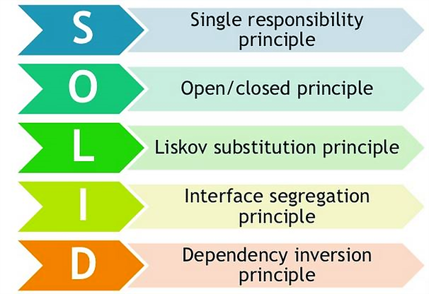
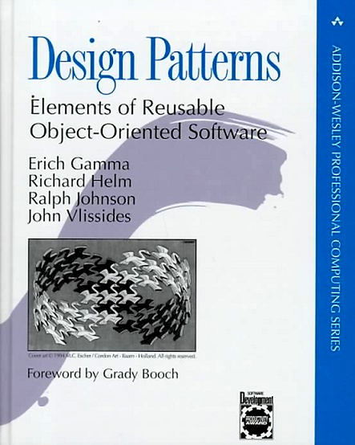
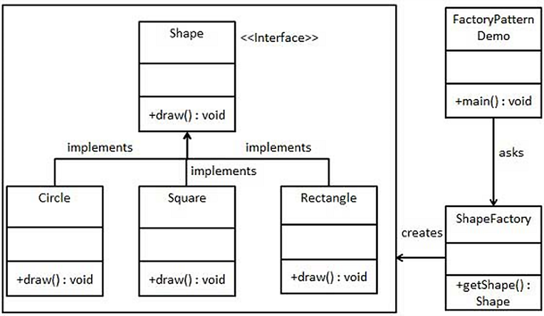
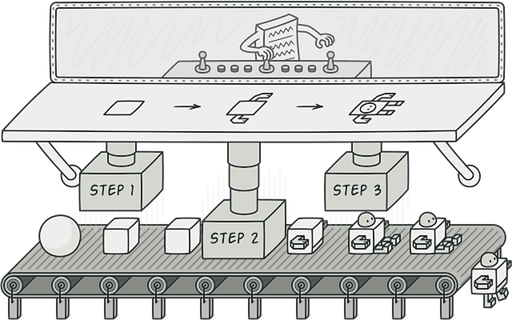
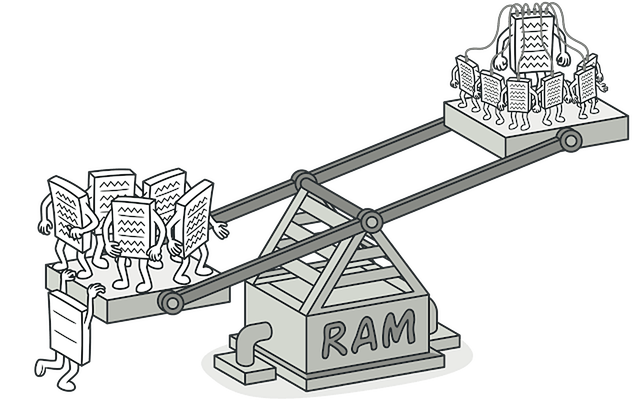
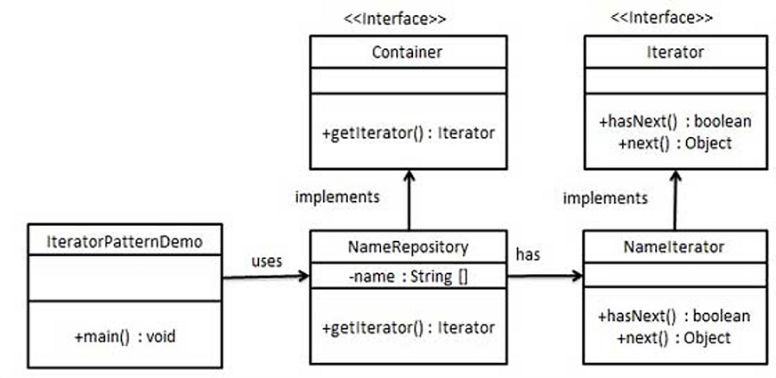
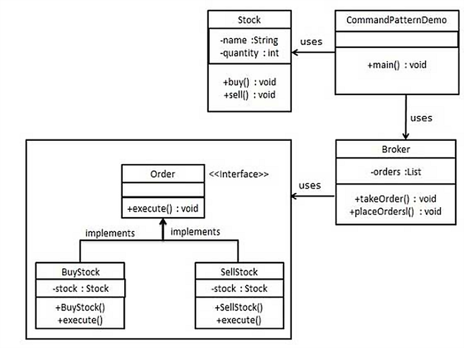
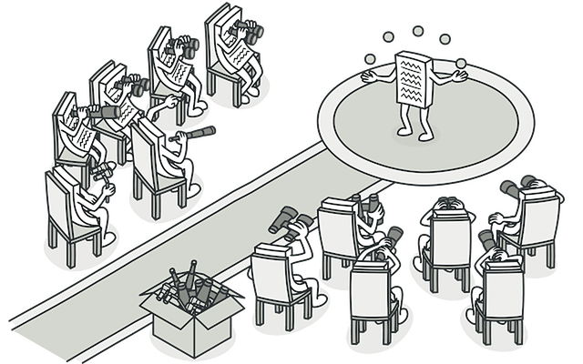
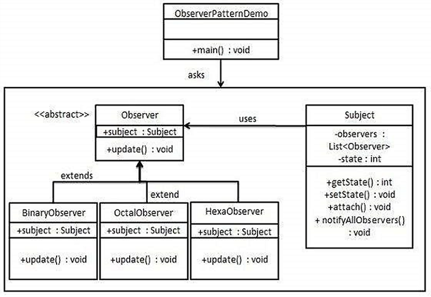
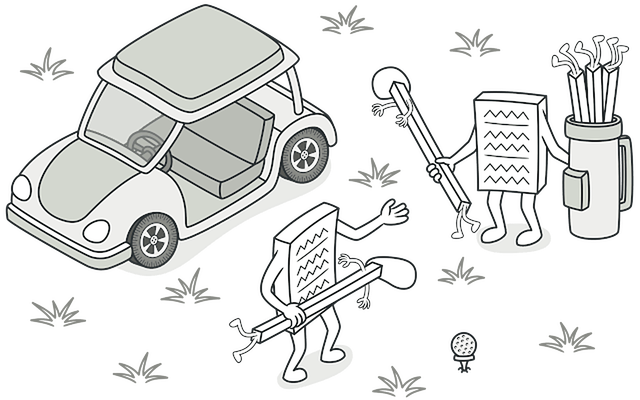

# Design Patterns

2022-01-12

---

### Last lecture covered:

- HTTP
- REST
- JSON
- Libraries for working with HTTP and JSON

---

### Today we will cover:

- S.O.L.I.D. design principles
- Design Patterns

---

### S.O.L.I.D. Design Principles

<p align="center">
  
</p>

---

### S.O.L.I.D: Single Responsibility Principle

<p align="center">
  
</p>

<br>

- A class should have only a single responsibility — changes to only one part of the software's specification should affect the specification of the class
- "A class should have only one reason to change."

---

### S.O.L.I.D: Open/Closed Principle

<p align="center">
  
</p>

<br>

- Software entities (classes, modules, functions, etc.) should be **open for extension**, but **closed for modification**
- Add new behaviour by extending, not by altering existing code

---

### S.O.L.I.D: Liskov Substitution Principle

<p align="center">
  
</p>

<br>

- Objects in a program should be replaceable with instances of their subtypes without altering the correctness of that program
- Subtypes must honour the contract of their base type

---

### S.O.L.I.D: Interface Segregation Principle

<p align="center">
  
</p>

<br>

- A client should not be forced to implement an interface it doesn't use
- Many client-specific interfaces are better than one general-purpose interface

---

### S.O.L.I.D: Dependency Inversion Principle

<p align="center">
  
</p>

<br>

- High-level modules must not depend on low-level modules — both should depend on abstractions
- "Depend upon abstractions, not concretions."

---

# Design Patterns

---

### What are Design Patterns?

Design patterns are:

- Generalised best practices accumulated from experienced software developers
- Standard solutions to common / frequently occurring design problems
- A shared vocabulary that helps developers communicate efficiently

---

### Design Patterns

<p align="center">
  
</p>

*Gang of Four — Gamma, Helm, Johnson, Vlissides (1994)*

---

### Design Patterns — Benefits

- Leverage collective software design experience for proven solutions to recurring problems
- Encourage code reusability, leading to higher-quality and more maintainable code
- Provide a common terminology that helps developers communicate clearly
- Speed up the development process by providing tested, proven paradigms

---

### Design Patterns — Categories

- **Creational Patterns** — object creation
- **Structural Patterns** — class and object composition
- **Behavioral Patterns** — communication between objects

---

### Creational Patterns

- Provide a way to create objects while hiding the creation logic, rather than instantiating objects directly with `new`
- Examples: Factory, Abstract Factory, Builder, Singleton, Prototype

---

### Structural Patterns

- Provide different ways to create more complex classes through inheritance and composition of simpler classes
- Examples: Adapter, Composite, Proxy, Flyweight, Facade, Bridge, Decorator

---

### Behavioral Patterns

- Concerned with communication and responsibility between objects
- Examples: Template Method, Mediator, Chain of Responsibility, Observer, Strategy, Command, State, Visitor, Interpreter, Iterator, Memento

---

# Creational Design Patterns

---

### Factory

<p align="center">
  
</p>

---

### Factory

- **Creational pattern**
- Creates an object without exposing the creation logic to the client
- Used when there is a parent class with multiple subclasses and the correct subclass to instantiate is determined at runtime based on an input parameter
- JDK examples: `Boolean.valueOf()`, `Integer.valueOf()`, `List.of()`, `Set.of()`, `Map.of()`, `Path.of()`, `Stream.of()`

---

### Factory — Example Diagram

<p align="center">
  
</p>

---

### Factory — Code Sketch

```java
public interface Shape {
    void draw();
}

public class Circle implements Shape {
    public void draw() { System.out.println("Drawing Circle"); }
}

public class ShapeFactory {
    public static Shape create(String type) {
        return switch (type.toLowerCase()) {
            case "circle"    -> new Circle();
            case "rectangle" -> new Rectangle();
            default -> throw new IllegalArgumentException("Unknown shape: " + type);
        };
    }
}
```

---

### Builder

<p align="center">
  
</p>

---

### Builder

- **Creational pattern**
- Solves problems of the Factory pattern for classes with many attributes, many of which are optional
- Avoids telescoping constructors and invalid intermediate states
- JDK examples: `StringBuilder`, `StringBuffer`, `HttpClient.newBuilder()`, `HttpRequest.newBuilder()`

---

### Builder — Implementation Steps

1. Create a `static` nested builder class and copy all parameters from the outer class into it
2. The builder class should have a public constructor accepting all **mandatory** attributes as parameters
3. Add setter methods for all **optional** parameters — each returns `this` (the same builder instance) for chaining
4. Add a `build()` method that validates and returns the fully constructed outer object

---

### Builder — Code Sketch

```java
public class Pizza {
    private final String size;   // required
    private final boolean cheese;
    private final boolean pepperoni;

    private Pizza(Builder b) {
        this.size      = b.size;
        this.cheese    = b.cheese;
        this.pepperoni = b.pepperoni;
    }

    public static class Builder {
        private final String size;
        private boolean cheese;
        private boolean pepperoni;

        public Builder(String size) { this.size = size; }
        public Builder cheese(boolean v)    { cheese = v;    return this; }
        public Builder pepperoni(boolean v) { pepperoni = v; return this; }
        public Pizza build() { return new Pizza(this); }
    }
}

// Usage
var pizza = new Pizza.Builder("large").cheese(true).pepperoni(true).build();
```

---

### Singleton

<p align="center">
  
</p>

---

### Singleton

- **Creational pattern**
- Ensures that at most one instance of a class exists at any time
- Implementation:
    - `private` constructor
    - `private static` field of the same class type holding the single instance
    - `public static` method that returns the instance (lazy or eager initialisation)

---

### Singleton — Thread-Safe Implementation

```java
public class ConfigManager {
    private static volatile ConfigManager instance;

    private ConfigManager() {}

    public static ConfigManager getInstance() {
        if (instance == null) {
            synchronized (ConfigManager.class) {
                if (instance == null) {
                    instance = new ConfigManager();
                }
            }
        }
        return instance;
    }
}
```

---

### Singleton — When to Use

- Typical use cases: logging, caching, thread pools, configuration managers
- Often used within other design patterns (Factory, Builder, Facade, Prototype)
- **Caution:** singletons introduce global state — use sparingly and prefer dependency injection where possible

---

# Structural Design Patterns

---

### Flyweight

<p align="center">
  
</p>

---

### Flyweight

- **Structural pattern**
- Allows fitting more objects into available memory by sharing common parts of state between multiple objects
- Reduces the memory footprint of a program
- Can also improve performance in applications where object instantiation is expensive

---

### Flyweight — Key Rules

- Flyweight objects are **immutable**: any operation that modifies their state must be performed by the factory
- The shared state is called **intrinsic** state; per-instance state is called **extrinsic** state
- JDK examples: `String` (string pool), `Integer.valueOf(int)`, `Byte.valueOf(byte)`, and similar cached ranges in other wrapper types

---

### Flyweight — Implementation

1. Define an interface with the operations client code can perform on flyweight objects
2. Create one or more concrete implementations of that interface
3. Create a factory responsible for instantiating and caching flyweight objects — never create flyweights directly

---

# Behavioral Design Patterns

---

### Iterator

<p align="center">
  
</p>

---

### Iterator

- **Behavioral pattern**
- Provides a way to sequentially traverse a collection of objects without exposing the underlying representation
- Decouples the traversal algorithm from the collection
- JDK examples: `java.util.Iterator`, enhanced `for`-loop over any `Iterable`

---

### Iterator — Example Diagram

<p align="center">
  
</p>

---

### Command

<p align="center">
  
</p>

---

### Command

- **Behavioral pattern**
- Encapsulates a request as an object, decoupling the sender from the receiver
- Enables undo/redo, queuing, and logging of operations
- JDK example: `java.lang.Runnable`, `java.util.concurrent.Callable`

---

### Command — Example Diagram

<p align="center">
  
</p>

---

### Observer

<p align="center">
  
</p>

---

### Observer

- **Behavioral pattern**
- Useful when we are interested in the state of an object and want to be notified when it changes
- The object that watches for state changes is called an *Observer*; the watched object is called a *Subject* (or *Publisher*)
- JDK examples: `java.beans.PropertyChangeListener`, event listeners in Swing/JavaFX
- Note: `java.util.Observer` / `java.util.Observable` were **deprecated** in Java 9

---

### Observer — Example Diagram

<p align="center">
  
</p>

---

### Strategy

<p align="center">
  
</p>

---

### Strategy

- **Behavioral pattern**
- Applied when there are multiple algorithms for a task and the client decides at runtime which implementation to use
- Replaces complex conditionals with polymorphism
- JDK examples: `Collections.sort()` / `List.sort()` — sorts by different criteria depending on the supplied `Comparator`

---

### Strategy — Code Sketch

```java
@FunctionalInterface
public interface SortStrategy {
    void sort(int[] data);
}

public class Sorter {
    private final SortStrategy strategy;

    public Sorter(SortStrategy strategy) { this.strategy = strategy; }

    public void sort(int[] data) { strategy.sort(data); }
}

// Usage — strategy supplied as a lambda
var sorter = new Sorter(Arrays::sort);
sorter.sort(new int[]{5, 3, 1, 4, 2});
```

---

### Where to Go Next

- Code examples from this lecture: [java-course snippets](https://github.com/fmi/java-course/tree/master/12-design-patterns/snippets/design-patterns)
- Detailed explanations and pseudo-code examples: [Refactoring Guru — Design Patterns](https://refactoring.guru/design-patterns)
- Large catalogue of Java implementations (beyond the original GoF 23): [Java Design Patterns](https://github.com/iluwatar/java-design-patterns)
- Original book: *Design Patterns: Elements of Reusable Object-Oriented Software* — Gamma, Helm, Johnson, Vlissides (1994)
