# Reactive Programming
# and the Java Virtual Machine

2022-01-19

---

### Last Lecture Recap

- S.O.L.I.D. design principles
- Design Patterns

---

### Today's Topics

- What is reactive programming?
- The Java Virtual Machine (JVM)
- Garbage Collection

---

### Reactive Programming

- Reactive programming revolves around:
    - parallel and asynchronous data processing
    - non-blocking APIs
- These concepts appear in the Stream API (parallel streams), Java NIO, and `HttpClient`
- Central mechanism: [Event/run loop](https://en.wikipedia.org/wiki/Event_loop)

---

### Reactor Design Pattern

- [Reactor pattern on Wikipedia](https://en.wikipedia.org/wiki/Reactor_pattern)
- Handles concurrent events and service requests
- Gave reactive programming and reactive systems their name
- The event-loop design is used widely in operating systems, GUIs, Spring 5 (WebFlux), JavaScript, and Node.js
- One concrete Java implementation: non-blocking network I/O via Java NIO channels and selectors

---

### Reactive

- The term *reactive* is used in the context of **reactive programming** and **reactive systems**
- Reactive programming is based on asynchronous data streams (*reactive streams*)
- Introduced to Java through the [RxJava](http://reactivex.io/) library (Reactive Extensions for Java)
- Official JDK support arrived in Java 9 in the `java.util.concurrent` package (`Flow` API)
- A `Publisher` generates a data stream; a `Subscriber` can asynchronously subscribe to it

---

### Publisher–Subscriber

- Key difference from standard `java.util.stream`:
    - In reactive streams the **publisher pushes** elements to subscribers at its own pace
    - In standard streams a new element is **pulled** from the stream only after the previous one is processed
- Back-pressure lets subscribers signal to publishers how fast they can consume data

---

### Reactive Streams Initiative

- *"Reactive Streams is an initiative to provide a standard for asynchronous stream processing with non-blocking back pressure."* — [reactive-streams.org](https://www.reactive-streams.org/)
- RxJava is one implementation of the Reactive Streams API
- The `java.util.concurrent.Flow` interfaces (Java 9+) are the JDK-native equivalent

---

### The Reactive Manifesto

- [reactivemanifesto.org](https://www.reactivemanifesto.org/)
- Declares goals for building reactive systems that are:
    - **Responsive** — react in a timely manner
    - **Resilient** — stay responsive in the face of failure
    - **Elastic** — stay responsive under varying workload
    - **Message-driven** — rely on asynchronous message passing

---

### The Reactive Manifesto

<br>

<p align="center">
  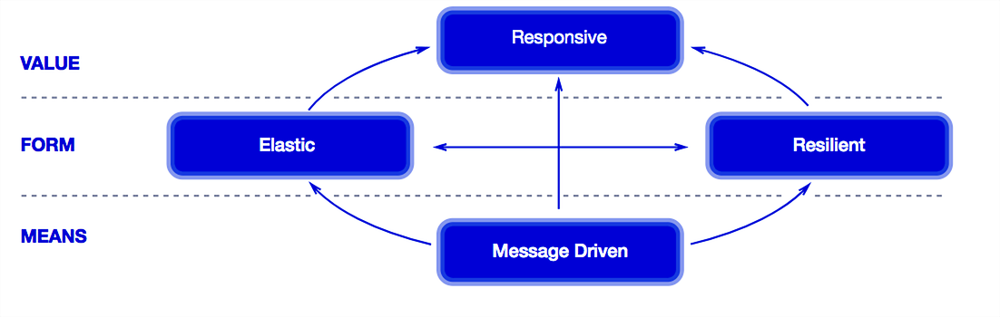
</p>

---

# The Java Virtual Machine

<p align="center">
  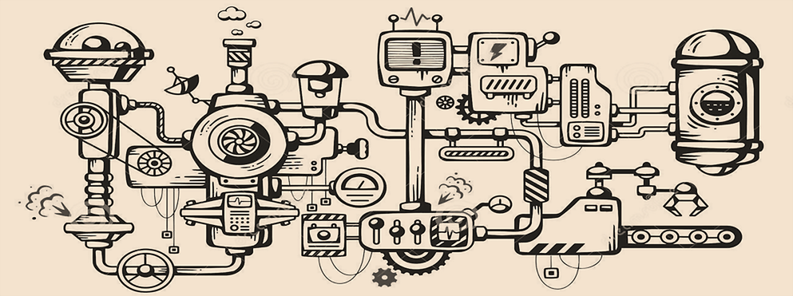
</p>

---

### The Java Virtual Machine (JVM)

- Interprets and executes bytecode instructions
- JIT-compiles bytecode to native machine code at runtime
- Allocates and manages memory for runtime data
- Performs automatic memory management (garbage collection)
- Loads classes dynamically
- Manages threads
- Interacts with the underlying operating system

---

### HotSpot JVM Architecture

<p align="center">
  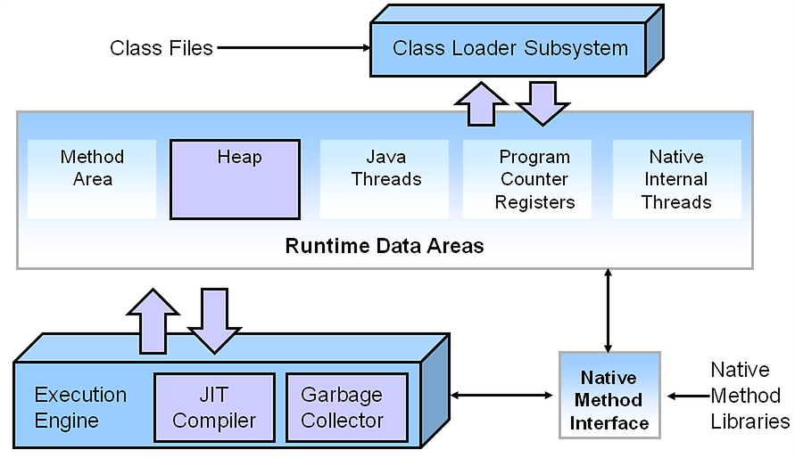
</p>

---

### Class Loader Subsystem

<p align="center">
  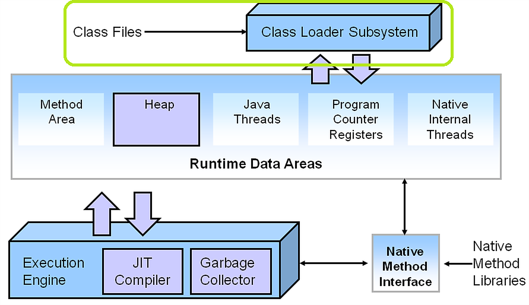
</p>

---

### `.class` File Format

```text
ClassFile {
    u4              magic;
    u2              minor_version;
    u2              major_version;
    u2              constant_pool_count;
    cp_info         constant_pool[constant_pool_count-1];
    u2              access_flags;
    u2              this_class;
    u2              super_class;
    u2              interfaces_count;
    u2              interfaces[interfaces_count];
    u2              fields_count;
    field_info      fields[fields_count];
    u2              methods_count;
    method_info     methods[methods_count];
    u2              attributes_count;
    attribute_info  attributes[attributes_count];
}
```

---

### `.class` File Contents (Hex View)

<p align="center">
  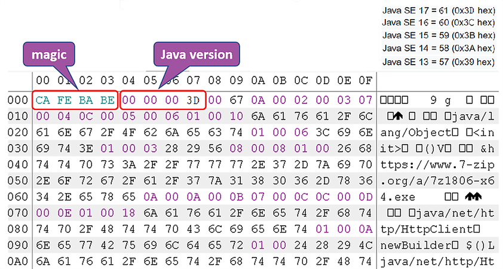
</p>

---

### Class Loading Phases

1. **Loading** — the bytecode is read from disk (or network) into the JVM
2. **Linking** — verification, preparation (default field values), and resolution of symbolic references
3. **Initialization** — static initializers and static field assignments are executed

---

### Runtime Data Subsystem

<p align="center">
  
</p>

---

### JVM Memory Organisation

<p align="center">
  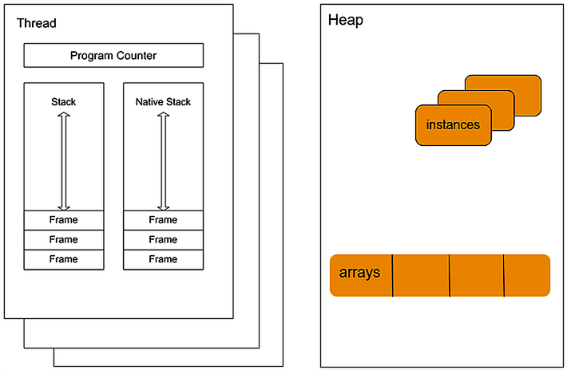
</p>

---

### Memory During Method Execution

<br>

<p align="center">
  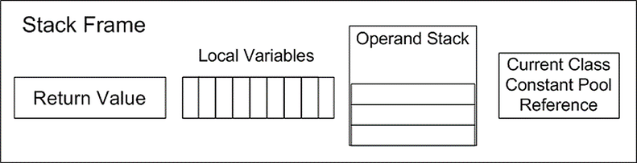
</p>

---

### Execution Subsystem

<p align="center">
  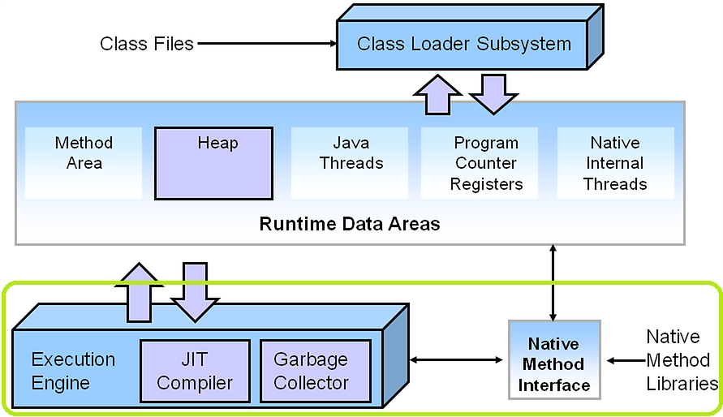
</p>

---

### Execution Subsystem — Responsibilities

- Creates object instances on the heap
- Initialises static and instance fields
- Pushes and pops stack frames on the Java stack
- Updates the PC register with the next instruction
- Maintains the native method stack
- Counts method invocations and optimises hot methods (JIT)
- Finalizes objects
- Triggers garbage collection
- Terminates the application

---

### Just-In-Time (JIT) Compiler

- Activated automatically when a method is invoked frequently ("hot method")
- Generates native machine code for that method
- If compiled code calls an uncompiled method, execution falls back to the interpreter
- Compiled code can be **deoptimised** back to interpreted mode (e.g. when a speculative assumption is invalidated)

---

### JIT Compiler Optimisations

- Operation reordering
- Null-check elimination
- Branch prediction (choosing the likely path)
- Loop unrolling
- Method inlining
- Escape analysis (stack allocation instead of heap)
- ...

---

### Java Program Execution Steps

1. Parse command-line arguments
2. Allocate memory
3. Read environment variables
4. Locate the main class
5. Create and initialise the JVM
6. Load the main class
7. Execute its `main` method
8. Return the exit code when `main` completes
9. Destroy the JVM

---

## Garbage Collection

---

### Before the JVM…

- Programmers managed memory manually
- An entire class of memory-management bugs was possible (leaks, dangling pointers, double-free)
- The JVM's Garbage Collector (GC) takes over memory management on behalf of the application

---

### Garbage Collection — Basics

- Java objects have a lifetime — some short-lived, some long-lived
- They reside in the memory region the JVM reserves for objects: the **heap** (`-Xmx2g`)
- When the heap is full, the JVM must collect garbage
- GC efficiency directly affects an application's **responsiveness** and **throughput**

---

### Garbage Collection — Safe Points

- Not every moment is safe for GC
- The JVM waits for a **safe point** — a moment when no thread is in the middle of allocating a new object
- The **stop-the-world** problem: all application threads must pause during certain GC phases

---

### What Is Garbage?

- Objects that are no longer reachable by any live object
- GC guarantees that no **live** object will ever be collected
- GC does **not** guarantee that dead objects are collected immediately
- The main challenge: determining which objects are still live

---

### Reference-Counting GC

- An early and intuitive technique
- Each object stores a count of how many references point to it
- When the count reaches 0, memory is freed immediately
- Used in PHP and Perl; Java relies on more advanced approaches

---

### Reference-Counting GC — Problems

- Keeping reference counts up-to-date is expensive
- Cannot handle **cyclic references** between objects

<br>

<p align="center">
  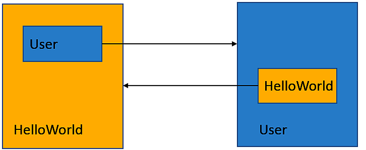
</p>

---

### Generational GC

- *Generational Hypothesis*: most objects die young
- The heap is split into **generations** — typically **young** and **old**
- Objects that survive a number of GC cycles are **promoted** from young to old
- Collecting the young generation is cheaper and faster than the old generation

---

### Tracing GC

- Finds all live objects by traversing the reference graph:
    1. Build an initial **root set** of definitely-live objects (CPU registers, global/static fields, stack locals)
    2. Traverse everything reachable from the roots and mark it as live
    3. All occupied, unmarked memory is reclaimed

---

### Tracing GC — Diagram

<p align="center">
  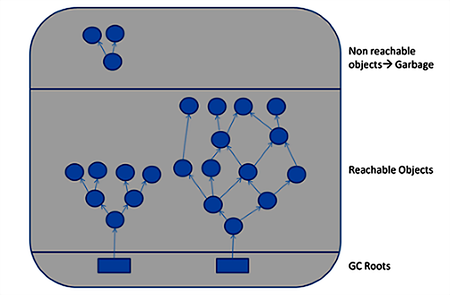
</p>

---

### Tracing GC — Trade-offs

- **Advantage**: handles cyclic references correctly
- **Disadvantage**: the mark phase causes a stop-the-world pause
- The most popular GC approach — proven in production environments

---

### Tracing GC Algorithms

- Mark-Sweep-Compact
- Mark-Copy

---

### Mark-Sweep-Compact GC

Three phases:
- **Mark** — traverse the heap via references, setting a live bit on each reachable object
- **Sweep** — scan the entire heap; unmarked regions become available free-lists
- **Compact** — defragment memory by moving live objects together

---

### Mark-Sweep-Compact GC — Diagram

<p align="center">
  
</p>

---

### Mark-Sweep-Compact GC — Performance

- The mark phase cost scales with the **number of live objects**
- The sweep phase cost scales with the **total heap size**
- GC must wait for both phases to complete, potentially causing long pauses
- The real challenge is **memory fragmentation** and how the collector handles it

---

### Memory Fragmentation

Free memory exists, but not in contiguous blocks large enough for a new allocation.

<p align="center">
  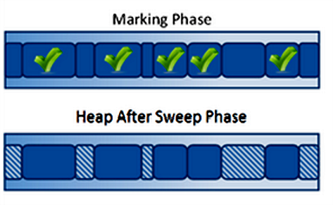
</p>

---

### Compaction

- A strategy for relocating live objects during GC to free larger contiguous regions
- Eliminates fragmentation but is a **stop-the-world** operation that impacts performance
- Pause length grows with the number of popular (frequently referenced) objects

---

### Compaction — Diagram

<p align="center">
  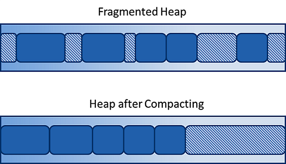
</p>

---

### Copying GC

- The heap is split into two equal halves: **from** and **to**
- The **to** region is always kept completely empty
- All new allocations happen in the **from** region until it fills up
- When GC triggers:
    1. Traverse all reachable objects
    2. Copy every live object from **from** → **to**
    3. Swap the roles of **from** and **to**

<p align="center">
  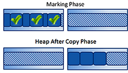
</p>

---

### Copying GC — Trade-offs

- **Advantages**
    - Objects are compacted: no fragmentation
    - Only live objects are traversed; in practice these are a small fraction of total objects
- **Disadvantages**
    - Stop-the-world pause
    - Memory inefficient (half the heap is always reserved as **to** space)

---

### GC in Java

- **Two-region GC** (Young + Old)
    - Serial
    - Parallel
    - Concurrent (CMS)
- **Multi-region GC**
    - Garbage First (G1)
    - ZGC
    - Shenandoah

---

### Serial, Parallel & Concurrent GC — Comparison

<p align="center">
  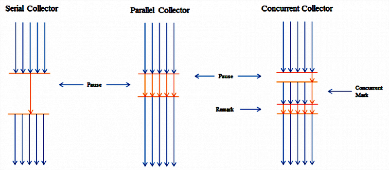
</p>

---

### GC Selection Factors

- **Throughput** — total work done per unit of time
- **Latency** — maximum pause duration experienced by the application
- **Footprint** — memory overhead of the GC itself

---

### Two-Region GC Layout

- Memory is split into **Young** and **Old** (Tenured) regions
- Young region has three parts: **Eden** and two (equal) **Survivor** spaces
- New objects are created in **Eden**
- When Eden fills, surviving objects move to the empty Survivor space
- When a Survivor fills, objects that have survived enough collections are **promoted** to Tenured

<br>

<p align="center">
  
</p>

---

### Two-Region GC — Algorithm per Region

- Different GC algorithms can be applied to each region independently:
    - **Copying GC** for Young → Eden is always compact; allocation is extremely fast (faster than C `malloc`)
    - **Mark-Sweep** for Tenured

---

### Serial Two-Region GC

- Simplest GC available: `-XX:+UseSerialGC`
- Copy collector for Young, Mark-Sweep for Tenured
- Stop-the-world approach; runs on a single thread
- Suitable only for single-CPU machines or very small heaps

---

### Parallel Two-Region GC

- Also called the *throughput* collector
- Default GC in Java 8: `-XX:+UseParallelGC`
- Copy collector for Young, Mark-Sweep for Tenured
- Uses all available CPU cores to run GC in parallel
- Still stop-the-world; not suitable for latency-sensitive applications

---

### Concurrent Two-Region GC (CMS)

- `-XX:+UseConcMarkSweepGC` (removed in Java 14)
- Stop-the-world copy collector for Young generation
- Mark and sweep phases for Tenured run **concurrently** with application threads
- Much better suited for applications with strict response-time requirements

---

### Multi-Region GC

- The heap is divided into many equal-sized pieces, each occupying a contiguous memory region
- Groups of pieces are assigned roles (Eden, Survivor, Old), but region sizes are not fixed

<p align="center">
  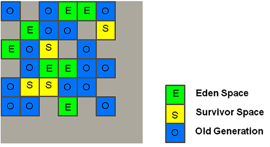
</p>

---

### G1 (Garbage First) GC

- Default GC from Java 9+: `-XX:+UseG1GC`
- Runs a **global concurrent mark** phase
- Prioritises regions with the most garbage (hence "Garbage First")
- Copies and compacts data from high-garbage regions into a new region
- Suitable for multi-processor machines with large heaps

---

### Z Garbage Collector (ZGC)

- One of the newest GCs: experimental from JDK 11, production-ready from JDK 15
- **Scalable** and **low-latency** (pauses < 1 ms regardless of heap size)
- All expensive operations run concurrently — application threads are not stopped
- Suited for applications requiring very low latency and/or very large heaps (terabytes)
- Enable with: `-XX:+UseZGC`

---

### Shenandoah Garbage Collector

- Available from JDK 15 (OpenJDK); also back-ported to earlier LTS releases
- **Sub-millisecond** pauses: collects garbage concurrently while the application runs
- Unlike other collectors, can **uncommit and release** unused RAM back to the OS without a full GC
- Enable with: `-XX:+UnlockExperimentalVMOptions -XX:+UseShenandoahGC`

---

### GC Summary

| Collector | Pause model | Best for |
|-----------|-------------|----------|
| Serial | Stop-the-world | Single CPU / tiny heaps |
| Parallel | Stop-the-world | Batch / throughput workloads |
| CMS | Mostly concurrent | Low-latency (removed Java 14) |
| G1 | Mostly concurrent | General-purpose (default Java 9+) |
| ZGC | Fully concurrent | < 1 ms latency, huge heaps |
| Shenandoah | Fully concurrent | < 1 ms latency, RAM-release |

---

## Questions?

---

## Where to Go Next?

<p align="center">
  
</p>

---

<p align="center">
  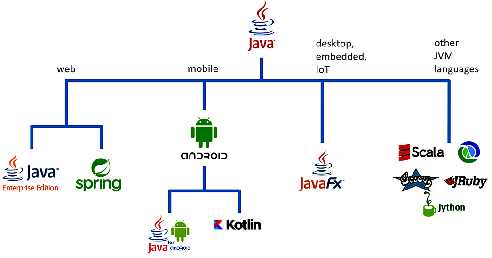
</p>

---

### The Java Ecosystem

- Java is developed openly in the [OpenJDK](https://openjdk.java.net/) project
- All specifications are defined through the **Java Community Process (JCP)**
- The JDK is only part of the story — open-source communities play a huge role:
    - **Eclipse Foundation** — 375+ projects, mainly Java
    - **Apache Software Foundation** — 340+ projects, not only Java

---

### Get Involved!

- Join [BGJUG](http://jug.bg) — the Bulgarian Java User Group
- Attend Java events: meetups, conferences, seminars
- Contribute to the Java language and platform

<br>

<p align="center">
  
</p>
